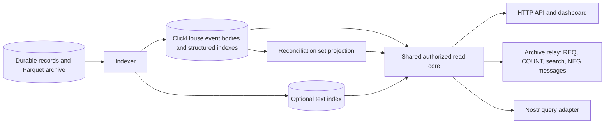

# Content search and archive reconciliation

Status: selected design, not implemented or production-benchmarked. This document
completes the shared read contract; it does not introduce another mandatory
service. Content search is a product requirement. OpenSearch is an engine option,
not a requirement. NIP-77 has separate acquisition-client and archive-server roles.

## Data flow and ownership

The text index is derived from retained event content. It does not replace the
full signed event. In the initial backend it belongs to ClickHouse, alongside the
online event representation. Turning off its maintenance saves index space and
work; turning off serving alone does not reclaim disk. Both operations leave the
canonical archive intact. Reconciliation indexes contain event identifiers,
timestamps and range summaries, not a second event-body archive.

Indexer owns durable projection progress. The read core owns matching semantics,
authorization, current/history policy, resource admission, pagination and answer
quality. The ArchiveRelay adapter owns websocket sessions. Neither an HTTP route
nor a relay connection can initiate uncontrolled index construction or obtain a
data-plane write credential.

## Search semantics before engine selection

The first complete online release includes content search through the API,
dashboard and NIP-50 ArchiveRelay path. The Nostr query adapter exposes it through
its versioned supported resource profile. Deployments may disable text indexing
or expose a narrower search corpus. Absence of search is an explicit capability
state, never an empty successful result or a fallback scan across the archive.

The initial resource searches the `content` string. Signed tags have their own
structured exact-match indexes; a text match is not a tag match. JSON inside
content remains a string unless a separately named kind-specific resource parses
it. Store the original signed string unchanged. Search does not decrypt private
events, infer their plaintext, or fetch linked media. Initial corpus selection is
all admitted nonempty content within the configured serving scope; operators may
select kinds/time ranges to avoid indexing opaque ciphertext or irrelevant data.
The capability descriptor reports exclusions, including encrypted-kind policies.

The versioned baseline supports three matching modes: all query terms, any query
term, and ordered phrase. API options select the mode explicitly. The NIP-50
adapter maps ordinary words to all-terms matching and a quoted phrase to phrase
matching; a documented parser defines escaping and unsupported combinations.
Do not pass user text directly to SQL or an engine-specific query language.
Substrings, prefix completion, typo tolerance, stemming, semantic embeddings and
arbitrary regular expressions are separate capabilities with separate costs.

The selected analyzer is `unicode16-word-v1`: Unicode 16 NFKC, full default
non-Turkic case folding and NFKC again; default UAX-29 word segmentation, retaining
letter/number words and separately eligible emoji grapheme tokens. No hidden
stemming or CJK dictionary is assumed. The exact normalization, phrase/extension
grammar, fixtures and version-data identity are specified in
[P06-T06](../implementation/06-read-surfaces.md#p06-t06--owned-search-index-stable-matching-and-nip-50-adapter).
Indexer and query use the same application analyzer. CH indexes the pretokenized
array for complete candidates; retained ordered tokens support bounded exact
phrase verification. Native array phrase acceleration is not presumed.
Changing this profile creates a new generation; preserve original signed text
and refuse work whose complete candidate verification exceeds its admitted bound.

The baseline ranking is deliberately explicit: normalized whole-content match,
then contiguous query phrase, then number of distinct query terms matched;
remaining ties use descending `created_at`, then ascending event ID. This is a
lexicographic relevance tuple, not BM25 and not a claim of optimal linguistic
relevance. For all-terms queries many rows legitimately tie. Compute the tuple
over the complete eligible candidate scope before applying the result limit;
never retrieve an arbitrary chronological prefix and rerank just that prefix.
An admitted plan may refuse an excessively broad request rather than misrepresent
its top results. Rich relevance is an engine evaluation criterion below.

"Query" in this ranking means the decoded searchable literals, excluding ignored
extension tokens and quote syntax. The exact mixed-phrase mapping, versioned
identity and temporal eligibility stamp are normative in the
[read-view contract](../specification/read-view-contract.md).

[NIP-50](https://github.com/nostr-protocol/nips/blob/a2494f4f81d46684e5814a9bf35e2b1df978f955/50.md)
adds a search string to ordinary filters and recommends ordering by match quality
before limiting. Its unsupported textual `key:value` extensions are ignorable;
this does not authorize ignoring the entire search field or explicit API options.
Advertise NIP-50 only when the mapped contract passes real client fixtures.

## Selected backend and alternatives

| Backend | When it fits BigBrotr | Additional responsibility and cost |
|---|---|---|
| ClickHouse text index — selected baseline | Existing online event store; structured predicates combined with content matching; bounded token/phrase searches | Token postings, optional positions, index build/merge CPU and extra disk; prove filtering and ranking on the pinned release |
| Tantivy — preferred experiment for richer embedded search | Stronger search relevance in a Rust application on one host, if baseline quality or latency is inadequate | Search writer/reader lifecycle, durable publication/rebuild, filter fields and snapshots; cluster operation is application work |
| OpenSearch — evaluated external backend | Rich relevance/language tooling and independent distributed search operation justify a search cluster | Separate projection, JVM/process budget, shard/replica management, security, upgrades and operational recovery |
| DuckDB over Parquet — archive jobs | Offline exploration, private notebooks and bounded/asynchronous archival scans | Reads content from files; does not supply the baseline shared online search service merely by opening Parquet |

Current [ClickHouse text-index documentation](https://clickhouse.com/docs/reference/engines/table-engines/mergetree-family/textindexes)
describes token indexes and phrase search, including position-aware options.
Do not assume these exact features exist in the earlier laboratory release.
Pin and test the release and index definition before final DDL. Index preprocessing
and query preprocessing must agree; comparing an index-enabled query with an
index-disabled query that normalizes differently is not a correctness oracle.

[Tantivy](https://github.com/quickwit-oss/tantivy) provides BM25, phrase queries,
configurable tokenization and incremental indexing as a Rust library. It is not
a distributed search server. [OpenSearch keyword search](https://docs.opensearch.org/latest/search-plugins/keyword-search/)
provides a server-based relevance search path. Neither is added merely because
content search exists. A richer backend must justify its total workload cost and
relevance improvement on BigBrotr queries, not somebody else's benchmark.

For an external text projection, store event ID, required filter/visibility fields
and postings/positions. Duplicating stored full content is a separate choice for
highlighting/latency, not an inevitable requirement. Retrieving bodies from CH
saves one stored copy but adds lookups. Both variants retain term dictionaries,
postings and filter indexes; neither makes full-text storage free.

## Search publication, coverage and isolation

Search has its own projection generation, analyzer/ranking version, source cut
and explicit kinds/time/history/visibility scope. API pagination pins them with
the shared policy epoch. ClickHouse can merge/replay rows without changing the
logical answer at a pinned cut. Any external engine must provide an equivalent
pinned reader/index generation and idempotent event projection before integration.
Do not read a fresher event body from outside the candidate's declared cut.

Visibility, deletion/current-state/expiration rules, authors, kinds, tags and time constraints
participate in candidate selection before top-K. Revalidation before sending
handles policy revocation. Filtering only the top-K afterward can lose eligible
results and leak restricted matches through counts or scores. If an engine uses
corpus statistics such as BM25 document frequencies, a public ranking corpus must
also obey public visibility; filtering final documents cannot remove private
influence on those statistics. Scope caches and snippets by authorization.

Expose `disabled`, `building`, `ready`, `lagging`, `failed` and `unsupported`
separately. During rebuild keep the old complete generation if policy permits.
Report its lag and coverage. Switching generations is atomic; retire old readers
only after pins expire. A restrictive policy change can invalidate existing pins.
Stopping indexing does not immediately invalidate an already complete search
snapshot, but its freshness must remain visible.

| Setting | Starting design | Change behavior |
|---|---|---|
| `search.enabled` | true in the complete online recipe; false in archive-only | Disabled requests refused; existing storage kept until explicit reclaim |
| `search.backend` | `clickhouse` | Rebuild/new generation; alternatives require a shipped tested adapter |
| `search.scope` | configured online event scope, nonempty content | Scope widening needs backfill; report coverage before claiming readiness |
| `search.analyzer` / `ranking` | pinned release profiles | New generation, not an arbitrary live expression |
| `search.query_max_bytes` / `max_terms` | 4096 / 32 | Admission bounds; decreases drain affected work |
| `search.execution` | shared read limits, with a separate bounded work share | Shares the host budget; never bypasses it |
| `search.index_budget` | allocated from Indexer's CPU, memory and merge shares | Throttle index progress while exposing lag |

The private UI can enable/disable, inspect coverage/size, request rebuild and
explicitly reclaim an unused derived index. It estimates rebuild headroom and
shows desired versus applied state. Search UI labels syntax, scope, loading,
partial coverage and unsupported operators; snippets render escaped text. API
errors follow the shared error contract, with stable `search_disabled`,
`search_not_ready`, `unsupported_search_mode` and `query_budget_exceeded` codes.

## NIP-77 on the archive's reading side

A client can reconcile its local event IDs against the events BigBrotr currently
makes retrievable to that client. This capability is independent of provenance:
provenance records upstream observations; server reconciliation describes this
archive's serving set. Do not reuse the acquisition client's per-upstream-relay
set as the archive server's answer.

[NIP-77](https://github.com/nostr-protocol/nips/blob/a2494f4f81d46684e5814a9bf35e2b1df978f955/77.md)
exchanges set differences through `NEG-OPEN`, `NEG-MSG` and `NEG-CLOSE`. The client
then fetches missing bodies using REQ. It does not transfer event bodies during
the set exchange. BigBrotr remains read-only: knowing IDs that a client possesses
does not authorize accepting its EVENT uploads. NEG subscription identifiers have
a separate namespace from REQ identifiers; reopening one replaces its prior state.

Define a served set as distinct `(created_at, event_id)` records under the pinned
read cut, normalized supported filter, current/history view, visibility policy
and retrievable body scope. Sort by timestamp then bytewise ID. Exclude merely
claimed, suppressed, missing-body and unauthorized records. Reject timestamps
that the reconciliation protocol cannot represent; expose this limitation rather
than altering the signed timestamp. Admission-only and blocked-as-owned IDs used
by an acquisition client must never leak into this server set.

A normal ArchiveRelay endpoint reconciles the same current/deletion-aware view it
serves. A separately configured authorized historical relay view may expose
retained versions where its policy allows. The HTTP immutable corpus export is
the stronger explicit contract for a frozen research dataset. Do not claim every
retained event is reachable through every public protocol view.

Pin one immutable logical set for each negotiation. Later ingestion appears in a
subsequent session. A policy revocation closes affected negotiations, even if their
snapshot TTL has not expired. Standard REQ does not carry BigBrotr's internal
snapshot token: a later fetch is evaluated under the then-current policy and
availability. Consequently ordinary NIP-77 plus REQ is not an atomic snapshot
export. Preserve body availability for active pins when safe, but do not promise
unlimited future retrieval or override revocation to satisfy a stale negotiation.

Accept supported NIP-01 predicates only after authorization and cost admission.
A supplied `limit` (including zero), search ordering, or another
unsupported filter combination must be rejected explicitly, never silently
interpreted as a different set. Initial supported shapes are IDs, bounded
author/kind/time/tag intersections and the configured full serving scope when its
shared index is ready. The conformance matrix exercises these shapes and explicit
rejection of both zero and nonzero `limit`; REQ's zero-limit live semantics remain
a separate contract. Unknown shapes do not trigger an unbounded fallback. `NEG-ERR` closes the negotiation with the specified
reason, including blocked oversized work or closed expired state.

## Reconciliation index and scale

Build a persistent rebuildable ordered set projection from the same published
logical event view, with shared range summaries implementing the pinned
Negentropy fingerprint algorithm. It may use an Indexer-owned RocksDB directory
separate from admission state; ArchiveRelay accesses bounded read operations
through the projection owner, not a second RocksDB writer. Initial implementation
must compare this design with CH bounded sorted reads for narrow filters. Retain
only the extra structure justified by measured repeated reconciliation work.

The general full-scope projection is incrementally updated from visibility/current
state changes, not merely new arrivals. Replacement/deletion and expiration affect
set membership; scheduled expiry creates a new temporal generation without any new event
arrival. Publish a complete reconciliation cut only after those changes apply.
Use consistent immutable read snapshots and retain their necessary files/versions;
if the chosen binding cannot safely expose them across processes, the projection
owner executes bounded range operations behind an authenticated interface.

Cache keys bind dataset, source cut, view, filter, analyzer if relevant and
visibility epoch. A public cached fingerprint must never summarize private
content. Frequent time/kind scopes can share indexes; arbitrary author/tag
intersections cannot all receive permanent materializations. Build small filtered
sets within a byte/record budget, reuse common results, or refuse and suggest a
narrower range. Never allocate the entire billion-event set per client.

Initial index construction still costs at least a pass over its input. An
incremental ordered structure charges updates, summaries, compaction and snapshot
retention. Reconciliation output still scales with the difference; unrelated sets
cannot exchange all missing IDs in constant bandwidth. Negentropy reduces repeat
transfer for similar sets, not the cost of every possible query.

For cold bodies, full-history negotiation is available only when the selected
retrieval path can serve that scope within its declared contract. If the online
index covers only a recent tier, advertise that scope. An archive-only deployment
without an online read engine does not gain an unrestricted public relay merely
because its Parquet files exist.

| Setting | Starting design | Enforcement |
|---|---|---|
| `archive_relay.negentropy.enabled` | true when the complete ArchiveRelay role is explicitly enabled | Advertise NIP-77 only after required projection is ready |
| `sessions_per_connection` / `sessions_global` | 2 / 32 | Additional to websocket and shared read limits |
| `session_ttl` / `idle_timeout` | 60 s / 15 s | Release pins/state on expiry; explicit close reason |
| `frame_max_bytes` | common 64 KiB websocket limit, including hex overhead | Reject before unbounded decode/allocation |
| `max_rounds` | 64 | Also bound total CPU, bytes and elapsed work |
| `private_state_max_bytes` / `shared_cache_max_bytes` | 1 MiB per session / 128 MiB deployment total | Host allocator remains authoritative; cached set construction included |
| `filtered_set_max_records` | 10,000 for ad-hoc materialization | Larger scopes require an admitted persistent-index path |

These are tunable admission defaults, not claims of measured capacity. Large
legitimate clients can split work into windows; the server never silently
truncates a negotiated set to satisfy a limit. Metrics distinguish set size,
records scanned, differences, cache hits, CPU, bytes, active pins, rejected shapes
and index lag without labels containing arbitrary user queries or event IDs.

## Practical evidence required before shipping

Search: compare indexed matches with an independent normalization/matching oracle
on signed multilingual events, repeated terms/tags and adversarial long content.
Verify relevance ordering before limit and filters before ranking. Exercise index
restart, replay, rebuild, policy revocation, stale cuts and malicious snippets
through API and real relay clients, not only direct engine SQL.

Reconciliation: compare actual negotiated differences against exact sets with a
reference client over websockets. Include identical/disjoint sets, same-second
bursts, old newly indexed events, overlapping tags, current-state replacement,
authorized deletion views, provenance off, cold/unavailable bodies, malformed hex,
version mismatch, ID replacement, policy revocation, slow clients and cancellation.
Measure aggregate memory with many simultaneous sessions. Assert the read path
cannot mutate admission/archive data. Exercise upload rejection after reconciliation.

Run both concurrently with ingestion, monitoring, graph work, compaction and
exports at the capacity matrix's sizes. Report latency distributions, scan bytes,
CPU, memory including page cache, index size, build throughput, lag, recall and
relevance judgments. Compare CH, Tantivy or OpenSearch only with equivalent corpus,
visibility, matching guarantees and resource budgets. No new experiment in this
amendment proves these future product contracts.

## Relay encoding eligibility and usable search scope

Server NEG uses the same `RelayRetrievable` predicate as full-body delivery,
including the complete escaped EVENT envelope under the listener's effective
wire/buffer limits. NIP-01's 64-character limit is implemented as at most 64
Unicode scalar values and 256 UTF-8 bytes; reject invalid Unicode. Reserve a
conservative 12 encoded bytes per scalar plus quotes/framing, covering escaped
surrogate-pair JSON too, so a shared set is independent of the client's ID length.
The actual adapter validates those units consistently; a 64-multibyte-character
fixture must not be rejected merely for exceeding 64 bytes.
An oversized retained body stays archived but is excluded from this advertised
retrievable set, with the limitation disclosed in capabilities/coverage. Another
HTTP/export path may serve it under its own larger limits. Ordinary broad REQ
still reports the specified oversized-result refusal if it encounters such a row.

Bind encoding version, subscription-ID allowance and serving-limit revision into
NEG generation/cache identity. Limit reductions invalidate incompatible sets;
no stale generation may promise delivery under the new bound. P06-T07/T08 must
negotiate then fetch small, escaping-heavy and oversized bodies on the same actual
listener, including a limit change. Possessing a body alone is the wrong oracle.

Search qualification must measure user usefulness as well as exact top-K truth.
P06-T06/T12 use common/rare terms, frequent phrases with many false token matches,
CJK/emoji, structured narrowing and old relevant results. Report the accepted and
refused query mix, candidate work, postings/tokens/body bytes and p95/p99 under
shared limits. Correct repeated refusal is not evidence that the default is useful
on billions of events. Compare safe top-K pruning/Tantivy at identical semantics
if CH misses that workload; do not silently narrow dates or rerank a recent prefix.
