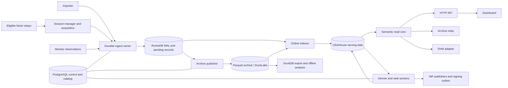

# System design

Status: implementation baseline after six design revisions; product implementation
has not begun. The service
contracts complement this document. A proposal is not a measured capacity claim.

## The selected direction

Use Rust for BigBrotr's core, PostgreSQL for transactional coordination and the
DuckLake catalog, RocksDB for durable admission and replayable pending work,
Parquet managed through DuckLake for the full archive, and ClickHouse for online
analytical and event reads. DuckDB is an embedded analysis/export/archive worker
engine. It is not an additional public database server. Start with one deployment
and independently selectable process roles; distribute roles when the measured
bottleneck or failure requirement justifies it.

Rust is chosen for explicit ownership, predictable resource control and a shared
systems implementation, not a claim that Go cannot hold 5,000 connections. The
prior controlled transport measurements actually found tuned implementations
close enough that buffer settings outweighed the language label. This choice
still requires a careful protocol adapter and idiomatic code; an SDK is not a
complete observatory.

The diagram omits ordinary monitoring/health connections. Control tables and the
DuckLake catalog use separate database roles and schemas. Applications do not
edit DuckLake's internal metadata directly.

## Four different frontiers

1. **Admitted:** validated event/observation and its replay record committed in
   an atomic RocksDB batch with WAL synchronization. The process may now return
   a local durable receipt. This survives process restart subject to the engine
   and storage contract; it is not a promise against loss of the host or disk.
2. **Archived:** data and an archive batch receipt committed together through
   DuckLake, with checksummed files and a catalog snapshot. This permits pending
   body reclamation only after the configured backup/replication requirements.
3. **Queryable:** all required serving structures for the published batch or
   generation are visible under the read contract. A partially indexed batch
   cannot be called complete.
4. **Observed coverage:** scoped evidence about a relay/filter/time interval,
   with traversal, gaps, remote claims and verification time. It references a
   durable frontier; it never derives completeness from the largest timestamp.

The online indexer may consume durable pending records immediately. It does not
wait for a large Parquet file to close. It can later replay the same logical
records from the archive. Stable record identities make this switch idempotent.
The archive publisher batches for efficient files independently of online read
latency. Each consumer has a named durable cursor; there is no shared tick that
one slow service can hold indefinitely.

## Service and process boundaries

A service is a responsibility with a lifecycle and owned state. A process is a
resource and failure boundary. A crate is a code boundary. They need not map one
to one. Provide the same binary with `serve` and explicit role selection, plus
single-job commands. Compose can run several roles in one container or separate
containers using the same image. The CLI prints the actual resolved topology.

Use direct typed calls within one process and a versioned authenticated internal
protocol across processes. The same receipt, cancellation and retry semantics
apply to both. Public API endpoints do not double as administrative or ingestion
RPC. Every remote ingest request has a stable request identity and bounded body.

Continuous session loops, finite jobs and listeners have different lifecycle
interfaces. Shared runtime facilities provide cancellation, supervision, budgets,
leases where needed, observability and health. They do not force a live listener
into a synthetic RunOnce polling model. A stopped ranker does not stop collection;
a stopped indexer makes reads stale and grows replay backlog; a stopped archive
publisher eventually fills pending storage and causes visible intake throttling.
No finite machine can buffer an unlimited outage.

## What stays optional

Provenance off means no historical event/relay edge persistence, edge indexes,
edge export or edge-derived facts. The registry and monitoring measurements still
exist. Full signed events are always retained under the archive policy. Remove
the legacy heavy_fields switch and LilBrotr/IndexBrotr profiles; projected exports
satisfy lightweight analysis without weakening canonical event fidelity.

ClickHouse is required by the complete online serving and derivation deployment.
An archive-only deployment may omit it and use DuckDB jobs with different latency
and concurrency expectations. This is a supported topology with explicit missing
online capabilities, not a second silently incompatible storage model. Ranker,
publishers, active probes, public API, DVM and archive-relay are independently
configurable; enabling signing or public exposure requires effective settings.

OpenSearch is an optional search adapter only if required query semantics include
relevance ranking, fuzzy matching, language analysis or other functionality that
the validated ClickHouse search path does not provide. It incurs another body
index, RAM budget, update stream and recovery path. Do not deploy it merely to
search a literal token. LMDB/nostrdb is a credible serving alternative for a
relay-first workload; it is not the default extra database beside every engine.

## Growth and failure domains

| Topology | Ownership and storage | What it solves |
|---|---|---|
| One host | One durable ingest owner initially; local NVMe; PG + CH; local Parquet plus off-host backup | Simple reference deployment and measured resource accounting |
| Multiple role hosts | Collectors route to owner; archive storage shared through object storage; read/rank workers isolated | Independent CPU, connection and query capacity |
| Sharded admission | Stable event-ID owner routing; durable shard epochs; per-shard frontiers | Write throughput once one owner is measured insufficient |
| Replicated admission | Replicated log with explicit quorum acknowledgements before durable receipt | Continued ingestion and defined RPO under host loss |
| Replicated serving | CH replication/sharding with documented consistency and routing | Query scale and serving availability |

A shared PostgreSQL connection does not make local RocksDB or a local file path
shared. Never mount the same RocksDB directory in multiple writers. A lease with
an expiry time is not sufficient fencing: a paused old owner may resume. For
single-host operation enforce exclusive owner process and storage locks. For
cross-host failover require positive old-owner exclusion or a replicated storage
service that rejects old epochs at commit. DuckLake's multiwriter support does
not provide application event-ID uniqueness; the isolated probe demonstrates it.

Kafka or a compatible replicated log becomes appropriate when replay fan-out,
write throughput or loss-of-host acknowledgements justify a managed distributed
log. A single Kafka broker does not provide replicated durability. Adding a
broker also does not remove admission verification, archive snapshots, indexes
or application idempotency. Avoid mandatory distributed infrastructure for a
single-host observatory.

## Recipe and capability matrix

| Recipe | Required data infrastructure | Enabled work | Available surfaces |
|---|---|---|---|
| Full local observatory | PG, RocksDB, DuckLake/Parquet, CH | Collection, monitoring, indexing, derivation; rank when input/viewpoint is usable | Local read/dashboard/admin; public/signing roles explicitly configured |
| Full archive without provenance (optional LilBrotr nickname) | Same full topology | Same work except edge persistence/index/derived facts | Event and eligible analysis resources; provenance explicitly unavailable |
| Social-filter example | Same selected topology, explicit social filters and provenance choice | Selected kinds plus documented dependencies of desired facts | Capabilities reflect actual historical coverage, not the recipe name |
| Archive-only | PG, RocksDB, DuckLake/Parquet | Collection/monitoring as selected, archival, import/export/offline DuckDB jobs | Private status/admin and archive exports; online CH read/derivation/rank roles disabled |
| Serving existing data | PG + CH, archive access for rebuild/cold tiers as configured | Read adapters; optional derive/rank | Existing complete generations with freshness/coverage metadata; no collector requirement |
| Custom/split roles | Required durable contracts reachable locally/remotely | Explicit selection | Preflight resolves dependencies; no silently started producer daemons |

A service enabled in a recipe must have its engine/data dependency. Stopping a
service leaves its already retained data readable when the read store remains
available. Archive-only is an intentional capability selection, not a claim that
all CH-backed resources can work without CH.
