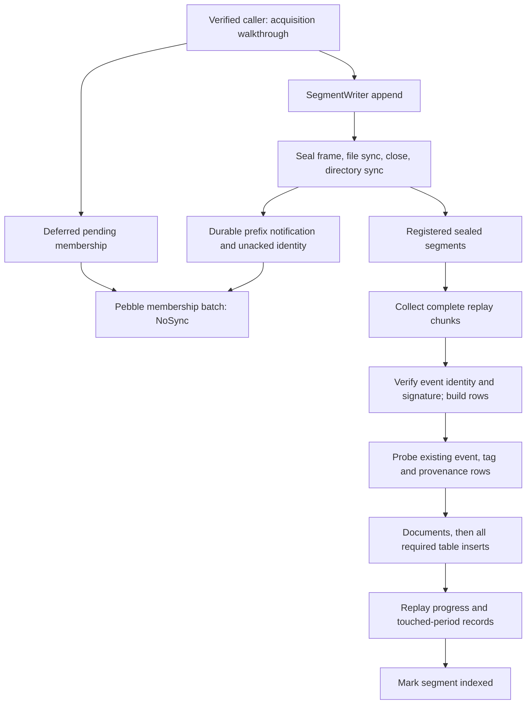

# Go implementation walkthrough: admission inventory, journal and indexing

Date: 2026-09-11. This is a selective full-file source review for the Rust design,
not a complete Go audit or a runtime test report. The neighboring checkout was
read only. The [source manifest](evidence/go-storage-code-sources.json) records
22 fully read files: 17 production Go files, four test files and `go.mod`, with
exact paths, SHA-256, sizes, line counts and before/after capture comparisons.
The test-file count includes `prepared_replay_test.go`, which contains a helper,
not an independently executed test. No Go build or test was run.

Snapshots are under ignored `.research/code-snapshots/storage/`. Source references
below name those frozen paths relative to the original repository; they do not
link to ignored artifacts or claim the moving worktree is one committed revision.
The files' original bytes still matched at this review's comparison. Referenced
driver, composition and dependency internals are outside this full-file scope
unless another walkthrough explicitly covers them.

## The actual path inspected

This is the inspected Go mechanism, not the proposed Rust storage flow. The
fresh plan uses atomic synced admission/pending state and transactional Parquet
publication, with explicit serving frontiers. Useful invariants survive while
the custom file protocol and checkpoint machinery change.

## Membership: exact answers are distinct from durability

`go.mod` directly selects Pebble v2.1.7. `internal/dedupe/store.go` fully defines
its options and access: exact `Get`, positive Bloom filtering, configurable cache
and memtables, no table compression, and `NoSync` marks/batches. `keys.go` uses
32-byte event keys, 40-byte event/relay keys and 33-byte typed-document keys.
Lengths distinguish these key domains. The implementation does not use Badger.

`deferred.go:109–220` reads a bounded positive cache, in-flight marks, pending
segment buckets, then Pebble. Marks become eligible for a store batch only after
their segment's durable-prefix notification. The store call runs outside the
common mutex; an explicit in-flight set prevents a temporary false-negative gap.
Failure returns keys to pending. This is a useful careful design, not merely a
database choice. Losing unsynchronized cache marks can produce retry work; a mark
persisted before its only body would instead suppress recovery of missing data.

The positive cache is a slab of nodes and buckets with full-key equality and LRU
links (`hotcache.go`). Its byte calculation explicitly excludes allocator size
classes/metadata. That grant does **not** bound pending maps, strings, in-flight
keys, batch copies or the embedded engine. A cache miss walks pending segment
buckets under one mutex. These are concrete costs to measure under delayed seals
and failed cache writes, not proof of a measured bottleneck. No-compression is
also a workload choice: high-entropy event IDs and repeated edge prefixes need
different measurements. Rust should use bounded, measured structures rather than
port a bespoke cache automatically.

The new exact owner must atomically bind admission state and pending durable
facts, distinguish in-flight from receipt-backed completion, and charge every
temporary copy. Provenance gains observer/access/visibility identity. Full event
membership never authenticates a newly received signature or a new witness.

## Journal: preserve the ordering lessons, replace the custom archive format

`journal/writer.go` frames typed/versioned records with length and CRC-32C and
latches write failure; its seal covers header and record frames. `reader.go`
checks size before body allocation, validates CRC/seal, rejects trailing bytes,
and distinguishes complete EOF from a torn body. CRC is corruption detection,
not authenticity. Signed verification is a separate boundary.

`segment_writer.go:134–201,255–354` separates append locking from serialized seal
ownership. Appending to the next file can proceed while the prior file syncs;
later durable identities cannot bypass that prefix. Pending seals remain visible
to barrier inspection. File sync, close and directory sync must all succeed
before publication; a failure latches and prevents certifying the newer tail.
Notifications run outside the locks and may arrive out of order, while the queued
durable identities retain order until acknowledged. This is a stronger useful
pattern than holding the append mutex through all disk synchronization.

Important qualifications from the implementation:

* `WriteRecords` keeps a bundle in one file and prevalidates its record sizes.
  It does not make all its writes an atomic transaction on I/O failure.
* `MaxSegmentAge` is checked when appending. A quiet file needs the separate
  real timer/barrier path; an age option alone cannot establish bounded latency.
* Low-level `Writer.WriteRecord` allocates the body before its cap check, although
  the production `SegmentWriter` validates first. A reusable primitive needs its
  own preallocation bound or a typed prevalidated input; this is not a claim that
  the inspected production caller bypasses that guard.
* `CurrentIndex`, `nextIndex` and filesystem names are part of the old identity
  scheme. Rust source identity must survive moves/compaction and reject numeric
  exhaustion rather than wrap to a sentinel or reused sequence.

`reconcile.go` carefully refuses truncating a tail containing later readable
records. Its final salvage path nevertheless reads the entire remaining tail
with `io.ReadAll`, then scans candidate offsets and may checksum overlapping
bodies. A damaged large file can therefore have very different memory/CPU cost
from its small clean-prefix output. Preserve the conservative no-silent-loss
rule; use the selected engine's documented recovery mechanism and a separately
admitted bounded forensic job, not this unbounded repair algorithm by default.
An eight-byte `SealIdentity` check is explicitly not a full integrity scan.

## Indexing: recovery repairs every required representation

`indexer/service.go` constructs real required ports, runs a resident drain or an
inline drain-to-empty mode, obtains a repair/drain lease, and reads pending
segments in chunks. `DrainUntilEmpty:441–530` prepares the next chunk while
flushing the current one and joins that preparation before proceeding. Failed
chunks fall back to individual segments; exhausted failures stop the prefix.
Keeping the failed item visible and avoiding wasted retries on innocent neighbors
are useful behaviors to retain.

`replay.go:380–679` verifies/rebuilds all records, merges earlier first-seen values
inside a chunk, probes existing targets, then inserts. The base event/provenance
rows may be skipped only when their stored minimum is no later. Slim event rows
and inverse provenance intentionally receive the full pre-filter input: a base
table's presence cannot prove its secondary representation succeeded. Documents
are inserted before referring observations. These are practical recovery lessons
for the new all-family serving frontier.

Several costs and semantic limits are visible in the actual code:

| Observation | Consequence for the Rust design |
|---|---|
| `takeChunk` bounds segment/record counts and takes the first segment even above the target | Hard byte/work admission must cover a large single unit; a row-count preference is insufficient |
| Collection materializes events, tags, observations, maps and document rows; lookahead retains another chunk; flush allocates probe/filter/partition slices | Account for both chunks, decoded expansion, tag fanout and driver staging simultaneously; streaming subunits preserve source identity |
| `ReplayWorkers` limits tasks, with a context permit budget for cooperating operations | Actual dependent drivers and background work must share the bound; a worker number is not a whole-host envelope |
| `ReplayDedupe` is presence-only, explicitly has no production implementor, yet can bypass minima/probes if supplied | Do not expose an optional shortcut whose contract cannot preserve first-observation corrections |
| Observation sink can be nil and observations skipped in the generic replay; composition promises it is present | Enabled record families must have a required sink or explicitly excluded projection frontier; no falsely complete generic success |
| Rows have no immutable source sequence; replacing logical minima erases older versions | Preserve new source-record IDs/corrections and apply the pinned cut before reducing logical facts |
| `SaveReplayCheckpoint` is used, but `LoadReplayCheckpoint` has no production caller | Separate displayed progress from an actual restart position and prove the documented recovery granularity |

The service records touched periods before `MarkIndexed`, because the Deriver's
indexed frontier must not outrun its dependency metadata (`service.go:817–867`).
This useful ordering should become one documented atomic metadata publication
where feasible. A failure between steps is replayable, not successful completion.
Dirty-only and empty-data work still need explicit progress, as the analytics
walkthrough explains.

`insert_settings.go` uses `wait_for_async_insert=1` and tokens derived from segment
path, table and concatenated row identities. The comment's word “durable” cannot
by itself prove loss-of-power safety; buffering completion is not a complete
storage fault model. Compare the actual engine configuration with the
[ClickHouse async-insert contract](https://clickhouse.com/docs/concepts/features/operations/insert/asyncinserts)
and the new [serving persistence protocol](../architecture/data-and-durability.md#serving-persistence-and-incarnation).
Finite engine deduplication windows and logical existence probes do not replace
immutable retry identities. Rust tokens bind unambiguous typed source identities,
table/schema and batch content; physical path, delimiter concatenation and
mutable minima are not sufficient identities for a new correction.

The heartbeat lease cancels its work context when renewal fails, but `StillHeld`
only inspects locally recorded loss. It is not commit-time fencing. Release uses
a cancellation-independent context and joins renewal; shutdown needs an explicit
bounded transport/process escalation if a dependency ignores cancellation. This
confirms the fresh plan's stronger ownership contract rather than justifying a
port of a TTL interlock.

## What the tests actually teach

All four selected test files were read, not executed. `inflight_test.go` disables
the positive cache, blocks the underlying batch and proves neither persistent nor
pending state can accidentally satisfy its assertion. That makes its in-flight
lookup case discriminating. `batchfirstseen_test.go` tries both duplicate orders
plus a single-observation control and checks base/slim/inverse outputs, with fake
sinks; it does not exercise actual CH merges or crash durability.

`segment_writer_concurrent_seal_test.go` pauses real file seal/directory operations,
checks concurrent appends and failure latching, and verifies resulting files.
It tests ordering at an injected boundary; it is not an actual power-loss test.
Some negative observations use a short timed wait and some channel waits are
unbounded: future fixtures should expose scheduling barriers and finite diagnostic
deadlines without claiming that one quiet 50 ms interval proves all schedules.
`prepared_replay_test.go` is a helper into the actual prepare/flush methods; merely
counting that file as a passing integration suite would be incorrect.

## Organization and handoff

Keep small consumer-owned interfaces, pure row representation, explicit pending
states and a single owner of checkpoint effects. Do not retain historical incident
ledgers, repeated uppercase warnings and obsolete decision IDs throughout source
comments. A concise invariant beside the code plus a maintained design/evidence
link better separates the current contract from why old implementations changed.
This is a judgment about clarity, not a line-length/comment quota.

The concrete refinements are integrated into the owning storage, runtime and
validation documents by the coordinating walkthrough review. This report keeps
the source reasoning so an implementer can independently revisit the decision.
