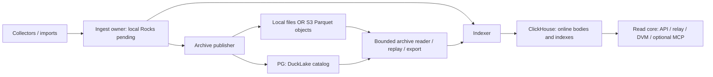

# Archive placement: local files and object storage

Status: selected deployment and persistence contract. P02-T04/T07/T08/T09 own
the actual adapters and qualification; P08 owns installation and operator jobs.
This complements [deployment composition](deployment-contract.md),
[durability](../architecture/data-and-durability.md) and the
[logical relation catalog](storage-catalog.md). A destination changes placement,
not event/provenance semantics, authority or the declared ACK failure class.

## Selected product boundary

Use a local persistent filesystem by default. A single-machine installation does
not need an object-store server. Support an explicitly configured S3-compatible
archive destination for managed cloud storage or an independently operated object
store. S3 is a network API, not necessarily Amazon, a container or a mounted disk.
The provider holds immutable Parquet objects; PostgreSQL still holds DuckLake's
catalog, and the separate PG control authority still owns deployment progress.
Credentials and connectivity to both are required by an archive reader/writer.

Arrows show data/dependency flow, not permission to mount another owner's writable
directory. Full-online gateways normally need no archive data mount: their body
reads use CH and qualified control/readiness state. Explicit tiered reads, archive
inspection and exports invoke the bounded archive worker. S3 does not replace the
Rocks WAL, CH local engine files, PG database or a publication queue. Do not put
embedded databases on an S3 FUSE mount and assume local filesystem guarantees.

An external provider is configured by endpoint/region/bucket/root plus protected
credentials; BigBrotr does not provision an account or silently incur cloud work.
Self-hosting can use a separately managed server/container or cluster after its
compatibility/durability qualification. No S3 implementation is a mandatory
bundled dependency. Running an object server on the same disk does not add
off-host durability and adds a process, network hop and operational responsibility.
Amazon describes its managed service in the [S3 overview](https://docs.aws.amazon.com/AmazonS3/latest/userguide/Welcome.html).

## Configuration and authority

These are schema roots/fields to implement in P01/P02, not working commands today.
The exact effective configuration is validated before worker activation.

| Field | Selected meaning and validation |
|---|---|
| `archive.storage.kind` | `local` by default, or `s3`; no automatic fallback from failed S3 to another archive |
| `archive.storage.root` | Absolute owned local directory, or canonical `s3://bucket/prefix/`; immutable dataset identity is separately checked |
| `archive.storage.s3.endpoint` | HTTPS origin for compatible service; absent means explicit provider/region resolution; no arbitrary path/query/userinfo |
| `archive.storage.s3.region` | Required explicit signing region, including a provider-specific value when applicable |
| `archive.storage.s3.addressing` | `virtual-hosted` or `path`, explicitly selected for the qualified endpoint; no retry to a different authority after signature failure |
| `archive.storage.s3.credentials_ref` | Protected reference/provider binding for the role; access/secret/session values never enter effective-config output, URLs or archive facts |
| `archive.storage.s3.tls` | Verified TLS and explicit CA/server-name policy; plaintext permitted only for explicit isolated development loopback/private lab configuration |
| `archive.storage.s3.provider_profile` | Versioned, tested endpoint capability profile; an API-compatible label is insufficient evidence of persistence/consistency |
| `archive.storage.request_timeout`, `max_inflight_requests`, `retry_budget` | Bounded infrastructure work within the archive worker/host grant; retries preserve immutable identity and do not decide ambiguous catalog outcomes |

A connection instance receives only the credentials needed for its role. Prefer
short-lived workload credentials where supported by the pinned engine/provider;
explicit mounted-secret references are the portable starting path. Refreshing a
credential does not change dataset identity. Configure secrets in the worker's
private memory/provider, redact driver errors and disable uncontrolled extension
installation. P01's verified offline engine bundle includes the required remote
filesystem extension; a dashboard request cannot install one.

The worker grant covers startup as well as queries. Budget signed-extension
verification threads/stacks separately from the engine's query thread setting;
the pinned engine does not use that query limit for signature hashing. Exhausted
native thread resources can abort the worker. Keep the grant until positive
termination and resolve any ambiguous catalog outcome before replay, as for
other native worker failures. Never bypass signature checks to fit a smaller
grant. [The dependency record](../research/dependency-selections.md#duckdb-worker-and-arrowparquet-responsibilities)
owns the exact-version finding and its measured scope.

Infrastructure endpoints are operator-supplied trusted routes, distinct from
untrusted relay/discovery URLs. Private PG/CH/S3/RPC endpoints are valid; keep
their destination allowlist, DNS/TLS rules and credential scope explicit. A
public request cannot change an endpoint or redirect a credential-bearing request
to an unapproved origin. `localhost` inside an isolated container means that
container, not another host or the Compose database service.

| Role | Minimum authority and placement |
|---|---|
| Archive publisher | Catalog write for its archive; object create/read/list and multipart capabilities needed by the pinned writer; exclusive publication ownership |
| Archive reader / replay / export | Read-only catalog and object read/list/range as actually required; no object write or catalog DDL |
| Archive maintenance | Explicit catalog maintenance and object-delete authority, bounded by retained references, backup barriers and fencing |
| Backup copier | Read source closure; write a separate protected destination; no implied permission to clean the source |
| Ordinary gateway | CH/read-control capabilities for enabled resources; no direct archive credential unless a separately admitted worker needs it |

Use a dedicated bucket/root per dataset and security boundary. Where the provider
supports enforceable prefix policies, narrower grants can be used and tested.
If it grants only whole-bucket read/write, a prefix is **not** a security boundary:
use separate buckets, and disclose that publisher write may include delete or
overwrite authority. The product never claims a permission split its provider
cannot enforce. Administrative raw-object/catalog access is not the scoped public
read core and can expose all data in that authority's dataset.

## Actual publication and protection boundaries

The initial adapter uses the pinned DuckLake engine's normal transactional write
path. It prepares bounded typed batches, then one fenced publisher writes all
required families and the deterministic semantic batch receipt in one catalog
transaction. DuckLake manages Parquet paths and metadata; the application does
not invent a second JSON manifest as the engine's transaction authority or edit
its PG metadata tables. [DuckLake connecting](https://ducklake.select/docs/stable/duckdb/usage/connecting)
documents the separate catalog and data path; the exact bundled version is tested.

File preparation and integrity checks must describe their actual implementation.
Native `INSERT` does not supply an application SHA-256 of every generated file.
The protected archive cut requires the matching semantic receipt, complete file/
family membership and the **qualified native object/file plus catalog persistence
path** for its advertised failure class. It does not require rereading every file
over S3 merely to compute its first checksum. A newly computed checksum alone
could not prove persistence or detect corruption that preceded that baseline.
A crash after catalog commit resolves the receipt and any incomplete protection
checks; it does not insert the batch again. File reuse/compaction carries exact
dependencies and the same qualified replacement-closure requirements.

Record content verification separately: semantic batch digest, storage-level
integrity evidence, and full-file SHA-256 are different fields. File SHA state is
`not_captured` or a digest with its method/time, never an invented zero or an ETag
assumed to be SHA-256. Capture it once in a supported writing/staging path where
available, or by a budgeted backup/scrub pass; compare subsequent copies/reads
against the captured value. A backup's complete file-hash manifest is mandatory
before that backup is marked verified. Strong semantic readback compares against
retained source digests and has a separately stated full/sampled scope.

Charge readback requests/CPU/egress whenever that verification is performed.
Supported staged-file registration or a hashing writer can be qualified later
when its total cost merits it; neither a custom filesystem adapter nor a second
whole-file read is a default admission dependency. Hashes cannot establish
power-loss persistence, off-host replication or cross-family completeness.

One immutable object key identifies one file generation; never overwrite a live
generation in place. Compaction writes new files and commits their new membership,
retaining old referenced generations until safe reclamation. A failed upload,
orphan completed object or abandoned multipart upload is not a visible archive
fact. An ambiguous receipt is resolved through the catalog and old-owner/transaction
exclusion, not by object listing or retrying a timed-out insert blindly.

On local files, qualify actual file/directory persistence under the declared
failure class. On S3, qualify completed object persistence, new-object read/list
visibility and the relationship between successful upload and catalog commit for
the selected provider. “S3-compatible” does not transfer Amazon's guarantees to
another server. A provider outage pauses archive progress; pending capacity and
completion reserves govern further admission. Never acknowledge a stronger
durability class solely because a destination is remote.

## File formation, reads and cost

Maintain the existing ZSTD3/bounded batch starting policy and disabled scientific
inlining; placement alone does not change those settings. Small transactions can
produce one small object per populated family, including technical receipts under
the starting no-inlining configuration. Measure quiet single-event traffic as
well as bulk traffic. Do not wait forever for a large file, publish partial family
cuts, or secretly move scientific bodies into the PG catalog to reduce PUTs.

Record actual object/file count, size distribution, range/GET/HEAD/LIST/PUT and
multipart activity, retries, checksum reads, compaction rewrites, export bytes and
egress. Illustrative billing has separate storage-byte-month, request and transfer
terms; neither compressed file size nor an API URL predicts the total bill.
Keep object concurrency and worker spill/cache within their existing grants;
an object store does not supply application RAM or make arbitrary scans cheap.
DuckDB's [documented S3 API requirements](https://duckdb.org/docs/current/core_extensions/httpfs/s3api)
include range reads, listing and multipart writes for their respective paths.

Use catalog-selected snapshots for internal reads. Raw globbing of a live bucket
is neither a consistent archive query nor a portable export. A public standalone
export has its own manifest, permitted scope/dependencies and stable files.
Never expose a private archive bucket to simplify public download links; publish
separate authorized artifacts or bounded expiring download grants.

Do not automatically move live catalog objects into a storage class requiring
asynchronous restore before reads. Such classes may suit separately inventoried
offline backups, with explicit retrieval delay/cost, not the normal live archive
contract. Object-store versioning/retention locks can help recovery where actually
available; they do not replace a consistent catalog/object backup or logical pins.

## Backup, relocation and qualification

A backup names a catalog snapshot, its exact object closure and checksums, plus
the control/pending/producer dependency closure required by the deployment backup
contract. Stop/fence conflicting maintenance or establish a proven barrier before
capturing it. Bucket listing alone can miss catalog authority and include orphans;
a PG dump alone can refer to deleted or inaccessible files. Catalog transactions
committed after a dump are not automatically recovered by copying their objects.
See [DuckLake backup and recovery](https://ducklake.select/docs/stable/duckdb/guides/backups_and_recovery).

Changing local storage to S3, bucket/prefix, endpoint authority or storage class
is an explicit relocation job: quiesce/fence affected publication and maintenance,
pin a complete cut, copy and hash its closure, restore/validate a separate catalog
binding, read every required family through the destination and only then activate
the new root/revision. Resume without reassigning scientific identities. Retain
the source until rollback/recovery obligations expire. Merely editing `DATA_PATH`
on a running deployment is not a migration; an engine path override is a tool
inside this procedure, not proof of copied data or safe writer ownership.

P02/P08 acceptance covers local and at least one qualified S3 provider: full signed
readback from a worker with no source-data mount, readonly credential denial,
bad/expired credentials, missing/corrupt objects, range and multipart behavior,
interrupted upload/commit and receipt resolution, object/catalog restore to another
root, cleanup with active pins, slow/disconnected infrastructure and bounded pending
growth. Separate one-host loopback evidence from real independent-host/WAN/failure
domain qualification. Release support names the tested provider/version/settings.

The [isolated S3 research](../research/tux-object-storage-20260917.md) checks a real
DuckLake/PG/Garage slice, including another reader process, faults and restore.
It does not certify the future Rust adapter, cloud pricing, distributed Garage,
power-loss protection or a multi-host BigBrotr deployment. Garage is a research
compatibility candidate, not a selected mandatory product dependency. Its official
[single-node quick start](https://garagehq.deuxfleurs.fr/documentation/quick-start/)
explicitly lacks redundant storage. MinIO Community is not a new default: its
[official repository](https://github.com/minio/minio) was archived on 2026-04-25;
replacement/vendor choices require their own maintained release qualification.
