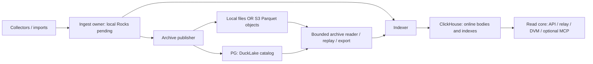

# Archive placement: local files and object storage

Status: selected deployment and persistence contract. P02-T04/T07/T08/T09 own
the actual adapters and qualification; P08 owns installation and operator jobs.
This complements [deployment composition](deployment-contract.md),
[durability](../architecture/data-and-durability.md) and the
[logical relation catalog](storage-catalog.md). A destination changes placement,
not event/provenance semantics, authority or the declared ACK failure class.

## Selected product boundary

Use a local persistent filesystem by default. A single-machine installation does
not need an object-store server. Support an explicitly configured S3-compatible
archive destination for managed cloud storage or an independently operated object
store. S3 is a network API, not necessarily Amazon, a container or a mounted disk.
The provider holds immutable Parquet objects; PostgreSQL still holds DuckLake's
catalog, and the separate PG control authority still owns deployment progress.
Credentials and connectivity to both are required by an archive reader/writer.

Arrows show data/dependency flow, not permission to mount another owner's writable
directory. Full-online gateways normally need no archive data mount: their body
reads use CH and qualified control/readiness state. Explicit tiered reads, archive
inspection and exports invoke the bounded archive worker. S3 does not replace the
Rocks WAL, CH local engine files, PG database or a publication queue. Do not put
embedded databases on an S3 FUSE mount and assume local filesystem guarantees.

An external provider is configured by endpoint/region/bucket/root plus protected
credentials; BigBrotr does not provision an account or silently incur cloud work.
Self-hosting can use a separately managed server/container or cluster after its
compatibility/durability qualification. No S3 implementation is a mandatory
bundled dependency. Running an object server on the same disk does not add
off-host durability and adds a process, network hop and operational responsibility.
Amazon describes its managed service in the [S3 overview](https://docs.aws.amazon.com/AmazonS3/latest/userguide/Welcome.html).

## Configuration and authority

These are schema roots/fields to implement in P01/P02, not working commands today.
The exact effective configuration is validated before worker activation.

| Field | Selected meaning and validation |
|---|---|
| `archive.storage.kind` | `local` by default, or `s3`; no automatic fallback from failed S3 to another archive |
| `archive.storage.root` | Absolute owned local directory, or canonical `s3://bucket/prefix/`; immutable dataset identity is separately checked |
| `archive.storage.s3.endpoint` | HTTPS origin for compatible service; absent means explicit provider/region resolution; no arbitrary path/query/userinfo |
| `archive.storage.s3.region` | Required explicit signing region, including a provider-specific value when applicable |
| `archive.storage.s3.addressing` | `virtual-hosted` or `path`, explicitly selected for the qualified endpoint; no retry to a different authority after signature failure |
| `archive.storage.s3.credentials_ref` | Protected reference/provider binding for the role; access/secret/session values never enter effective-config output, URLs or archive facts |
| `archive.storage.s3.tls` | Verified TLS and explicit CA/server-name policy; plaintext permitted only for explicit isolated development loopback/private lab configuration |
| `archive.storage.s3.provider_profile` | Versioned, tested endpoint capability profile; an API-compatible label is insufficient evidence of persistence/consistency |
| `archive.storage.request_timeout`, `max_inflight_requests`, `retry_budget` | Bounded infrastructure work within the archive worker/host grant; retries preserve immutable identity and do not decide ambiguous catalog outcomes |

A connection instance receives only the credentials needed for its role. Prefer
short-lived workload credentials where supported by the pinned engine/provider;
explicit mounted-secret references are the portable starting path. Refreshing a
credential does not change dataset identity. Configure secrets in the worker's
private memory/provider, redact driver errors and disable uncontrolled extension
installation. P01's verified offline engine bundle includes the required remote
filesystem extension; a dashboard request cannot install one.

The worker grant covers startup as well as queries. Budget signed-extension
verification threads/stacks separately from the engine's query thread setting;
the pinned engine does not use that query limit for signature hashing. Exhausted
native thread resources can abort the worker. Keep the grant until positive
termination and resolve any ambiguous catalog outcome before replay, as for
other native worker failures. Never bypass signature checks to fit a smaller
grant. [The dependency record](../research/dependency-selections.md#duckdb-worker-and-arrowparquet-responsibilities)
owns the exact-version finding and its measured scope.

Bind a Linux private worker to its actual spawning thread before opening the
engine. Parent-death SIGKILL with expected-parent checks prevents cooperative
shutdown or pipe draining from being the only orphan safeguard. The synchronous
owner keeps that thread alive through reap. Signal registration/delivery alone
does not certify exit, filesystem cleanup or exclusion of a remote catalog
transaction; a successor must still resolve old activity positively. The private
[handoff contract](../reference/archive-handoff.md#supervised-private-inspection)
owns the implementation and scoped Linux amd64 qualification. Mac development does
not inherit Linux process-lifecycle guarantees.

Catalog recovery must exclude **every** old credential-holding coordinator and
native client before treating an absent receipt as permission to publish again.
Seal the attempt's login, positively establish client/process termination or an
equivalent enforced storage fence, terminate/resolve its remaining catalog backend
transactions, then inspect receipts in a new healthy transaction. Enumerating
`pg_stat_activity` requires fresh statistics snapshots/transactions. A PID string,
successful signal delivery, expired lease, NOLOGIN or an empty activity result
alone is insufficient. Unknown termination or catalog state retains the job and
source obligation; it does not authorize replacement publication or cleanup.

The [exact native startup qualification](../implementation/evidence/p02-native-startup-exclusion-20260918.json)
supports this ordering for the pinned trusted blocking libpq18.3 client and
PG16.15 server: the server publishes backend status before ReadyForQuery, and
the native client waits for readiness before sending catalog SQL. A terminated
client cannot later issue SQL through an invisible startup connection; SQL already
submitted remains a separate backend/receipt obligation. The real negative control
keeps that client alive and commits after login revocation and empty activity.
This is a dependency prerequisite, not implemented persistent product recovery.
P02-T04 must persist attempt/process/credential ownership before exposing write
authority and qualify successor recovery. An unreachable old host is unknown
until an enforced exclusion is established; do not substitute a timeout or treat
new local process capacity as old-host termination. Changing the native connection
protocol, pool/credential ownership or process containment requires requalification.

### Retained publication intent issuance

Migration 0009 adds `control.archive_attempts` as the first persistent publisher
prerequisite. An immutable attempt binds dataset, stable catalog identity,
strictly increasing issuance ordinal, expected predecessor, schema1 semantic
input digest, retained sealed topology, coordinator and unique worker incarnation.
The attempt ID is globally unique within this control database and must never
name a second credential lifetime. The intended batch remains retained by ingest;
this row is not a second admission log, a source-cut validation or archive receipt.

Only the actual fenced Control backend may issue the next ordinal. A caller must
supply its expected predecessor; stale/new requests cannot silently supersede
another intent. An identical request resolves its original immutable row even
under a successor Control epoch. Changed input, catalog, process lifetime or
predecessor under the same ID is refused. A historical replay reports whether it
is still the latest issued intent; it never reactivates an old catalog login.
Cancellation or failed/unknown COMMIT poisons the issuing connection. Resolve the
same request under a freshly acquired Control session, preserving its ID/input.

Issuance is deliberately distinct from `owner_epochs` active/excluded state:
allocating a successor intent does not prove exclusion of the previous native
writer or release its resource grant. Before exposing catalog credentials, the
catalog adapter must durably import this exact intent and enforce monotonic
activation at its own write boundary, refusing late lower ordinals and mismatched
same-ordinal attempts. Guard initialization/activation follows
the versioned compatibility exception below; its
[scoped native qualification](../implementation/evidence/p02-catalog-product-native-20260918.json)
passes at `944f3e6`, while persisted recovery remains pending.
Control issuance alone cannot authorize publication, cleanup or pending ACK.
Pre-protocol archive owner rows cause migration 0009 to refuse atomically rather
than invent exclusion or adopt unknown credentials. Existing SQL stays immutable.

Infrastructure endpoints are operator-supplied trusted routes, distinct from
untrusted relay/discovery URLs. Private PG/CH/S3/RPC endpoints are valid; keep
their destination allowlist, DNS/TLS rules and credential scope explicit. A
public request cannot change an endpoint or redirect a credential-bearing request
to an unapproved origin. `localhost` inside an isolated container means that
container, not another host or the Compose database service.

| Role | Minimum authority and placement |
|---|---|
| Archive publisher | Catalog write for its archive; object create/read/list and multipart capabilities needed by the pinned writer; exclusive publication ownership |
| Archive reader / replay / export | Read-only catalog and object read/list/range as actually required; no object write or catalog DDL |
| Archive maintenance | Explicit catalog maintenance and object-delete authority, bounded by retained references, backup barriers and fencing |
| Backup copier | Read source closure; write a separate protected destination; no implied permission to clean the source |
| Ordinary gateway | CH/read-control capabilities for enabled resources; no direct archive credential unless a separately admitted worker needs it |

Use a dedicated bucket/root per dataset and security boundary. Where the provider
supports enforceable prefix policies, narrower grants can be used and tested.
If it grants only whole-bucket read/write, a prefix is **not** a security boundary:
use separate buckets, and disclose that publisher write may include delete or
overwrite authority. The product never claims a permission split its provider
cannot enforce. Administrative raw-object/catalog access is not the scoped public
read core and can expose all data in that authority's dataset.

### Versioned catalog commit guard

P02-T04 selects the tested PG statement-trigger fence for the pinned DuckLake1.0
metadata layout. `migrations/catalog/0001_writer_guard.sql` belongs to the separate
catalog database; it is not an application-Control migration. Native bootstrap
alone creates the 28 metadata tables. The scientific initializer additionally
creates the six declared logical tables at snapshot1. After the finite worker has
exited and been positively reaped, the installer requires that exact empty state,
metadata version/root/encryption, column/key/collation layout and a restricted bootstrap
login. In one transaction it transfers native table ownership to the catalog
manager, revokes bootstrap DDL/DML and PUBLIC native privileges, attaches all 28
statement guards, and records dataset/catalog/root, SQL and live-layout hashes.
No native metadata values/columns are rewritten. Nonempty or unfamiliar history
is refused; the explicitly named `native_only_local` foundation fixture retains
the original empty snapshot0 path and cannot inspect a scientific binding; there is no automatic adoption or native migration. Repeated install
inspects the existing guard without modifying it. Unknown COMMIT requires a fresh
connection and inspection, not an assumption that initialization failed.

The application-owned `bigbrotr_archive` schema contains immutable installation
and attempt records plus one mutable owner row. Every native metadata mutation
locks that row FOR SHARE through the actual native transaction. Activation locks
it FOR UPDATE before compatibility inspection and imports the exact immutable
Control receipt with a strictly greater ordinal. A late lower ordinal cannot
reactivate an old writer; matching historical/current retries report observations
without creating another lifetime. A dedicated `bb_archive_<attempt-id>` login
and its PG role OID bind each imported lifetime. The SECURITY DEFINER trigger uses
`session_user`, qualified objects and a fixed search path; SET ROLE cannot change
its credential attribution. Runtime logins have native DML only, no metadata DDL,
trigger, guard-schema, role-administration or replication-bypass authority.
NOLOGIN is accepted for inspection and replacement: it reduces future connection
authority but does not exclude an existing backend. Inspection/activation never
re-enable an old login; credential exposure and launch readiness remain separate.

Compatibility inspection checks actual native columns/keys, table ownership,
function bodies/security settings, enabled statement triggers, stored installation
identity/checksums and live structural hash. It refuses scoped nonzero inlining
and extra inlined metadata tables. Returned definitions/counts are bounded; the
caller retains a 64 MiB inspection grant, transaction driver and total deadline.
Server statement/lock/idle-transaction timeouts are additional bounds. The guard
manager is a privileged operator boundary: direct privileged DDL, role changes or
catalog restore require quiescence and explicit reinspection. Checks do not make
an arbitrary administrator adversary safe.

The adapter accepts separately provisioned restricted logins or atomically creates
a fresh login with the retained intent and owner activation. New provisioning uses
256 random password bits and a locally derived PostgreSQL SCRAM verifier; plaintext
is never present in CREATE ROLE SQL. Only a known successful new commit returns a
move-only local credential handoff. An existing role or imported attempt refuses
provisioning without resetting its password or re-enabling it. Unknown completion
returns no credential: inspect from a fresh connection. A committed abandoned
lifetime requires a new retained intent; a proven rollback left no usable role.
The consuming callback still owns downstream copies and the one supervised child;
the Rust value alone is not proof of process uniqueness or memory erasure.

The PG16 catalog manager needs CREATEROLE and its implicit ADMIN-only membership
in roles it creates. Provisioning locally clears createrole_self_grant; inspection
allows only the guard-schema owner's ADMIN=true, INHERIT=false, SET=false link.
All other memberships involving the writer remain refused. Privileged initial
ownership transfer is separate from this non-superuser runtime manager authority.
Explicit sealing locks the owner, verifies the complete immutable lifetime and
actual role OID, removes its password/LOGIN, and disables it only if still current.
Repeated/historical sealing never disables a successor. It retains role/history;
role garbage collection requires its own lifecycle authority and bounded policy.

The [credential qualification](../implementation/evidence/p02-catalog-credentials-native-20260918.json)
at `d2b2609` passes 8 actual-PG sequences and 16 native Rust cases, including actual
SCRAM login/native attach, password/membership refusal, seal, lost COMMIT response
and same-intent races. The selected root is still explicitly local. Installed
initialization, S3 integration and persistent
launch/recovery remain required. Never launch a
second native client under the same attempt merely because activation is observed.
Replacement requires a new retained intent, unique worker and credential lifetime.
Catalog exclusion does not prove old process death or authorize orphan file/object
cleanup or resource-grant release. Existing six native fence schedules and 44
permission/coverage cases motivate this exception; they do not qualify the new
complete product publisher/recovery implementation. The
[product guard prerequisite report](../implementation/evidence/p02-catalog-product-native-20260918.json)
qualifies bootstrap/installation/inspection/activation and a live stale native
writer at `944f3e6`, including independently attributed PG guard rejection.
The [activation recovery report](../implementation/evidence/p02-catalog-recovery-native-20260918.json)
qualifies14 actual PG cases at `55dba36`: install/activation lost COMMIT responses,
both activation lock orders, identical retries and cancellation while the original
transaction still blocks resolution. Independent observations check complete
identity/privilege effects. These are manager operations with synthetic input;
native scientific publication, persistent credential/worker recovery and installed
recovery remain open. A matching observation still grants no second native client
lifetime.

PostgreSQL documents [session identity and privilege checks](https://www.postgresql.org/docs/16/functions-info.html)
and [actual trigger metadata](https://www.postgresql.org/docs/16/catalog-pg-trigger.html).
The exact upstream native-layout fixture records source revision/path/hash and is
used only for inspection, never as a replacement metadata creator.

### Explicit scientific initialization

A separate finite initializer creates the first five fact relations and empty
technical receipt relation from the versioned declaration. It requires an
exclusively reserved new PostgreSQL database and canonical empty local directory,
checks for unfamiliar objects before native ATTACH, and uses one native DDL
transaction. Repeated/existing catalogs refuse; uncertain results require fresh
privileged inspection. The operation shares the private supervisor and returns
only after exit/EOF and positive reap. It does not install the guard or certify a
schema ready for publication.

`CatalogIdentity::local` selects scientific schema1. The additive catalog
migration0002 binds version, initialization snapshot and declaration/native-layout/
SQL checksums in the same transaction as guard installation and ownership transfer.
Applied0001 is unchanged. An existing native-only guard cannot be silently upgraded
or adopted; the explicit foundation constructor cannot inspect a scientific guard.
The binding is immutable under the existing history trigger and contributes its
actual PG object shape to the installation checksum.

Installation, retry, inspection and activation validate all six live table
relationships, all203 columns (including nested parents, order, exact types,
nullability and defaults), schema versions and declared schema/placement metadata.
The declaration-derived fixture is independently compared with actual pinned
native metadata. STRUCT/LIST default types are empty; scalar default types are
`literal`. SQL NULL fails required predicates. Returned column strings/counts are
bounded. Current schema1 permits only its four global metadata values and optional
zero-inlining at global/main-schema/six-table scopes; unknown, duplicate or malformed
settings refuse. New persistent options require explicit compatibility qualification.
File/name mappings, file contents and protection are separate publication/recovery
checks, not certified by logical schema inspection.

Installed inspection holds the owner row FOR UPDATE against guarded native DML.
It must not subsequently acquire SHARE table locks: native DML holds its table
lock before its statement trigger waits for the owner. Ordinary AccessShare reads
are compatible with that waiting DML. First installation instead locks all native
tables before any guard exists. Runtime metadata DML can encode logical DuckLake
DDL; this inspection does not constrain arbitrary SQL within a lifetime. The
closed publisher and future schema transitions remain required.

An absent initializer response can be resolved only by a fresh privileged
inspection of the exact complete empty state. Guard installation then establishes
its binding; snapshot0/partial/unfamiliar initialization is refused. Explicit
interrupted-initialization recovery and the installed CLI journey remain P02-T04
work. No synthetic admission batch or archive attempt is needed to initialize an
empty installation. Ordinary publication never silently initializes or migrates.

## Actual publication and protection boundaries

The initial adapter uses the pinned DuckLake engine's normal transactional write
path. It prepares bounded typed batches, then one fenced publisher writes all
required families and the deterministic semantic batch receipt in one catalog
transaction. DuckLake manages Parquet paths and metadata; the application does
not invent a second JSON manifest as the engine's transaction authority or edit
its PG metadata values or column definitions. The narrowly scoped guard exception
below changes ownership/privileges and attaches statement triggers. [DuckLake connecting](https://ducklake.select/docs/stable/duckdb/usage/connecting)
documents the separate catalog and data path; the exact bundled version is tested.

The typed Arrow/native adapter must preserve nullable compound values through
actual Parquet, including null entries before and between present references.
For the pinned binding, mask scalar children as well as a null reference's parent;
valid child placeholders can otherwise shift persisted values. Present references
still require every qualified identity field. This is a physical compatibility
normalization, not a new canonical identity recipe or permission to fill unknown
values with zero; [the row format](../reference/archive-format.md) and dependency
record own the mapping and executed counterexample.

The private [pending handoff](../reference/archive-handoff.md) preserves complete
admission-batch membership and canonical fact bytes. A bounded decoded prefix may
enter private discardable staging only. Complete framing/digest verification is
required before publication; preparation cannot acknowledge or reclaim pending.
Its transport framing and diagnostics are not an archive-batch receipt or export.

File preparation and integrity checks must describe their actual implementation.
Native `INSERT` does not supply an application SHA-256 of every generated file.
The protected archive cut requires the matching semantic receipt, complete file/
family membership and the **qualified native object/file plus catalog persistence
path** for its advertised failure class. It does not require rereading every file
over S3 merely to compute its first checksum. A newly computed checksum alone
could not prove persistence or detect corruption that preceded that baseline.
A crash after catalog commit resolves the receipt and any incomplete protection
checks; it does not insert the batch again. File reuse/compaction carries exact
dependencies and the same qualified replacement-closure requirements.

Record content verification separately: semantic batch digest, storage-level
integrity evidence, and full-file SHA-256 are different fields. File SHA state is
`not_captured` or a digest with its method/time, never an invented zero or an ETag
assumed to be SHA-256. Capture it once in a supported writing/staging path where
available, or by a budgeted backup/scrub pass; compare subsequent copies/reads
against the captured value. A backup's complete file-hash manifest is mandatory
before that backup is marked verified. Strong semantic readback compares against
retained source digests and has a separately stated full/sampled scope.

Charge readback requests/CPU/egress whenever that verification is performed.
Supported staged-file registration or a hashing writer can be qualified later
when its total cost merits it; neither a custom filesystem adapter nor a second
whole-file read is a default admission dependency. Hashes cannot establish
power-loss persistence, off-host replication or cross-family completeness.

One immutable object key identifies one file generation; never overwrite a live
generation in place. Compaction writes new files and commits their new membership,
retaining old referenced generations until safe reclamation. A failed upload,
orphan completed object or abandoned multipart upload is not a visible archive
fact. An ambiguous receipt is resolved through the catalog and old-owner/transaction
exclusion, not by object listing or retrying a timed-out insert blindly.

On local files, qualify actual file/directory persistence under the declared
failure class. On S3, qualify completed object persistence, new-object read/list
visibility and the relationship between successful upload and catalog commit for
the selected provider. “S3-compatible” does not transfer Amazon's guarantees to
another server. A provider outage pauses archive progress; pending capacity and
completion reserves govern further admission. Never acknowledge a stronger
durability class solely because a destination is remote.

## File formation, reads and cost

Maintain the existing ZSTD3/bounded batch starting policy and disabled scientific
inlining; placement alone does not change those settings. Small transactions can
produce one small object per populated family, including technical receipts under
the starting no-inlining configuration. Measure quiet single-event traffic as
well as bulk traffic. Do not wait forever for a large file, publish partial family
cuts, or secretly move scientific bodies into the PG catalog to reduce PUTs.

Record actual object/file count, size distribution, range/GET/HEAD/LIST/PUT and
multipart activity, retries, checksum reads, compaction rewrites, export bytes and
egress. Illustrative billing has separate storage-byte-month, request and transfer
terms; neither compressed file size nor an API URL predicts the total bill.
Keep object concurrency and worker spill/cache within their existing grants;
an object store does not supply application RAM or make arbitrary scans cheap.
DuckDB's [documented S3 API requirements](https://duckdb.org/docs/current/core_extensions/httpfs/s3api)
include range reads, listing and multipart writes for their respective paths.

Use catalog-selected snapshots for internal reads. Raw globbing of a live bucket
is neither a consistent archive query nor a portable export. A public standalone
export has its own manifest, permitted scope/dependencies and stable files.
Never expose a private archive bucket to simplify public download links; publish
separate authorized artifacts or bounded expiring download grants.

Do not automatically move live catalog objects into a storage class requiring
asynchronous restore before reads. Such classes may suit separately inventoried
offline backups, with explicit retrieval delay/cost, not the normal live archive
contract. Object-store versioning/retention locks can help recovery where actually
available; they do not replace a consistent catalog/object backup or logical pins.

## Backup, relocation and qualification

A backup names a catalog snapshot, its exact object closure and checksums, plus
the control/pending/producer dependency closure required by the deployment backup
contract. Stop/fence conflicting maintenance or establish a proven barrier before
capturing it. Bucket listing alone can miss catalog authority and include orphans;
a PG dump alone can refer to deleted or inaccessible files. Catalog transactions
committed after a dump are not automatically recovered by copying their objects.
See [DuckLake backup and recovery](https://ducklake.select/docs/stable/duckdb/guides/backups_and_recovery).

Changing local storage to S3, bucket/prefix, endpoint authority or storage class
is an explicit relocation job: quiesce/fence affected publication and maintenance,
pin a complete cut, copy and hash its closure, restore/validate a separate catalog
binding, read every required family through the destination and only then activate
the new root/revision. Resume without reassigning scientific identities. Retain
the source until rollback/recovery obligations expire. Merely editing `DATA_PATH`
on a running deployment is not a migration; an engine path override is a tool
inside this procedure, not proof of copied data or safe writer ownership.

P02/P08 acceptance covers local and at least one qualified S3 provider: full signed
readback from a worker with no source-data mount, readonly credential denial,
bad/expired credentials, missing/corrupt objects, range and multipart behavior,
interrupted upload/commit and receipt resolution, object/catalog restore to another
root, cleanup with active pins, slow/disconnected infrastructure and bounded pending
growth. Separate one-host loopback evidence from real independent-host/WAN/failure
domain qualification. Release support names the tested provider/version/settings.

The [isolated S3 research](../research/tux-object-storage-20260917.md) checks a real
DuckLake/PG/Garage slice, including another reader process, faults and restore.
It does not certify the future Rust adapter, cloud pricing, distributed Garage,
power-loss protection or a multi-host BigBrotr deployment. Garage is a research
compatibility candidate, not a selected mandatory product dependency. Its official
[single-node quick start](https://garagehq.deuxfleurs.fr/documentation/quick-start/)
explicitly lacks redundant storage. MinIO Community is not a new default: its
[official repository](https://github.com/minio/minio) was archived on 2026-04-25;
replacement/vendor choices require their own maintained release qualification.
