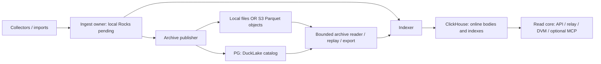

# Archive placement: local files and object storage

Status: selected deployment and persistence contract. P02-T04/T07/T08/T09 own
the actual adapters and qualification; P08 owns installation and operator jobs.
This complements [deployment composition](deployment-contract.md),
[durability](../architecture/data-and-durability.md) and the
[logical relation catalog](storage-catalog.md). A destination changes placement,
not event/provenance semantics, authority or the declared ACK failure class.

## Selected product boundary

Use a local persistent filesystem by default. A single-machine installation does
not need an object-store server. Support an explicitly configured S3-compatible
archive destination for managed cloud storage or an independently operated object
store. S3 is a network API, not necessarily Amazon, a container or a mounted disk.
The provider holds immutable Parquet objects; PostgreSQL still holds DuckLake's
catalog, and the separate PG control authority still owns deployment progress.
Credentials and connectivity to both are required by an archive reader/writer.

Arrows show data/dependency flow, not permission to mount another owner's writable
directory. Full-online gateways normally need no archive data mount: their body
reads use CH and qualified control/readiness state. Explicit tiered reads, archive
inspection and exports invoke the bounded archive worker. S3 does not replace the
Rocks WAL, CH local engine files, PG database or a publication queue. Do not put
embedded databases on an S3 FUSE mount and assume local filesystem guarantees.

An external provider is configured by endpoint/region/bucket/root plus protected
credentials; BigBrotr does not provision an account or silently incur cloud work.
Self-hosting can use a separately managed server/container or cluster after its
compatibility/durability qualification. No S3 implementation is a mandatory
bundled dependency. Running an object server on the same disk does not add
off-host durability and adds a process, network hop and operational responsibility.
Amazon describes its managed service in the [S3 overview](https://docs.aws.amazon.com/AmazonS3/latest/userguide/Welcome.html).

## Configuration and authority

These are schema roots/fields to implement in P01/P02, not working commands today.
The exact effective configuration is validated before worker activation.

| Field | Selected meaning and validation |
|---|---|
| `archive.storage.kind` | `local` by default, or `s3`; no automatic fallback from failed S3 to another archive |
| `archive.storage.root` | Absolute owned local directory, or canonical `s3://bucket/prefix/`; immutable dataset identity is separately checked |
| `archive.storage.s3.endpoint` | HTTPS origin for compatible service; absent means explicit provider/region resolution; no arbitrary path/query/userinfo |
| `archive.storage.s3.region` | Required explicit signing region, including a provider-specific value when applicable |
| `archive.storage.s3.addressing` | `virtual-hosted` or `path`, explicitly selected for the qualified endpoint; no retry to a different authority after signature failure |
| `archive.storage.s3.credentials_ref` | Protected reference/provider binding for the role; access/secret/session values never enter effective-config output, URLs or archive facts |
| `archive.storage.s3.tls` | Verified TLS and explicit CA/server-name policy; plaintext permitted only for explicit isolated development loopback/private lab configuration |
| `archive.storage.s3.provider_profile` | Versioned, tested endpoint capability profile; an API-compatible label is insufficient evidence of persistence/consistency |
| `archive.storage.request_timeout`, `max_inflight_requests`, `retry_budget` | Bounded infrastructure work within the archive worker/host grant; retries preserve immutable identity and do not decide ambiguous catalog outcomes |

A connection instance receives only the credentials needed for its role. Prefer
short-lived workload credentials where supported by the pinned engine/provider;
explicit mounted-secret references are the portable starting path. Refreshing a
credential does not change dataset identity. Configure secrets in the worker's
private memory/provider, redact driver errors and disable uncontrolled extension
installation. P01's verified offline engine bundle includes the required remote
filesystem extension; a dashboard request cannot install one.

The worker grant covers startup as well as queries. Budget signed-extension
verification threads/stacks separately from the engine's query thread setting;
the pinned engine does not use that query limit for signature hashing. Exhausted
native thread resources can abort the worker. Keep the grant until positive
termination and resolve any ambiguous catalog outcome before replay, as for
other native worker failures. Never bypass signature checks to fit a smaller
grant. [The dependency record](../research/dependency-selections.md#duckdb-worker-and-arrowparquet-responsibilities)
owns the exact-version finding and its measured scope.

Bind a Linux private worker to its actual spawning thread before opening the
engine. Parent-death SIGKILL with expected-parent checks prevents cooperative
shutdown or pipe draining from being the only orphan safeguard. The synchronous
owner keeps that thread alive through reap. Signal registration/delivery alone
does not certify exit, filesystem cleanup or exclusion of a remote catalog
transaction; a successor must still resolve old activity positively. The private
[handoff contract](../reference/archive-handoff.md#supervised-private-inspection)
owns the implementation and scoped Linux amd64 qualification. Mac development does
not inherit Linux process-lifecycle guarantees.

Catalog recovery must exclude **every** old credential-holding coordinator and
native client before treating an absent receipt as permission to publish again.
Seal the attempt's login, positively establish client/process termination or an
equivalent enforced storage fence, terminate/resolve its remaining catalog backend
transactions, then inspect receipts in a new healthy transaction. Enumerating
`pg_stat_activity` requires fresh statistics snapshots/transactions. A PID string,
successful signal delivery, expired lease, NOLOGIN or an empty activity result
alone is insufficient. Unknown termination or catalog state retains the job and
source obligation; it does not authorize replacement publication or cleanup.

The [exact native startup qualification](../implementation/evidence/p02-native-startup-exclusion-20260918.json)
supports this ordering for the pinned trusted blocking libpq 18.3 client and
PG16.15 server: the server publishes backend status before ReadyForQuery, and
the native client waits for readiness before sending catalog SQL. A terminated
client cannot later issue SQL through an invisible startup connection; SQL already
submitted remains a separate backend/receipt obligation. The real negative control
keeps that client alive and commits after login revocation and empty activity.
This is a dependency prerequisite, not implemented persistent product recovery.
P02-T04 must persist attempt/process/credential ownership before exposing write
authority and qualify successor recovery. The initial
[local custody candidate](../reference/archive-handoff.md#persistent-local-attempt-custody-candidate)
binds an immutable, synchronized per-attempt journal to close-only descriptor
custody in the coordinator, actual catalog transport and native child. It is
restricted to the same Linux boot and qualified local ext4 placement. This does
not replace server transaction resolution, positive process/resource reconciliation
or explicit cross-boot/host recovery. [Scoped native qualification](../implementation/evidence/p02-local-custody-native-20260919.json)
now covers real inherited custody, parent/manager death and queued provisioning
COMMIT cancellation. [Missing-import qualification](../implementation/evidence/p02-missing-import-native-20260919.json)
additionally resolves a never-imported attempt without mutation under recovered
custody and the catalog owner lock, including actual delayed protocol execution
and conflicting retained identities. Installed lifecycle/resource reconciliation
and incomplete-journal recovery remain required. An unreachable old host is unknown
until an enforced exclusion is established; do not substitute a timeout or treat
new local process capacity as old-host termination. Changing the native connection
protocol, pool/credential ownership or process containment requires requalification.

### Persistent coordinator state

`storage.archive_state_root` is a separate deployment root, private mode0700,
canonical local ext4 and disjoint from selected data, scratch and other writable
stores. Physical placement checks compare device/inode and the descriptor's actual
mount ID/root from bounded [Linux proc records](https://www.kernel.org/doc/html/latest/filesystems/proc.html),
so equal and nested ext4 bind aliases cannot pass through different canonical names.
Other roots that are absent remain a later store-opening prerequisite; mount changes
require quiescence and repeated preflight. It is not scratch space. After explicit catalog initialization/recovery,
`archive state-initialize --file PATH` binds it to the existing local reservation.
The finite command opens no database and grants no catalog readiness, attempt
adoption, replay or publication authority.

The existing `.bigbrotr-initialization/custody.lock` also serializes coordinators.
While holding recovered initialization custody, write identical bounded canonical
`bigbrotr-local-coordinator/1` bytes to `coordinator.json` in the state root and
`.bigbrotr-initialization/coordinator.json` in the data root. They bind the canonical
state path/device/inode and the initialization journal SHA256, which transitively
binds dataset/catalog, original root/lock identities, nonce and boot. Sync the
state file/directory before creating and syncing the reverse binding. A second
root cannot create a competing registration. Applied initialization journal bytes
and SQL remain unchanged.

An identical complete pair is idempotent. Explicit state-initialize may complete
an identical fully written first half when the reverse binding is absent and the
state directory contains nothing else. Partial bytes, missing state after reverse
binding, different identities and unrelated entries refuse without repair or
removal. Ordinary serve only opens a complete pair; it never initializes either
half. Reopening verifies and syncs both exact files and directories before returning
custody. Cross-boot/restore/relocation remain refused by the original reservation.

Control with a locally assigned Archive acquires this custody before connecting,
inventories under it, and retains it through the actual unpolled driver and final
join. A selected Control-only deployment without local Archive has no such
prerequisite. Existing installations must run the explicit binding command before
this newer Control startup. Generated roots remain outside accepted policy identity.

This closes local coordinator overlap only for participating code. Pre-protocol
coordinators/fixture-created attempts never held this lock and are not adopted or
resolved by registering it. The current consumer still reports resolution not
performed. Before later dispatch/recovery can interpret missing journals, it must
establish the protocol's initial history boundary under the actual Control fence
(or a separately qualified external exclusion) and retain complete input linkage
before issuance. Per-attempt driver/native custody, remote SQL outcome resolution,
source protection and process resource reconciliation remain independent gates.

### Initial coordinator protocol boundary

Migration `0010_archive_coordinator.sql` adds one immutable
`control.archive_coordinators` binding per dataset. It names the catalog, protocol1,
SHA256 of the exact existing two-ended `coordinator.json` bytes, and original
Control issuer attribution. The digest transitively binds local initialization,
root/lock identities and boot; it contains no credential. This migration leaves
old attempt rows unchanged and inspectable, with a NULL coordinator binding.
It does not infer that those attempts obeyed local custody.

Explicit `ControlSession::initialize_archive_coordinator` holds the actual Control
fence and dataset row lock before inspecting binding/history. Only absent binding
and zero issued attempts permit its initial insertion. An exact existing binding
retries without rewriting its original attribution, including after later issuance.
Different binding or any pre-protocol history refuses. Ordinary
`require_archive_coordinator` only observes an existing exact binding; missing is
a prerequisite failure, never implicit initialization. Actual SQL connection drivers
must retain original local custody before any query, including failed/cancelled calls.

New attempt insertion after migration10 requires non-NULL
`coordinator_binding_sha256` matching the dataset/catalog's binding. The existing
attempt trigger retains the Control fence and dataset lock before the additional
binding guard runs. `register_retained_archive_attempt` consumes a borrowed actual
RetainedInputs token, checks this binding and preserves it on identical retries;
the local permit and lock remain held. The earlier API supports schema9 prerequisite
fixtures; its unbound new INSERT is refused after migration10. An observed or
retried historical request remains no publication capability.

Application transactions hold the existing shared migration lock; explicit migration
holds its exclusive counterpart. An old issuance therefore completes before the
upgrade (and blocks first binding), or observes migration10 before it can issue.
Both old applied SQL files and their checksums remain unchanged. PostgreSQL16
[transactional trigger behavior and ordering](https://www.postgresql.org/docs/16/trigger-definition.html)
and [lock semantics](https://www.postgresql.org/docs/16/explicit-locking.html) own
the underlying boundaries. [Native d355c5b evidence](../implementation/evidence/p02-coordinator-faults-native-20260919.json)
exercises both candidate legacy-API/migration lock orders, cancelled blocked binding
and both lost binding COMMIT replies with exact fresh-session retry. It does not
execute a prior-version binary or qualify an administrative history rollback.

This is same-boot participation history, not catalog inspection, launch permission
or a restore protocol. Privileged in-place rollback of Control history while exact
local bytes survive cannot be detected by a binding hash alone. Restore, cross-boot
and relocation keep their separately fenced recovery gates. Complete missing-journal
interpretation still requires actual catalog identity and per-attempt exclusion.
The current implementation provides explicit typed operations and fixture consumers;
[Eight native boundary cases plus six signed schedules](../implementation/evidence/p02-coordinator-protocol-native-20260919.json) pass at b203a41. The separate d355c5b matrix adds the races and binding faults above. Installed
command/startup now passes its [eleven native cases](../implementation/evidence/p02-coordinator-cli-native-20260919.json)
at `5050999`; complete recovery/dispatch remains pending.

The current installed `archive coordinator-initialize --file PATH` extends that
historically qualified coordinator-only operation with explicit fresh persistence
participation described below. It requires migration15 and uses both configured
Control and catalog-manager credentials, actual Control fencing, a bounded catalog
barrier and custodied drivers. Identical retry preserves original rows and issuer
attribution. Successful output includes catalog inspection, persistence protocol1
and separate creation flags, while retaining `ready:false`. A lost response is
resolved by the same command under a fresh actual Control fence; preserve both
local files and SQL history. Local `state-initialize` remains separate. The `5050999` matrix qualifies only its
earlier coordinator-only behavior. The expanded operation has the separate scoped qualification linked below.

Ordinary Control startup with Archive assigned locally now requires this exact
SQL binding before it inventories attempts or emits idle, including `--roles
control`. Missing migration/binding or pre-protocol history cannot initialize
itself. This is an explicit compatibility change from the earlier schema9
inventory-only candidate: old attempts remain retained/inspectable, but this
startup refuses until a separately qualified recovery path exists. A deployment
without local Archive retains its Control-only prerequisites. The executable path
has native command, stop, restart and refusal qualification within the linked report; first complete event/read/export recovery remains open.

### Retained complete input linkage

Before Control issuance, `LocalCoordinator::retain_inputs` synchronizes immutable
`<32-lowercase-hex-attempt-id>.inputs` in the bound state root. It binds the original
initialization journal SHA256, full immutable ArchiveAttemptRequest and the ordered
complete PendingBatchHeader values. A header retains exact first SourceRecordId,
last sequence and admission digest; no fact bodies, secrets or second ACK ledger.
The caller checks actual downstream source, route, wire and resource admissibility
before issuance. Current native publication still consumes one complete PendingBatch;
the larger local format is not a promise of multi-batch dispatch.

The local version1 bytes are `BBINPUT` followed by byte01 (eight bytes total),
initialization SHA256 (32), attempt/dataset/catalog/coordinator/worker IDs (16 each),
publication ordinal and topology generation (u64 big-endian each), archive digest
(32), header count (u32 big-endian), then the ordered headers. Each header is first
shard (u32), epoch and sequence (u64 each), followed by the existing 42-byte pending
header `[01,21] || last_sequence_be64 || admission_digest`. Dataset is inherited
from the request; schema1 and predecessor `ordinal-1` are fixed by the version.
A final SHA256 covers every preceding byte. The checksum detects accidental change;
it is not authenticity, a commit receipt or a proof that pending facts exist.

Require 1–1024 headers, exact length `204 + 62*count` (maximum63,692), private
regular nonlinked/nonfollowed files, ordered disjoint batches and checked total
record counts. The frozen [format fixture](../../tests/fixtures/storage/archive-inputs-v1.json)
uses independently assembled CBOR/field bytes and synthetic fact digests. It does
not replace signed native qualification. A 1MiB owned application data grant and
one item cover encoded buffers, headers, cached ranges and temporary conversion;
that grant and a clone of the original coordinator lock stay with RetainedInputs.
The cached receipt expectation is borrowed, not returned as an uncharged allocation.
This is an allocation floor, not an RSS or retained-disk allowance.

Exclusive creation syncs the file and state directory before returning. An identical
complete retry verifies and syncs again; changed grouping under the same semantic
Archive digest, partial bytes, unknown versions, wrong identities, symlinks, hard
links and excess limits refuse without replacement/cleanup. A cancelled/failed
write may have left bytes and cannot issue by assuming rollback. Synchronous file
I/O needs an owned joined blocking service worker; cancellation is checked around
bounded work, not assumed to interrupt filesystem sync.

`read_inputs` takes the actual expected retained request and constructs receipt
counts/maximal ranges without facts. Missing linkage means unknown input. Before
replay, the actual Ingest owner must read every exact first batch, validate complete
fact bytes, match each original header and recompute the full Archive digest.
Regrouping adjacent batches can preserve that semantic digest and is still refused.
Receipt preflight uses the exact complete native JSON wrapper, including route and
credentials; 1024 valid ranges need not fit its separate32KiB wire limit. mTLS
preflight additionally reserves the largest later descriptor-number widths in both
DSN and JSON. No secret/certificate read or network connection occurs in preflight.

Applied SQL, initialization/coordinator journals and pending formats are unchanged.
Old attempts without linkage remain unresolved; this format does not adopt them,
enumerate unissued orphan files, infer missing-journal outcomes or grant replay,
publication, source protection or reclamation. The protocol-history boundary and
installed Control+Archive recovery/dispatch remain separate prerequisites.

### Retained publication intent issuance

Migration 0009 adds `control.archive_attempts` as the first persistent publisher
prerequisite. An immutable attempt binds dataset, stable catalog identity,
strictly increasing issuance ordinal, expected predecessor, schema1 semantic
input digest, retained sealed topology, coordinator and unique worker incarnation.
The attempt ID is globally unique within this control database and must never
name a second credential lifetime. The intended batch remains retained by ingest;
this row is not a second admission log, a source-cut validation or archive receipt.

Only the actual fenced Control backend may issue the next ordinal. A caller must
supply its expected predecessor; stale/new requests cannot silently supersede
another intent. An identical request resolves its original immutable row even
under a successor Control epoch. Changed input, catalog, process lifetime or
predecessor under the same ID is refused. A historical replay reports whether it
is still the latest issued intent; it never reactivates an old catalog login.
Cancellation or failed/unknown COMMIT poisons the issuing connection. Resolve the
same request under a freshly acquired Control session, preserving its ID/input.

Issuance is deliberately distinct from `owner_epochs` active/excluded state:
allocating a successor intent does not prove exclusion of the previous native
writer or release its resource grant. Before exposing catalog credentials, the
catalog adapter must durably import this exact intent and enforce monotonic
activation at its own write boundary, refusing late lower ordinals and mismatched
same-ordinal attempts. Guard initialization/activation follows
the versioned compatibility exception below; its
[scoped native qualification](../implementation/evidence/p02-catalog-product-native-20260918.json)
passes at `944f3e6`, while persisted recovery remains pending.
Control issuance alone cannot authorize publication, cleanup or pending ACK.
Pre-protocol archive owner rows cause migration 0009 to refuse atomically rather
than invent exclusion or adopt unknown credentials. Existing SQL stays immutable.

Installed recovery also needs to observe a retained intent without knowing its
complete original input in memory or resubmitting registration. The next bounded
consumer reads one attempt ID from Control under the current actual owner fence,
checks the complete ArchiveAttemptRequest identity including dataset/catalog,
and returns only after
successful rollback. It returns no fresh credential or launch authority. A missing
row is only missing Control history, never rollback or permission to reuse the ID.
The existing driver/control reservation and deadline remain owned through join;
failed or cancelled reads poison that Control session. Fixed-size fields and
bounded numeric text keep the one-row response finite. No new ledger or migration
is needed. Issuer attribution and issue time remain retained SQL history; this
receipt API does not return them. The baseline atfcd63ac passed13 structural Rust
cases and failed the actual retained-row assertion (None instead of Some). The
bounded read and custody consumer at `d86e147` now have
[native qualification](../implementation/evidence/p02-retained-attempt-read-native-20260919.json):
13 structure cases, the actual Control read/cancellation probe and five affected
custody/missing-import journeys with fresh observer processes and ten clone
controls. No input sidecar or registration retry is required. Valid ordinals1/2
and topology0 do not qualify malformed stored metadata or u64-extreme values;
installed lifecycle/resource reconciliation remains required.

The installed Control startup now inventories retained intent obligations when an
Archive role is assigned locally, even if `--roles control` omits its execution.
`begin_archive_attempt_scan` captures the dataset's highest issued ordinal under
its actual Control owner. An opaque cursor binds that owner, dataset, expected
catalog and fixed cutoff. `read_archive_attempt_page` returns at most 64 bounded
identity records in numeric ordinal order, using the existing dataset/ordinal
index rather than OFFSET. Every ordinal from 1 through the cutoff must appear;
a historical catalog mismatch or missing prefix is incompatible state, never a
filtered empty archive. Later issuance cannot extend the cutoff; `latest_issued`
remains the current statement's historical observation, not a snapshot grant.

A failed/cancelled page does not advance the cursor and poisons its Control
session. Reconnection starts a new scan under the new owner; caller-supplied
cursors cannot skip old obligations. Each page ends its transaction before the
runtime refreshes policy and scheduling authority. Startup retains only the
bounded page, uses its existing process reservation and deadlines, and joins the
actual driver on every exit. Local driver termination does not prove immediate
PostgreSQL backend exit: a blocked read may retain its server session fence until
it proceeds or times out. A successor must still acquire that real fence and may
return Busy in the interim; no owner metadata can substitute for it. Migration 0009 is an explicit prerequisite; no startup
migration or journal repair occurs. The lifecycle record distinguishes observed
issued history from resolution, always reporting publication authority not granted.
This inventory is not custody reacquisition, catalog outcome resolution, source
input reconstruction or Archive readiness. Missing journals and incomplete input
metadata remain recovery gates. [Native evidence at a010c15](../implementation/evidence/p02-control-archive-inventory-native-20260919.json)
qualifies the bounded 134-intent adapter and eight actual runtime cases with 130
synthetic intents; the corrected harness is `d32d303`. It records historical mismatch,
real blocked cancellation, residual session fencing and all preceding failures.
This is a bounded functional workload, not aged capacity or Archive recovery.

Infrastructure endpoints are operator-supplied trusted routes, distinct from
untrusted relay/discovery URLs. Private PG/CH/S3/RPC endpoints are valid; keep
their destination allowlist, DNS/TLS rules and credential scope explicit. A
public request cannot change an endpoint or redirect a credential-bearing request
to an unapproved origin. `localhost` inside an isolated container means that
container, not another host or the Compose database service.

| Role | Minimum authority and placement |
|---|---|
| Archive publisher | Catalog write for its archive; object create/read/list and multipart capabilities needed by the pinned writer; exclusive publication ownership |
| Archive reader / replay / export | Read-only catalog and object read/list/range as actually required; no object write or catalog DDL |
| Archive maintenance | Explicit catalog maintenance and object-delete authority, bounded by retained references, backup barriers and fencing |
| Backup copier | Read source closure; write a separate protected destination; no implied permission to clean the source |
| Ordinary gateway | CH/read-control capabilities for enabled resources; no direct archive credential unless a separately admitted worker needs it |

Use a dedicated bucket/root per dataset and security boundary. Where the provider
supports enforceable prefix policies, narrower grants can be used and tested.
If it grants only whole-bucket read/write, a prefix is **not** a security boundary:
use separate buckets, and disclose that publisher write may include delete or
overwrite authority. The product never claims a permission split its provider
cannot enforce. Administrative raw-object/catalog access is not the scoped public
read core and can expose all data in that authority's dataset.

### Versioned catalog commit guard

P02-T04 selects the tested PG statement-trigger fence for the pinned DuckLake1.0
metadata layout. `migrations/catalog/0001_writer_guard.sql` belongs to the separate
catalog database; it is not an application-Control migration. Native bootstrap
alone creates the 28 metadata tables. The scientific initializer additionally
creates the six declared logical tables at snapshot1. After the finite worker has
exited and been positively reaped, the installer requires that exact empty state,
metadata version/root/encryption, column/key/collation layout and a restricted bootstrap
login. In one transaction it transfers native table ownership to the catalog
manager, revokes bootstrap DDL/DML and PUBLIC native privileges, attaches all 28
statement guards, and records dataset/catalog/root, SQL and live-layout hashes.
No native metadata values/columns are rewritten. Nonempty or unfamiliar history
is refused; the explicitly named `native_only_local` foundation fixture retains
the original empty snapshot0 path and cannot inspect a scientific binding; there is no automatic adoption or native migration. Repeated install
inspects the existing guard without modifying it. Unknown COMMIT requires a fresh
connection and inspection, not an assumption that initialization failed.

The installed initializer must separate its explicit privileged credential from
the configured non-superuser CREATEROLE catalog manager. Within that same install
transaction it must transfer the 28 native tables, guard schema/tables and both
guard functions to the expected manager name/OID, retaining database and public
schema ownership. A consistent but wrong owner is not an existing installation
for that manager. Broad REASSIGN OWNED, temporary runtime superuser promotion and
post-commit ownership transfer are not selected paths.

Because database/public-schema ownership is retained, the initializer explicitly
grants the manager CONNECT and public-schema USAGE WITH GRANT OPTION. Inspection
requires both ordinary access and delegation, independently of PUBLIC. Activation
grants the new writer CONNECT, USAGE and the four native DML privileges without
delegation, and checks their effective presence before committing the role,
attempt and owner. PostgreSQL [GRANT warnings](https://www.postgresql.org/docs/16/sql-grant.html)
alone do not establish access.
Older installed ACLs lacking delegation refuse UnsafeRole; the explicit privileged
[ACL upgrade](../user/archive-initialization.md) changes only those grants under
quiescence. Applied migration checksums, object ownership and retained attempts
stay unchanged. Runtime inspection/recovery does not repair grants or reset a
previously issued credential. The installed signed consumer at `dbb3aea` reproduced
the previous failure: successful initialization, two issued writer lifetimes
without CONNECT/USAGE and native authentication refusal with no files created.
The [installed signed matrix](../implementation/evidence/p02-installed-publication-native-20260919.json)
at `61271e2` passes all six publication/fencing schedules with the actual CLI and
non-superuser manager, plus separate missing-delegation refusals without durable
mutation. PUBLIC remains without database/schema access; 22 writer lifetimes
finish sealed with nondelegable CONNECT/USAGE. The documented ACL grants are
executed on a fresh installed catalog with each grant option removed in turn;
this does not qualify a general populated historical upgrade.

Ownership is not privilege closure. The installed boundary must reject unexpected
creator default grants and inspect actual table, column, schema and function ACLs,
including PUBLIC and built-in defaults for NULL ACLs. Ordinary readers may receive
SELECT on installation/scientific_schema and native tables; no non-owner grant may
authorize owner/attempt mutation, guard function execution, guard schema CREATE,
native REFERENCES/TRIGGER/TRUNCATE or onward delegation. The sole non-owner
delegation exception is the manager's database CONNECT/public-schema USAGE above;
it does not extend to writers or readers. Runtime manager rights
must also be present before dependent binding INSERTs: owners can revoke their
ordinary privileges from themselves, and foreign-key checks use that owner.
Refuse this as unsafe role state before a generic SQL permission failure.
Manager membership must not create another ordinary owner principal. Superusers,
database/public-schema administrators and privileged cluster-wide roles remain
the trusted infrastructure boundary; object ACL inspection does not isolate them.
The finite `install_for_manager` operation and shared guard inspection now enforce
this ownership/ACL boundary with [56 native cases](../implementation/evidence/p02-catalog-ownership-native-20260919.json)
at df4a598. Existing incompatible grants are refused, not silently repaired.
The complete reserved initializer, its CLI and fresh runtime-manager publication
still require implementation/qualification under P02-T04.

Fresh initialization reserves the actual local data root with a permanent private
`.bigbrotr-initialization/` directory containing `custody.lock` and `intent.json`.
The immutable `bigbrotr-local-initialization/1` journal binds a nonzero 128-bit
initialization identity, dataset/catalog/root, Linux boot identity, and actual root
and lock device/inode pairs. Synchronize the files and both directories before
exposing bootstrap authority. Existing or partial reservations are preserved and
refused; ordinary initialization never deletes or recreates them. This is separate
from an ArchiveAttempt because no scientific batch exists yet.

As with local publication custody, the supported starting placement is same-boot
Linux ext4. Keep duplicates of the same locked open file description in the
coordinator, actual PostgreSQL driver and at most one native child. Recovery may
reacquire custody and inspect the retained identity, but grants no new child
launch. It must still resolve database reservation, bootstrap retirement and server
transactions. A copy, changed inode, different boot or incomplete journal is not
automatic recovery authority. Cross-boot/restore mappings remain explicit work.
The native reserved-initialization consumer must validate the retained marker and
inherited descriptor before catalog effects; temporarily removing the marker to
satisfy the older empty-root fixture is forbidden. The typed trusted parent
establishes locked-open-file-description custody. Native validation checks the
descriptor's device/inode and the retained journal's hash; it does not independently
prove flock ownership or defend against a replaced/malicious parent supplying a
separately opened descriptor for that same inode. The database also needs its
separate durable reservation before credential exposure; local custody alone
cannot exclude another root pointing to the same database. The local reservation
and real native consumer now have [scoped qualification](../implementation/evidence/p02-initialization-custody-native-20260919.json)
at `3efde78`: 22 actual parent/native/PG cases, unchanged full database/filesystem
observations on refusals, real driver custody and a separately executed native
holder regression. The raw reopened-descriptor case demonstrates the stated
trusted-parent boundary. The database reservation and generated bootstrap boundary
is specified below; ambiguous initialization recovery and the complete installed
CLI remain required.

The durable database reservation is a dedicated cluster role named
`bb_init_database_<database-oid>`, created by the explicit privileged initializer
in the same transaction as a newly generated `bb_init_<initialization-id>` bootstrap
login. The reservation has NOLOGIN, no password, administrative attributes or role
memberships. Its canonical comment is
`bigbrotr-catalog-initialization/1:<lowercase-hex-id>:<bootstrap-oid>:<manager-oid>`.
The ID is the nonzero nonce in the local journal; OIDs are nonzero canonical decimal.
The comment contains no root, dataset or secret. PostgreSQL roles and their
[comments are cluster-wide](https://www.postgresql.org/docs/16/catalog-pg-shdescription.html),
so unrelated databases cannot have independent reservations for the same OID.
The configured runtime manager remains a separately supplied restricted CREATEROLE
role. Neither it nor the bootstrap receives membership in the reservation.

Serialize provision/observation using the existing database-scoped catalog
transaction lock, and retain the reservation after commit: the lock alone is not
durable exclusion. Require the same pristine database predicate as native startup
before granting bootstrap CONNECT and public-schema USAGE/CREATE. Existing names,
even with matching comments, refuse fresh provisioning. Generate a new 256-bit
password locally using the existing SCRAM material implementation; send only its
verifier in CREATE ROLE and expose the move-only password after known COMMIT.
One fresh local custody may attempt provisioning once; recovered custody permits
bounded observation and exact retirement, never fresh credentials or child launch.
Cancellation or unknown COMMIT exposes no credential and retains
the local marker for fresh, serialized observation after old transport exclusion.
Check effective bootstrap privileges, including PUBLIC database CREATE and
session_replication_role SET, before exposing the credential. Return only bounded
identity fields; compare the canonical comment on the server without transferring
an arbitrary role comment to the application.

A committed reservation whose response/password was lost while the database is
still pristine cannot resume native initialization automatically. Resolve and
retire the retained bootstrap, preserve both reservations, and explicitly abandon
that database/root pair in favor of a new pair. Reusing the stranded pair requires
a separately specified and qualified recovery mapping; observation is insufficient.

Retain the reservation and bootstrap role identities through retirement and guard
installation. Fresh inspection must compare exact role OIDs and the retained
comment; dropping/recreating a bootstrap or manager is incompatible. The reservation
is not scientific data and creates no schema object that would invalidate native
freshness. Ordinary startup/retry must not drop it, reset passwords or adopt partial
state. Database drop/OID reuse, cluster restore and role-identity remapping require
an explicit recovery mapping including cluster-global roles; a database-only dump
does not carry this reservation. A retained collision fails closed. The complete
initializer/recovery command still owns backend exclusion, retirement, installation
and final manager inspection; provisioning alone grants none of those outcomes.
The atomic reservation and sole fresh credential now have
[native qualification](../implementation/evidence/p02-database-reservation-native-20260919.json)
at `bb8be6d`: 29 actual cases, exact returned role identities, effective privilege
refusals, native scientific initialization with the generated password, competing
roots/nonces, both lost-COMMIT outcomes and coordinator SIGKILL with late commit or
rollback. The killed coordinator's local custody can be reacquired while its
remote transaction remains open; fresh serialized SQL establishes the eventual
outcome. This grants no authority to reprovision or relaunch. That provisioning
qualification does not implement the observer or full initializer/recovery
consumer; the separate recovery boundary follows below.

Reservation recovery must require an actually reacquired local holder, not merely
a consumed launch flag. The successful fresh path also joins its driver and native
child, releases the fresh holder and reacquires the journal before this recovery
boundary. Under the same exclusive database transaction lock, compare the retained
nonce and current bootstrap/manager OIDs to the canonical server-side comment,
validate restricted roles without assuming bootstrap ownership of already-installed
tables, and return fixed identity fields plus whether the bootstrap is retired.
No password/verifier or arbitrary comment crosses this observation boundary.
Comments above 128 bytes refuse as a resource limit; bounded noncanonical/missing
comments refuse as conflict. A bootstrap is either LOGIN with a nonnull password
or NOLOGIN with no password; mixed partial states refuse as unsafe role state.
An absent reservation is reported only when both reserved role names are absent
and the database is pristine. It means current absence, not proof that provisioning
never committed, and grants no retry/relaunch authority.

Exact retirement takes a previously observed or freshly committed Reservation,
revalidates all its role/database OIDs and comment in the locked transaction, and
sets only that bootstrap NOLOGIN PASSWORD NULL. Keep both roles and the comment.
An already-retired observation returns without a durable change. Unknown retirement
COMMIT requires fresh excluded transport and exact revalidation; matching observed
retired state or idempotent retirement resolves the credential state. Neither
result establishes server-backend exclusion or allows guard installation by itself.
The comment binds the original bootstrap/manager OIDs; first recovery observes the
reservation role's current OID, while retries with a known Reservation compare that
OID too. Privileged replacement/forgery of all retained metadata is outside the
ordinary trusted-administrator failure model.

The bounded observer and exact retirement now have
[native qualification](../implementation/evidence/p02-initialization-recovery-native-20260919.json)
at `660df73`: 39 actual cases, independently checked identities and durable effects,
partial/altered-role refusals, post-manager-installation observation, both lost
COMMIT outcomes and both graceful-cancel outcomes. The new observer actually waits
on the old transaction's advisory lock after reacquiring local custody. The
baseline failed its three missing operations as intended; the first 39-case pass
had weaker ambiguous-effect oracles, strengthened and rerun without changing Rust.
No applied SQL, comment/journal format or dependency changed. That slice left
full initializer CLI, SQL-capable backend drain, native mutual TLS and service
ownership to the subsequent work below.

The explicit command consumer is `archive initialize --file PATH
--initializer-user NAME --initializer-password-ref file:/ABSOLUTE/PATH`, with an
optional `--worker-root` for the authenticated installed bundle. `archive recover`
takes the same initializer arguments and never launches a native child. Both use
the configured catalog endpoint/database/TLS, expected dataset/catalog/root and
separate runtime manager. They do not create databases or promote that manager.
Before permanent reservation, initialize must validate credentials, the bundle,
bounded native/application grants and a new private directory below the configured
scratch root, disjoint from the data root and bundle. Pin one resolved endpoint
address across initializer, native and final manager connections. The native
client-identity candidate reads bounded protected certificate/key inputs before
reservation, validates their PEM/key pairing, and seals exact bytes in private
mode 0400 Linux memfds. Each launch preserves its own CLOEXEC duplicates; libpq
receives only their /proc/self/fd paths. No named secret copies or PEM in the
32 KiB worker protocol. The 16 MiB preparation/source allowance remains owned until
positive child reap, or permanently charged on unknown termination. The configured
CA path must fit libpq 18.3's 1024-byte buffer including its terminator; longer paths
refuse before permanent reservation even when the Rust connector could open them.
The [native TLS matrix](../implementation/evidence/p02-native-mtls-20260919.json)
at `50d9496` now qualifies initialization and receipt observation through this path;
signed mTLS publication remains a separate consumer gate.

The consumer must join every actual provisioning driver and its sole native child,
reacquire local custody, observe and retire the exact bootstrap, then wait a bounded
time for remaining sessions with that bootstrap OID across the cluster. Each poll
uses a fresh transaction/statistics snapshot. This natural drain follows positive
client destruction: a late, previously invisible selected-client backend cannot
have queued application SQL after that destruction. No PID termination, empty
activity-only proof or new native launch is permitted. Timeout preserves unresolved
state. A pristine stranded reservation is retired but cannot be installed; report
the need for a new database/root pair. Partial scientific state refuses. Complete
scientific state proceeds through `install_for_manager` and a fresh connection
using the configured manager to inspect the installed identity/schema/guards.
Signals cancel SQL, then join its driver; native cancellation must set the child's
flag and await its blocking supervisor, never abandon a running blocking task.
Output delivery has a bounded drain after coordinator clients/supervisors terminate;
an unknown child termination preserves custody and permits no further operation.
The [installed CLI core matrix](../implementation/evidence/p02-initialization-cli-native-20260919.json)
now records 17 passing scenarios with actual binaries at `6265286` and the separately
identified harness at `3335e06`; production inputs are identical. It includes clean
initialization with a 128 MiB parent payload grant, fresh manager inspection,
idempotent recovery, retained partial/stranded refusals, both lost reservation
COMMITs, two actual-driver cancellations with waiting recovery and native libpq
startup cancellation/reap. A proven full stdout pipe exits with I/O failure in
0.317s in this isolated run. The first malformed fixture remains a recorded failure.
The subsequent [actual CLI drain matrix](../implementation/evidence/p02-initialization-drain-native-20260919.json)
at artifact `78e7734` / harness `1978e12` passes five cases with a real queued bootstrap
session after the custodied tokio-postgres driver is destroyed and joined. Recovery
waits across database boundaries, preserves unresolved state on its 30-second
deadline and SIGTERM/SIGINT, then observes stranded state after natural completion.
Exact remote CLI/backend identities and unchanged catalog/marker bytes are checked.
This is a deliberate residual-session fixture, not a blocked native libpq write.
The [25-case native TLS matrix](../implementation/evidence/p02-native-mtls-20260919.json)
at `50d9496` now covers TLS and server-enforced mTLS initialization with a 128 MiB parent
payload, fresh manager inspect/recover, unchanged pre-reservation refusals, real
SELECT-only receipt observations and cancellation of an actually blocked native
TLS query. An exact pidfd observes child exit before SQL blocker release; the
60-second native deadline remains distant. The older executable's valid-mTLS
refusal and initial Linux-only test compilation failure are retained. Signed mTLS
publication and complete installed service/M1 acceptance remain required.
[Nine late-fault cases](../implementation/evidence/p02-initialization-late-native-20260919.json)
at `3ad4c64` now cover lost scientific/guard COMMIT replies, coordinator SIGKILL at
both boundaries and native-worker SIGKILL before schema COMMIT. Recovery with the
entire bundle absent preserves native rows/root markers, installs or recognizes
complete state, and refuses partial scientific state.

The application-owned `bigbrotr_archive` schema contains immutable installation
and attempt records plus one mutable owner row. Every native metadata mutation
locks that row FOR SHARE through the actual native transaction. Activation locks
it FOR UPDATE before compatibility inspection and imports the exact immutable
Control receipt with a strictly greater ordinal. A late lower ordinal cannot
reactivate an old writer; matching historical/current retries report observations
without creating another lifetime. A dedicated `bb_archive_<attempt-id>` login
and its PG role OID bind each imported lifetime. The SECURITY DEFINER trigger uses
`session_user`, qualified objects and a fixed search path; SET ROLE cannot change
its credential attribution. Runtime logins have native DML only, no metadata DDL,
trigger, guard-schema, role-administration or replication-bypass authority.
NOLOGIN is accepted for inspection and replacement: it reduces future connection
authority but does not exclude an existing backend. Inspection/activation never
re-enable an old login; credential exposure and launch readiness remain separate.

Compatibility inspection checks actual native columns/keys, table ownership,
function bodies/security settings, enabled statement triggers, stored installation
identity/checksums and live structural hash. It refuses scoped nonzero inlining
and extra inlined metadata tables. Returned definitions/counts are bounded; the
caller retains a 64 MiB inspection grant, transaction driver and total deadline.
Server statement/lock/idle-transaction timeouts are additional bounds. The guard
manager is a privileged operator boundary: direct privileged DDL, role changes or
catalog restore require quiescence and explicit reinspection. Checks do not make
an arbitrary administrator adversary safe.

The adapter accepts separately provisioned restricted logins or atomically creates
a fresh login with the retained intent and owner activation. New provisioning uses
256 random password bits and a locally derived PostgreSQL SCRAM verifier; plaintext
is never present in CREATE ROLE SQL. Only a known successful new commit returns a
move-only local credential handoff. An existing role or imported attempt refuses
provisioning without resetting its password or re-enabling it. Unknown completion
returns no credential: inspect from a fresh connection. A committed abandoned
lifetime requires a new retained intent; a proven rollback left no usable role.
The consuming callback still owns downstream copies and the one supervised child;
the Rust value alone is not proof of process uniqueness or memory erasure.

The application-generated native publisher/receipt route now explicitly selects
libpq 18.3 `require_auth=scram-sha-256` and `gssencmode=disable`. Without an
explicit client identity it selects `sslcertmode=disable`; an explicit sealed
identity selects `sslcertmode=require` plus the exact inherited descriptors. Plaintext stays within its declared local boundary; TLS
still requires the configured CA and server name. A passwordless or incomplete
authentication exchange must refuse before native SQL. This does not audit all
server HBA rules: the dedicated roles must also require password authentication
from every reachable client under the trusted infrastructure contract. Enabling
trust elsewhere would invalidate sole-credential-holder exclusion even if this
client refuses it. The sealed client-identity consumer has scoped initializer
and receipt qualification in the matrix above; no ambient client certificate is
selected. `sslcertmode=require`
ensures a requested client certificate is sent, not that the server validates it.
Server HBA must impose its intended clientcert policy as well as SCRAM. A shared
configured certificate does not imply CN equality with separately generated roles;
verify-full client-CN binding requires an explicit compatible server mapping.
This tightens native compatibility: deployments accepting only trust, certificate,
GSS, cleartext-password or MD5 authentication refuse. Existing SCRAM credentials,
catalog migrations and persisted identities remain unchanged. The
[native qualification at e98f484](../implementation/evidence/p02-native-catalog-auth-20260919.json)
covers 16 actual receipt-read authentication cases, including unchanged old-client
controls, omitted server-final, trust, cleartext challenge and verify-full TLS.
The old client sends SQL after the incomplete exchange; the new client refuses
before SQL. This does not qualify native mutual TLS or installed initialization.

The PG16 catalog manager needs CREATEROLE and its implicit ADMIN-only membership
in roles it creates. Provisioning locally clears createrole_self_grant; inspection
allows only the guard-schema owner's ADMIN=true, INHERIT=false, SET=false link.
All other memberships involving the writer remain refused. Privileged initial
ownership transfer is separate from this non-superuser runtime manager authority.
Explicit sealing locks the owner, verifies the complete immutable lifetime and
actual role OID, removes its password/LOGIN, and disables it only if still current.
Repeated/historical sealing never disables a successor. It retains role/history;
role garbage collection requires its own lifecycle authority and bounded policy.

The [credential qualification](../implementation/evidence/p02-catalog-credentials-native-20260918.json)
at `d2b2609` passes 8 actual-PG sequences and 16 native Rust cases, including actual
SCRAM login/native attach, password/membership refusal, seal, lost COMMIT response
and same-intent races. The selected root is still explicitly local. Installed
initialization, S3 integration and persistent
launch/recovery remain required. Never launch a
second native client under the same attempt merely because activation is observed.
Replacement requires a new retained intent, unique worker and credential lifetime.
Catalog exclusion does not prove old process death or authorize orphan file/object
cleanup or resource-grant release. Existing six native fence schedules and 44
permission/coverage cases motivate this exception; they do not qualify the new
complete product publisher/recovery implementation. The
[product guard prerequisite report](../implementation/evidence/p02-catalog-product-native-20260918.json)
qualifies bootstrap/installation/inspection/activation and a live stale native
writer at `944f3e6`, including independently attributed PG guard rejection.
The [activation recovery report](../implementation/evidence/p02-catalog-recovery-native-20260918.json)
qualifies14 actual PG cases at `55dba36`: install/activation lost COMMIT responses,
both activation lock orders, identical retries and cancellation while the original
transaction still blocks resolution. Independent observations check complete
identity/privilege effects. These are manager operations with synthetic input;
native scientific publication, persistent credential/worker recovery and installed
recovery remain open. A matching observation still grants no second native client
lifetime.

PostgreSQL documents [session identity and privilege checks](https://www.postgresql.org/docs/16/functions-info.html)
and [actual trigger metadata](https://www.postgresql.org/docs/16/catalog-pg-trigger.html).
The exact upstream native-layout fixture records source revision/path/hash and is
used only for inspection, never as a replacement metadata creator.

### Explicit scientific initialization

A separate finite initializer creates the first five fact relations and empty
technical receipt relation from the versioned declaration. It requires an
exclusively reserved new PostgreSQL database and canonical empty local directory,
checks for unfamiliar objects before native ATTACH, and uses one native DDL
transaction. Repeated/existing catalogs refuse; uncertain results require fresh
privileged inspection. The operation shares the private supervisor and returns
only after exit/EOF and positive reap. It does not install the guard or certify a
schema ready for publication.
The parent decodes the closed completion object directly, refusing duplicate
fields (including identical duplicates), unknown fields and trailing JSON values.
The pinned worker's valid wire output does not change.

`CatalogIdentity::local` selects scientific schema1. The additive catalog
migration0002 binds version, initialization snapshot and declaration/native-layout/
SQL checksums in the same transaction as guard installation and ownership transfer.
Applied0001 is unchanged. An existing native-only guard cannot be silently upgraded
or adopted; the explicit foundation constructor cannot inspect a scientific guard.
The binding is immutable under the existing history trigger and contributes its
actual PG object shape to the installation checksum.

Installation, retry, inspection and activation validate all six live table
relationships, all 203 columns (including nested parents, order, exact types,
nullability and defaults), schema versions and declared schema/placement metadata.
The declaration-derived fixture is independently compared with actual pinned
native metadata. STRUCT/LIST default types are empty; scalar default types are
`literal`. SQL NULL fails required predicates. Returned column strings/counts are
bounded. Current schema1 permits only its four global metadata values and optional
zero-inlining at global/main-schema/six-table scopes; unknown, duplicate or malformed
settings refuse. New persistent options require explicit compatibility qualification.
File/name mappings, file contents and protection are separate publication/recovery
checks, not certified by logical schema inspection.

Installed inspection holds the owner row FOR UPDATE against guarded native DML.
Before shape validation, that lock returns only a fixed scalar and at most two
rows, retaining exact-one refusal without importing untrusted owner payload.
Activation and resolution share that lock; activation reads owner values only
after validating the installed shape. Applied SQL/checksums and lock order stay
unchanged. Server scan/MVCC work remains distinct from bounded response bytes.
The explicit [`archive inspect --file PATH`](../engineering/configuration-and-runtime.md#explicit-catalog-inspection)
consumer supplies expected `topology.dataset_id`, `archive.catalog_id` and
`storage.archive_root` from deployment roots and uses the protected catalog
manager connection. It verifies logical metadata only, rolls back its transaction
and grants no runtime authority. Missing/partial/unbound catalogs refuse; it does
not initialize, repair or infer expected identity from observed catalog state.
It must not subsequently acquire SHARE table locks: native DML holds its table
lock before its statement trigger waits for the owner. Ordinary AccessShare reads
are compatible with that waiting DML. First installation instead locks all native
tables before any guard exists. Runtime metadata DML can encode logical DuckLake
DDL; this inspection does not constrain arbitrary SQL within a lifetime. The
closed publisher and future schema transitions remain required.

The [scientific guard report](../implementation/evidence/p02-scientific-guard-native-20260918.json)
at `a91ae01` qualifies 37 actual-PG sequences, including complete installation
rollback/ambiguity, schema refusals with no imported attempt/role, and both SQL
lock orders. The actual native DDL controls and direct PG concurrency fixtures
have separate scopes. It does not qualify scientific publication or file closure.

An absent initializer response can be resolved only by a fresh privileged
inspection of the exact complete empty state. Guard installation then establishes
its binding; snapshot0/partial/unfamiliar initialization is refused. Explicit
interrupted-initialization recovery and the installed CLI journey remain P02-T04
work. No synthetic admission batch or archive attempt is needed to initialize an
empty installation. Ordinary publication never silently initializes or migrates.

## Actual publication and protection boundaries

The pinned normal `INSERT` path is **not qualified** for publication. The actual
[native COMMIT-loss experiment](../implementation/evidence/p02-native-commit-file-loss-20260918.json)
at `c9a29e0` shows PostgreSQL retaining three committed file references while
DuckLake deletes all three corresponding files after the COMMIT response is lost.
Fresh metadata counts succeed, but full body reads fail. This invalidates normal
INSERT as the selected safe path until that ownership/cleanup boundary is resolved.
The earlier lost-ack fixture killed a worker after COMMIT returned; it did not
exercise this native connection fault. Pending must remain retained.

The selected candidate uses supported registration of caller-owned staged files,
including the technical receipt. The [native registration experiment](../implementation/evidence/p02-native-registration-20260918.json)
at `ea270ac` retains all three synthetic files and reads their full bodies after
the same lost COMMIT response; a pre-forward rollback leaves three unregistered
orphans. This qualifies the scoped dependency behavior, not scientific publication.
The later [signed scientific qualification](../implementation/evidence/p02-signed-publication-native-20260919.json)
at `2075a39` connects actual signed admission/reopen to the guarded publisher and
compares all current family fields, receipt and signature through a fresh native
reader. Normal and completed-but-lost native COMMIT retain8 committed files;
pre-forward rollback retains2 bootstrap references and all8 physical files.
Six scientific file hashes match across schedules; receipt files carry their
distinct attempt identities. All pending Rocks bytes remain unchanged. The lab's
privileged reader is a separate observer, not product recovery or a protection
grant. Source authorization is fixture-specific; relocation, persistent lifecycle,
durability and S3 remain qualification gates.
The [signed native fencing report](../implementation/evidence/p02-signed-fencing-native-20260919.json)
at `b12c902` adds actual scientific publisher races in both owner-lock orders,
including old COMMIT and ROLLBACK. Pinned REPEATABLE READ first rejects the old
snapshot with40001; DuckLake retries, then the actual guard rejects with55000.
That bounded observed sequence is distinct from a generic native failure.
Positive old-child reap, historical seal and complete fresh native readback precede
successor launch. Committed work refuses duplicate replay; absent work publishes
once under a new lifetime. All pending and orphan files remain retained. This is
finite fixture qualification, not persistent lifecycle or installed recovery.
Qualify complete nested mappings, immutable placement, transaction ambiguity,
positive ownership and orphan recovery together before enabling the adapter.
Keep one engine path; do not retain a silently weaker normal-INSERT fallback.
All required families and the deterministic semantic batch receipt must still
enter one fenced native catalog transaction. No second JSON manifest becomes
transaction authority and no PG metadata values/columns may be edited. The versioned guard exception
changes ownership/privileges and attaches statement triggers. [DuckLake connecting](https://ducklake.select/docs/stable/duckdb/usage/connecting)
documents the separate catalog and data path; the exact bundled version is tested.

For local placement, prepare files below canonical `main/<table>/` in exclusively
created mode0700 `prepared-<attempt-id>/` directories. Never overwrite or reuse an
attempt directory and never unlink its files in worker error cleanup. Native
registration must store paths relative to the guarded table root; relocation and
recovery must preserve their complete membership. The local file-persistence
prerequisite exclusively creates and holds the output descriptor before native
COPY, explicitly disables temporary-file replacement with `USE_TMP_FILE false`,
and checks that the completed path still names that same regular, single-link
inode. Synchronize that original descriptor, then attempt/table/main/root directory
descriptors held before their child creations, before registering the file. Any
synchronization error aborts the attempt; retrying fsync until success cannot
repair an earlier writeback error. Existing parents still require synchronization.
The data root and its own parent entry must already be persistently provisioned;
this finite publisher does not create or synchronize arbitrary ancestors. These
calls alone are not qualification of the filesystem/device/catalog failure class.
A completed COPY is retained after synchronization/registration failure. An
internally failed COPY can remove its own incomplete output; no attempt directory
is reused in either case. Privileged concurrent namespace alteration remains
outside the operator-owned root boundary. Existing SQL and scientific formats
are unchanged. Explicitly disable Hive path partition discovery and refuse
missing/extra columns: directory names cannot
replace actual scientific values. Local roots containing `*`, `?` or `[` are
refused consistently by the private parent, worker and catalog identity because
the pinned engine treats singleton registration paths as globs. SQL quoting does
not make them literal. Existing such experimental roots require a separately
qualified operator relocation, never silent path rewriting. Applied catalog SQL,
scientific schema and canonical identities are unchanged. Selected local Archive
configuration now enforces these lexical path restrictions at the expected
catalog-identity boundary; actual placement/alias checks remain runtime work.

The typed Arrow/native adapter must preserve nullable compound values through
actual Parquet, including null entries before and between present references.
For the pinned binding, mask scalar children as well as a null reference's parent;
valid child placeholders can otherwise shift persisted values. Present references
still require every qualified identity field. This is a physical compatibility
normalization, not a new canonical identity recipe or permission to fill unknown
values with zero; [the row format](../reference/archive-format.md) and dependency
record own the mapping and executed counterexample.

The private [pending handoff](../reference/archive-handoff.md) preserves complete
admission-batch membership and canonical fact bytes. A bounded decoded prefix may
enter private discardable staging only. Complete framing/digest verification is
required before publication; preparation cannot acknowledge or reclaim pending.
Its transport framing and diagnostics are not an archive-batch receipt or export.

Fresh receipt resolution compares the complete retained batch and original
attempt identity. The [private reader candidate](../reference/archive-handoff.md#fresh-receipt-observation-candidate)
opens a new readonly native client/transaction and reads actual receipt fields
through successful EOF. A metadata count or filtered existence query does not
establish absence when unreadable receipt objects could be pruned. The initial
bounded full scan has linear cost and refuses exhaustion; it does not qualify
unbounded recovery workloads. A reader uses separate SELECT-only catalog
credentials and readonly data access. Its immutable binding check does not
replace privileged guard compatibility inspection. Neither Present nor Absent
grants source protection or relaxes the old-lifetime exclusion order.

The installed finite `archive receipt-inspect` candidate consumes the original
Control attempt and its retained local input headers. It requires existing local
and SQL coordinator bindings and local Control/Archive assignment. The manager
first inspects the complete guard and effective privileges of a separately
configured reader; the native reader uses that same pinned catalog route. A
missing Control row or local header file is unresolved, never Absent. Historical
attempts remain inspectable. The command observes only; it does not seal writers,
exclude old transactions, authorize replay or protect/reclaim source records.
Its final private operator report describes the observation checked before Control
release and transport cleanup. `policy_revision` identifies admission/completion
policy, not current delivery authority. Diagnostic output after cleanup authorizes
no further catalog/native action; retry requires fresh admission. This exception
does not apply to served query data, which needs delivery-time authorization.

Reader login/password-reference are nullable paired deployment roots, separate
from the manager and excluded from persisted policy identities. Operator-provisioned
access is CONNECT, schema USAGE and SELECT on native tables plus the two immutable
binding tables, without memberships, DML, ownership, role administration, database
CREATE/TEMP or grant options. Runtime inspection refuses unsafe effective access;
privileged external operator changes remain outside the runtime threat boundary.
No migration or persistent format changes solely for this consumer.

The command-local `--max-receipts` defaults to128 and bounds the entire catalog
scan, not only matching rows. It narrows finite work under the accepted policy's
native allowance. With512MiB total,128MiB engine and384MiB native overhead, the
existing allocation floor permits at most489 rows. Exhaustion refuses without a
partial observation. Shared disjoint application/native budget lanes cover Control,
manager preparation, retained inputs, reader material, optional TLS and the worker;
at most five data items coexist. Accepted values cannot be substituted by managed
seed drift. A policy-head change, signal, failed refresh or expiry cancels work and
joins the actual blocking supervisor/SQL drivers before Control cleanup. Unknown
native termination preserves its existing grants/scratch obligations. Whole-process
RSS, disk pressure, read-only mount compatibility and uninterruptible filesystem
stalls need their own measured qualification. See [operator usage](../user/archive-receipts.md).

File preparation and integrity checks must describe their actual implementation.
Native `INSERT` does not supply an application SHA-256 of every generated file.
The protected archive cut requires the matching semantic receipt, complete file/
family membership and the **qualified native object/file plus catalog persistence
path** for its advertised failure class. It does not require rereading every file
over S3 merely to compute its first checksum. A newly computed checksum alone
could not prove persistence or detect corruption that preceded that baseline.
A crash after catalog commit resolves the receipt and any incomplete protection
checks; it does not insert the batch again. File reuse/compaction carries exact
dependencies and the same qualified replacement-closure requirements.

Record content verification separately: semantic batch digest, storage-level
integrity evidence, and full-file SHA-256 are different fields. File SHA state is
`not_captured` or a digest with its method/time, never an invented zero or an ETag
assumed to be SHA-256. Capture it once in a supported writing/staging path where
available, or by a budgeted backup/scrub pass; compare subsequent copies/reads
against the captured value. A backup's complete file-hash manifest is mandatory
before that backup is marked verified. Strong semantic readback compares against
retained source digests and has a separately stated full/sampled scope.

Charge readback requests/CPU/egress whenever that verification is performed.
Supported staged-file registration or a hashing writer can be qualified later
when its total cost merits it; neither a custom filesystem adapter nor a second
whole-file read is a default admission dependency. Hashes cannot establish
power-loss persistence, off-host replication or cross-family completeness.

One immutable object key identifies one file generation; never overwrite a live
generation in place. Compaction writes new files and commits their new membership,
retaining old referenced generations until safe reclamation. A failed upload,
orphan completed object or abandoned multipart upload is not a visible archive
fact. An ambiguous receipt is resolved through the catalog and old-owner/transaction
exclusion, not by object listing or retrying a timed-out insert blindly.

On local files, qualify actual file/directory persistence under the declared
failure class. On S3, qualify completed object persistence, new-object read/list
visibility and the relationship between successful upload and catalog commit for
the selected provider. “S3-compatible” does not transfer Amazon's guarantees to
another server. A provider outage pauses archive progress; pending capacity and
completion reserves govern further admission. Never acknowledge a stronger
durability class solely because a destination is remote.

### Qualified local persistence participation

P02-T04/T07 records local synchronization protocol1 explicitly before its first
publication. Additive Control migration0015 retains old attempt rows unchanged,
with a nullable historical `persistence_protocol`. Every new attempt must name
protocol1 and an immutable `archive_persistence` binding for the exact dataset,
catalog and local coordinator. A new binary, file hash or membership observation
cannot certify old files retrospectively. The ordinary migrator applies the SQL;
runtime initialization never performs DDL.

The explicit coordinator initializer uses its actual Control fence and retained
local custody, opens the configured catalog manager and holds
`bigbrotr_archive.owner FOR UPDATE`. It verifies the installed scientific guard,
requires the native writer to be disabled, and checks the exact initial catalog
at snapshot1 with no catalog or Control attempt history, including failed or
ambiguous attempts. Control initialization and issuance serialize on the same
dataset row. The marker commits with protocol, class, baseline snapshot and
original issuer/time. An identical retry observes that row without requiring an
already participating archive to become empty again. Missing, different or
pre-protocol participation needs explicit recovery; historical values are never
backfilled by migration or ordinary startup.

This check concerns registered catalog membership. It does not rescan, adopt or
remove unregistered files. The qualified writer exclusively creates its attempt
directory and original file, synchronizes that inode and its parents, then registers
only that explicit path. An unrelated orphan remains outside membership; a path
collision refuses publication without overwriting it. Root/parent durable
provisioning remains a separate installation requirement. A synchronous directory
walk on Control would add no persistence proof and could block its supervision.

The connected cut capture retains the same catalog barrier while a joined private
worker observes its exact snapshot. An observation made before this barrier or
for another catalog/snapshot refuses. A fresh manager query checks session and
barrier liveness before downstream persistence. Capture is limited to120 seconds;
the server's abandoned-transaction timeout is125 seconds. The local coordinator
and both actual database drivers retain custody through termination. This custody
must also exclude every future local reclamation operation, including when the
manager backend disappears. No table SHARE lock may be acquired after the owner
row: native DML locks its table first and would invert that order.

The [native qualification](../implementation/evidence/p02-archive-cut-native-20260920.json)
at `354de75` passes 54 selected Rust tests, two signed complete-cut journeys and15
installed CLI cases (harness `b4c3a2e`). It observes manager loss before final verify
and during Control COMMIT. Retry creates the missing marker after the first
refusal, or preserves the original committed marker after the second. Eleven updated protocol cases pass with fixture `2e0d50d`;
only that fixture was rebuilt over unchanged product sources. Initial plain-TRUNCATE
fixture failures remain recorded. The 130-row upgrade test preserves schema9
unbound history; already-bound populated 10/14 recovery remains unqualified.
The persistence marker and captured cut alone grant no read,
frontier, pending reclamation or source acknowledgement. P02-T04/T07 must still
bind a real Archive consumer frontier and native snapshot atomically, retain its
lease and positive source claims (zero streams retain the native pin), and resolve
lost replies using the same immutable identity. Complete M1 is still open.

### Native frontier binding candidate

The P02-T04/T07 frontier adapter adds explicit Control migration0016. It extends
the existing consumer ledger with immutable native snapshot/count/request bindings
and selected attempt identities, rather than introducing another acceptance log.
Before publication it compares actual retained complete input handles, original
Control intents with protocol1, the exact sealed topology and authoritative source
closure, then consumes a joined CapturedCut under the same local/catalog barrier.
Source locks are ordered and the short Control transaction uses READ COMMITTED.
The logical Archive owner has its own role/epoch and immutable attribution to the
actual current Control issuer; both scheduling leases must remain unexpired.
Positive storage exclusion, never lease age, permits replacing the old owner.

Historical owner rows cannot acquire the new protocol retrospectively. Historical
unbound frontiers remain inspectable but cannot become a new head. New frontier,
native binding, selected inputs, complete bounds (including zero) and head commit
together. An identical operation preserves original attribution; a separate
historical result lookup resolves the fixed identity after latest native snapshot
advances, without rereading latest as the old snapshot. The receipt grants no
principal authorization, read lease, source ACK or pending reclamation. Native pin
registration and the served read/export consumer remain the next connected step;
the pin/maintenance bridge has no complete qualification yet.

[Native frontier evidence](../implementation/evidence/p02-archive-frontier-native-20260920.json)
binds exact product `e64ee85` to two signed histories,17 installed SQL/upgrade cases,
16 schema tests and15 restart/fault cases (fixture `4bdc20f`, harness `1865da9`).
Before-forward COMMIT loss leaves no frontier; after-complete reply loss resolves
the original rows/xmin without a new Archive epoch. Manager loss before final
verification rolls back. Manager loss after final verification at a held COMMIT
can retain the historical result under actual local custody; the failed capture
is not a usable pin or read grant. Both transports remain retained through join.
The cancellation fixture drops the future while SQL is blocked and then releases
the test blocker; it does not establish permanent-blocker cancellation latency.
Preserved fixture failures and scope limits are in the report. Authoritative
source handoff, native pin/GC lock orders and protected read/export remain required.

### Native snapshot pin candidate

P02-T07 adds migration0017 over the existing snapshot lease and retention claim
ledger. A new Archive lease explicitly names protocol1 and has one immutable
binding to an exact0016 frontier and its native snapshot. Control acquires local
custody, selects that retained snapshot under the catalog barrier, and registers
lease, original current Control issuer and all positive source prefixes atomically.
The publisher of a historical frontier need not remain alive. A zero or empty cut
still requires its native snapshot binding, without inventing positive claims.
No old lease or claim is rewritten or automatically adopted by the migration.

The first adapter supports the current Control role-instance holder and reader
purpose. It checks the actual fenced backend, holder incarnation and PostgreSQL
clock after waits. Registration is limited to120 seconds and1024 source bounds.
Lease identity and declared TTL are immutable; an identical acquisition retry
returns the original stored result without renewal or resurrection. SQL supports
live CAS renewal, but the typed renewal and other consumer-purpose adapters remain
unimplemented. A receipt is historical metadata, not principal authorization or
proof of a live pin after its reply arrives.

All pin mutations take the stable Archive consumer row before lease/claim row
locks. Maintenance must take the same consumer lock and scan obligations in a
fresh READ COMMITTED statement; locking only existing leases misses insertion.
Unreleased obligations include expired and legacy rows. SQL BEFORE ROW triggers
cannot precede PostgreSQL's own UPDATE row lock, so callers must explicitly follow
this order. The adapter keeps clock/completeness checks deferred through COMMIT
and rechecks the catalog capture afterward. Forcing constraints early is not a
proof of commit-time validity. Native work and delivery require separate live
authority checks and retained custody through actual termination.
This ordering uses PostgreSQL16's [per-statement READ COMMITTED snapshots](https://www.postgresql.org/docs/16/transaction-iso.html#XACT-READ-COMMITTED)
and its [explicit constraint timing](https://www.postgresql.org/docs/16/sql-set-constraints.html).
The maintenance scan must be a new statement after acquiring the stable lock;
switching deferred constraints to IMMEDIATE runs pending checks at that point.

Release atomically transitions the original holder's lease and every claim after
its consumers have joined. No Drop, timeout or expiry releases obligations. A new
Control holder cannot release the old holder's pin through this API; recovery
needs positive exclusion of its consumers, including concurrent work under the
same local coordinator. That recovery transition, renewal, both maintenance lock
orders during actual reclamation and authorized delivery remain qualification gates.

[Historical capture evidence](../implementation/evidence/p02-archive-historical-capture-native-20260920.json)
at `a670f03` qualifies exact old snapshot3 under head4, missing-snapshot refusal
and refusal to publish an old observation as the latest frontier.
[Native pin evidence](../implementation/evidence/p02-archive-snapshot-pins-native-20260920.json)
at `27150f2` qualifies two signed cuts with exact pin registration, unchanged retry
and atomic original-holder release. Fixture `583f085` and oracle `e828eb6` add14
SQL cases, unchanged legacy upgrade, independent three-table/xmin checks and22
fault cases. Controlled claim omission refuses at COMMIT. Both maintenance lock
orders observe real blocking and a fresh scan. Manager loss at COMMIT may retain
a historical result, but postcommit verification refuses its use. Seven expired
or orphaned obligations remain retained; another Control cannot release them.
The initial multiline JSON parser failure is preserved. No live delivery,
old-holder recovery, actual compaction or protected read/export is qualified.

### Excluded reader recovery candidate

P02-T07's next additive migration0018 records immutable recovery attribution
without adopting or rewriting existing0017 bindings. The new adapter requires a
`LocalPinRecovery` lifetime obtained only by a fresh local flock acquisition. It
cannot be built from an existing coordinator or converted publicly into one.
The owning LocalInitialization is permanently restricted: event/cut readers and
new pin registration, including acquisition retries, refuse. Rewrapping custody
cannot reset that restriction. Receipt/membership diagnostics remain separate
primitives; this recovery path does not invoke them.

This deliberately requires all recovery drivers to terminate before normal
startup reacquires custody and establishes its ordinary Control connection. The
extra bounded startup transition excludes readers that could otherwise begin
under the same coordinator while recovery awaits SQL. A new wrapper alone, the
expiry of a pin, or loss of only the old Control backend is insufficient evidence.
Existing qualified0017 pins can be explicitly recovered after this new acquisition;
unqualified NULL rows remain outside automatic recovery and retain their obligations.

The adapter verifies the exact native snapshot under the catalog barrier, then
prelocks the consumer and records the current actual Control backend as recoverer.
The original issuer must be released, and its lease identity/holder remain intact.
Recovery attribution, lease transition and every positive source claim release
commit together. A historical retry preserves the original recovery attribution
and xmin; it grants no new read. As with ordinary release, the scheduling lease may
have expired: this closure requires the actual fenced backend and positive local
exclusion, not new scheduling authority. Unknown COMMIT and failed postcommit
capture verification require explicit result resolution; an unavailable reply
does not establish rollback of the release.

Local custody/rewrap tests and compilation pass; migration0018 and the native
recovery consumer are not yet engine-qualified. This does not close P02-T07.

## File formation, reads and cost

Maintain the existing ZSTD3/bounded batch starting policy and disabled scientific
inlining; placement alone does not change those settings. Small transactions can
produce one small object per populated family, including technical receipts under
the starting no-inlining configuration. Measure quiet single-event traffic as
well as bulk traffic. Do not wait forever for a large file, publish partial family
cuts, or secretly move scientific bodies into the PG catalog to reduce PUTs.

Record actual object/file count, size distribution, range/GET/HEAD/LIST/PUT and
multipart activity, retries, checksum reads, compaction rewrites, export bytes and
egress. Illustrative billing has separate storage-byte-month, request and transfer
terms; neither compressed file size nor an API URL predicts the total bill.
Keep object concurrency and worker spill/cache within their existing grants;
an object store does not supply application RAM or make arbitrary scans cheap.
DuckDB's [documented S3 API requirements](https://duckdb.org/docs/current/core_extensions/httpfs/s3api)
include range reads, listing and multipart writes for their respective paths.

Use catalog-selected snapshots for internal reads. Raw globbing of a live bucket
is neither a consistent archive query nor a portable export. A public standalone
export has its own manifest, permitted scope/dependencies and stable files.
Never expose a private archive bucket to simplify public download links; publish
separate authorized artifacts or bounded expiring download grants.

Do not automatically move live catalog objects into a storage class requiring
asynchronous restore before reads. Such classes may suit separately inventoried
offline backups, with explicit retrieval delay/cost, not the normal live archive
contract. Object-store versioning/retention locks can help recovery where actually
available; they do not replace a consistent catalog/object backup or logical pins.

## Backup, relocation and qualification

A backup names a catalog snapshot, its exact object closure and checksums, plus
the control/pending/producer dependency closure required by the deployment backup
contract. Stop/fence conflicting maintenance or establish a proven barrier before
capturing it. Bucket listing alone can miss catalog authority and include orphans;
a PG dump alone can refer to deleted or inaccessible files. Catalog transactions
committed after a dump are not automatically recovered by copying their objects.
See [DuckLake backup and recovery](https://ducklake.select/docs/stable/duckdb/guides/backups_and_recovery).

Changing local storage to S3, bucket/prefix, endpoint authority or storage class
is an explicit relocation job: quiesce/fence affected publication and maintenance,
pin a complete cut, copy and hash its closure, restore/validate a separate catalog
binding, read every required family through the destination and only then activate
the new root/revision. Resume without reassigning scientific identities. Retain
the source until rollback/recovery obligations expire. Merely editing `DATA_PATH`
on a running deployment is not a migration; an engine path override is a tool
inside this procedure, not proof of copied data or safe writer ownership.

P02/P08 acceptance covers local and at least one qualified S3 provider: full signed
readback from a worker with no source-data mount, readonly credential denial,
bad/expired credentials, missing/corrupt objects, range and multipart behavior,
interrupted upload/commit and receipt resolution, object/catalog restore to another
root, cleanup with active pins, slow/disconnected infrastructure and bounded pending
growth. Separate one-host loopback evidence from real independent-host/WAN/failure
domain qualification. Release support names the tested provider/version/settings.

The [isolated S3 research](../research/tux-object-storage-20260917.md) checks a real
DuckLake/PG/Garage slice, including another reader process, faults and restore.
It does not certify the future Rust adapter, cloud pricing, distributed Garage,
power-loss protection or a multi-host BigBrotr deployment. Garage is a research
compatibility candidate, not a selected mandatory product dependency. Its official
[single-node quick start](https://garagehq.deuxfleurs.fr/documentation/quick-start/)
explicitly lacks redundant storage. MinIO Community is not a new default: its
[official repository](https://github.com/minio/minio) was archived on 2026-04-25;
replacement/vendor choices require their own maintained release qualification.

The [coordinator-state native evidence](../implementation/evidence/p02-coordinator-state-native-20260919.json)
at `952fd9a` with harness `f822978` records 16 actual CLI/Control cases, 98 passing
Rust tests plus one explicitly ignored holder fixture, and the bounded 134-intent
adapter. Actual bind aliases, live contention, SIGKILL/restart, partial bindings and
blocked inventory cancellation are exercised. The local fixture creates an
initialization reservation only; it does not install a native scientific catalog.
No pre-protocol history adoption, Archive dispatch or protection is qualified.
