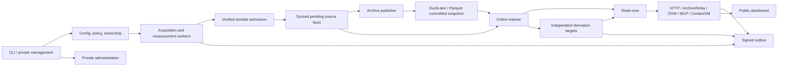

# Component boundaries and implementation vocabulary

Status: selected specification, not shipped APIs. Names here connect the
[phase tasks](../implementation/README.md); generated Rust/schema definitions
must agree. Change a shared contract here and update its producer, consumers,
fixtures and public documentation together. A task cannot invent a second
meaning for an existing receipt, event, policy or completion state.

The [readiness register](../planning/specification-readiness.md) tracks paper
closure. [Identity and encoding](identity-and-encoding.md) selects persistent
fingerprint bytes, cross-scope effects and the separate certification operation;
generated interfaces must mechanically preserve those field/presence rules.

## Dependency map



Arrows are data/control dependencies, not synchronous request chains. Outages
have bounded queues, explicit stale/unavailable results and owned recovery.
The read core does not need the Synchronizer running to serve already committed
data. An outbox destination outage does not block archive admission. An archive
outage eventually fills its bounded pending allowance and stops new admission.

## Shared model and paths

| Proposed file | Definitions / ownership |
|---|---|
| `crates/bigbrotr-model/src/identity.rs` | DatasetId, ShardId, OwnerEpoch, Sequence, SourceRecordId, ProjectionRowId, EndpointId, Receipt, ExistingProof, SourceCut, GenerationId |
| `crates/bigbrotr-model/src/event.rs` | SignedEvent, VerifiedEvent, EventPayloadV1, EventEligibilityV1, EventId, Signature, Tags, scoped first-receive metadata |
| `crates/bigbrotr-model/src/evidence.rs` | Measurement/claim/document kinds, observer/clock/access dimensions, scientific outcomes |
| `crates/bigbrotr-model/src/coverage.rs` | Interval bound, filter/access/visibility scope, EventEffectBasis, traversal evidence, gap and terminal reason |
| `crates/bigbrotr-model/src/policy.rs` | VisibilityScope, Principal, Grants, PolicyEpoch; no embedded secrets/engine handles |
| `crates/bigbrotr-model/src/analytics.rs` | DefinitionId, TargetManifest, typed fact values and score basis |
| `crates/bigbrotr-model/src/read.rs` | QueryRequest, admitted context identity, QueryPage, resource/exactness states |
| `crates/bigbrotr-model/src/publication.rs` | SignedIntent, coordinate, destination obligation and outcomes |
| `apps/bigbrotr/src/runtime/` | Cancellation, BudgetGrant, lease authority, actual async ownership; private application modules |
| `apps/bigbrotr/src/interfaces/rpc/` | Versioned internal transport adapters, authenticated peer identity and limits |
| `apps/bigbrotr/src/read/gateways/` | Optional finite MCP/ContextVM application adapters; shared registry/admission, no public generic RPC |

Immutable verified constructors stay private to the audited verification
boundary. Serialized input cannot claim to be a VerifiedEvent. Pure model crates
have no Tokio/PG/CH dependencies; cancellation and secret references belong to
application orchestration. Introduce a library only when its task has a real
consumer and useful public contract.

The [naming contract](naming.md) fixes wire/model identity spelling, qualified
ordinals, typed measurement/score subjects and role terminology. Include
`ReadViewStamp` in the shared read model from
[the time/search contract](read-view-contract.md). Public Rust helper names remain
subject to implementation review; inventing every private function now would
create false precision without a stable consumer.

## Typed boundaries

Signatures below describe ownership and results; they are specification notation,
not source code to copy without lifetime/error design.

| Contract | Input → output | Authority and failure |
|---|---|---|
| Verify | BoundedWireEvent + VerificationPolicy → VerifiedEvent or Invalid/Excluded | Recompute canonical ID; verify actual signature; record exact reason without archiving hostile body |
| Admit | ProducerRequestId + event intent (verified body, scope, origin/lineage, optional LocalObservation) + BudgetGrant → AdmissionResult | Owner independently validates remote input/current policy; atomic synced payload/eligibility/receive/provenance/dictionaries/receipt; exact bound-intent conflict |
| CertifyExisting | Event intent + current authority + bounded dependency lookup → ExistingProof / NeedsAdmission / Invalid / Excluded / Retryable / IncompatibleSchema | Full validation and consistent committed inventory read; no ProducerRequestId, writes or new fact; operational dependency proof with causal backup closure |
| AdmitEvidence | ProducerRequestId + typed Measurement/Document/Claim batch + BudgetGrant → AdmissionResult | Same receipt/retired/conflict/refusal semantics as Admit; required dictionaries and tagged subject references validated; event validity alone cannot authenticate an evidence claim |
| ReadPending | Owner stream + after Receipt + byte/item bound → SourceBatch | Complete committed sequences only; immutable record IDs and content digest |
| PublishArchive | Deterministic ArchiveBatch + ownership → ArchiveCommit | Data/dictionaries/references/receipt commit once under fenced single publisher |
| Project | SourceBatch + TableGeneration + deterministic chunk identity → ProjectionAck | Ack records actual durability class/incarnation, never merely accepted into RAM |
| ActivateFrontier | Required family acknowledgements + expected previous frontier → SourceCut | Fenced PG compare-and-swap; missing required family cannot count as complete |
| ReadSource | Authorized scope + compatible SourceCut + bounded selector → SourceRows | Same cut/visibility across IDs, tags, bodies and correction reduction |
| Derive | TargetDefinition + immutable inputs/config + resource grant → TargetManifest | Complete/empty/suppressed/failed independently per target; activate only verified output |
| Query | QueryRequest + authenticated caller → QueryPage or typed refusal | Resolve policy/resource/query mode before plan; one budget for HTTP/WS/DVM/MCP/ContextVM |
| Sign | ValidatedPurpose + canonical unsigned event + authorized key reference → SignedEvent | Kind/subject/key/body validated; no public generic signing endpoint |
| Enqueue | Immutable signed bytes + lineage + destination set → OutboxReceipt | Durable bytes before send; per-destination outcomes and exact retry |
| Manage | Actor + typed command + expected configuration revision → durable Job/Revision | Desired/applied state separate; action-level grants, no arbitrary SQL/shell |

The [gateway contract](gateway-contracts.md) owns optional MCP/ContextVM wire
versions, finite tool mappings and smaller transport limits. Both resolve into
the ordinary authenticated principal and admitted context; supplied `_meta`,
remote tool names or Nostr key possession cannot manufacture grants. Adapter
subquotas divide the same deployment reservation. Shared temporal/authorization
checks apply before encoding/signing/output, including traversal's per-page
eligibility. Native MCP and ContextVM free-call restart/cancellation semantics do
not inherit DVM durable job/outbox/payment promises. Internal gRPC remains private.

`AdmissionResult` is one of `NewFacts(Receipt)`,
`AlreadyDurable(existing Receipt)`, `Excluded(reason)`,
`Invalid(reason)`, `RequestConflict`, `IncompatibleSchema`, `Retryable(reason)`,
`RetiredRequest`. An existing event with a new permitted visibility scope or
provenance edge is NewFacts, not a new event body. A later repeated edge in an
existing scope is AlreadyDurable. Scoped first/earlier local observation can
create facts with provenance off. Retryable never authorizes progress. Durable outcomes expose
which body/evidence effects they cover, rather than returning a generic boolean.
RetiredRequest reports that detailed receipt resolution is no longer available
under a durably closed request range; it never authorizes new progress/effects.

ProducerRequestId binds a registered logical producer slot/epoch and monotonic
local request identity; the process incarnation holds that epoch's authority.
While receipt detail exists, retries with another payload are rejected by digest;
after GC the retired range is refused without reconstructing that digest.
Contiguous producer acknowledgement and fenced epoch retirement govern receipt
reclamation, with `RetiredRequest`
returned for already retired requests rather than executing them anew. See the
[complete retirement contract](../architecture/storage-services.md#producer-acknowledgement-and-receipt-reclamation).
SourceRecordId is permanent archive identity; producer retry detail is operational
state. Its display TTL alone cannot define its correctness horizon.

CertifyExisting has a separate effect/proof contract and never creates a mutation
receipt to certify another receipt. A new scope, import→network receive, earlier
correction or new witness returns NeedsAdmission. A valid alternate signature
in an already eligible scope may be certified after verification; a changed
signature under the same retained **Admit** request still conflicts. Proofs are
private operational artifacts and require retained source/dictionary dependencies
under the actual recovery protection class. They are not public scientific facts.

For acquisition, `EventEffectBasis = Receipt | ExistingProof` names the retained
basis of a verified event result; it does not change `AdmissionResult` or create
a new receipt kind. Ordered page/import checkpoints accept either basis and
atomically retain its deduplicated dependency closure with classified input
positions, gaps and progress. A certified duplicate requires no mutation request,
request-sequence allocation or ingest ACK. `NeedsAdmission` enters strict Admit
with a fresh persisted request identity; separate claims/measurements still need
their own AdmitEvidence receipts. Mixed pages retain both kinds of basis and ACK
only contiguous mutation requests. A lost certification response is re-evaluated;
an unresolved mutation must first be resolved by its original request identity.
Checkpoint authority, restore validation and complete-source-cut compaction follow
[the certification contract](identity-and-encoding.md#certifyexisting-without-mutation-semantics).
Proof collection is byte/item bounded and may checkpoint classified prefixes
without declaring EOSE or interval completion; it cannot grow one permanent
ledger entry per repeated delivery or require a mutation to make read proof usable.
Ordinary status/coverage responses expose authorized basis status, not private
proof tokens or hidden source dependencies; internal checkpoint closure is never
copied wholesale into public scientific evidence or export metadata.

AdmitEvidence enforces enabled data families as well as visibility. In particular,
provenance off excludes imported event→relay sidecars and intentional per-event
availability measurements; an alternate ingestion route cannot create hidden
provenance state. Full signed originals and non-provenance observations retain
their separate meanings.

## Internal transport and topology

[Deployment composition](deployment-contract.md) owns installation recipes,
fixed relay selection, conditional dependencies, remote credentials and trusted
infrastructure routes. Selecting a role never silently starts another worker or
provisions a database. [Archive placement](archive-storage-contract.md) keeps
local files as the simple default and S3 conditional on the chosen topology.

The selected remote interface uses protobuf over HTTP/2 gRPC with authenticated
peer identities and mTLS in split-role deployments. Same-process callers use
the same application contract without serialize/deserialize copies. Protobuf
records use fixed byte fields with explicit length validation, uint64 protocol
times, repeated ordered tag strings and a schema version; no Rust memory layout
or lossy JSON-number conversion crosses the boundary.

Initial services are Ingest (Admit/AdmitEvidence/CertifyExisting/receipt resolution), Archive
(commit/status), Index (derived-state commit and pinned ordered-set access),
Read (query/page/capabilities), and Control (config/jobs/leases).
Public HTTP/Nostr interfaces are different adapters with their own authentication.
Frame/message/stream byte limits, deadlines, cancellation and per-peer quotas
apply before decode/allocation. Application limits still apply after decompression.
No unauthenticated private RPC port is published by Compose.

Index is a transport surface of the existing Indexer owner, not another mandatory
process role. `CommitDerivedDelta` takes target ownership, expected checkpoint,
bounded typed state delta and deterministic output identity; its synchronized
checkpoint receipt resolves ambiguous retries. `ReadIndex` takes a validated
target/ordered-set pin plus bounded typed lookup/range request. The storage owner
checks current admitted action/resource/policy/ReadViewStamp authority for reads,
or explicit target-owner authority for derivation; mTLS peer identity and
possession of another scope's pin are insufficient. Neither accepts
arbitrary key writes, engine queries or a client-claimed lease. The
[derived key-space contract](storage-catalog.md#rocksdb-key-spaces) separates
working state, CH materialization and fenced PG activation. Dirty-only work is
possible without new ingestion; stopping source projection need not stop the
storage/RPC owner. Stopping that owner exposes unavailable dependencies or pinned
read-only alternatives, not parallel writable mounts. P01-T07 establishes codecs;
P05-T01/P06-T08 complete actual adapter/fault tests.

Use the maintained [tonic HTTP/2 transport](https://docs.rs/tonic/0.14.6/tonic/)
behind this application contract. Configure both encoding and decoding limits;
the library's finite decode default is not a bound on outbound messages or on
aggregate simultaneous streams. Pin the actual tested dependency set in P01-T01.

Topology configuration maps stable event ownership to ingest shards; provenance
routes with the event. Measurement/document streams use stable subject ownership
and source identity, not an arbitrary currently available worker. Initial one-host
operation has one writer per embedded store. Shared files are not mounted writable
into independent owners. Split-role operation can route to that owner; it does
not imply automatic failover or replicated durability.

Request timeout after possible durable acceptance is ambiguous. Resolve/retry the
same request identity; do not allocate a new source identity merely because an
HTTP response was lost. New topology generation requires controlled handoff,
positive old-owner exclusion and preservation of dictionaries/receipts.

## State machines and temporal boundaries

* Admission: validate → reserve → atomic synced commit → durable response.
  Cancellation before commit has no receipt; after commit recovery can resolve it.
* Archive batch: prepared → committed or ambiguous → receipt resolution →
  qualified protection checks → pending-reclaim eligible. File checksum capture
  is separate from persistence qualification; cleanup cannot race a published reference.
* Index generation: building → verified → active → retained → reclaimable.
  Unclean serving loss invalidates its incarnation before any stale PG receipt
  can restore readiness.
* Derived target: planned → running → complete/empty/suppressed/failed.
  A generation uses exact input manifests, not “latest” resolved independently
  inside each SQL statement.
* Outbox: prepared bytes → queued → attempted → accepted/refused/unknown per
  destination. Unknown is retryable exact bytes; acceptance is not remote retention.
* Managed change: validated desired revision → applying → applied/partial/failed.
  Security restrictions activate under authority leases, not eventual UI refresh.

Process health uses starting/ready/idle/degraded/draining/stopped. Finite jobs use
succeeded/partial/failed/cancelled/skipped. A zero-row valid result is different
from unsupported, expired, missing, budget-refused or not-executed work.

## Schema, migration and generated documentation ownership

PostgreSQL migration names start with `0001_control.sql`,
`0002_ingest.sql`, `0003_relay.sql`, `0004_acquisition.sql`,
`0005_import.sql`, `0006_relay_lifecycle.sql`; later tasks reserve distinct phase-prefixed migrations through
the central manifest. DuckLake schema versions live in `contracts/archive/v1/`
and their migration runner; ClickHouse begins with
`migrations/clickhouse/0001_events.sql` and `0002_evidence.sql`.
Role ownership and applied versions are explicit; do not auto-run destructive
migrations from every service startup.

The central migration manifest reserves the following namespaces; numeric gaps
are intentional task ownership, not permission to invent missing migrations:

| Engine | Reserved identifiers and owner |
|---|---|
| PG | 0001 control, 0002 ingest, 0003 minimal relay (P02); 0004 acquisition, 0005 import (P03); 0006 relay lifecycle (P04) |
| PG | 0501 analytics control and common artifact/file inventory with its first graph consumer; 0603 read pins; 0609 DVM jobs, 0610 subscriptions, 0611 payments |
| PG | 0703 publication outbox, 0704 delivery, 0705 NIP-85 progress, 0707 NIP-66 progress |
| PG | 0801 management identity, 0802 commands/revisions/jobs, 0803 saved views |
| PG | 0804 additive artifact publication/catalog fields over 0501 inventory (P08-T04); publication authority is separate from Nostr signing |
| CH | 0001 events, 0002 evidence; 0502 current state through 0512 relay quality as named by P05; 0606 search projection |

Tasks extend the named owner file rather than creating another migration with
the same number. Archive format migrations are separately versioned by their
manifest. Once a migration ships, later changes use a new version and compatibility
transition; editing its past checksum is not an upgrade strategy.

The shared job identity/state foundation belongs to 0001/P02-T01; 0802 adds
management operations. Common snapshot leases/retention claims belong to
0002/P02-T07; 0603 adds cursor-specific pins. The
[storage catalog](storage-catalog.md) distinguishes those initial owners from
later additive consumers, avoiding phase cycles and duplicate mutable authorities.

Config schema, OpenAPI, protobuf and archive manifests each have one generated/
validated source pipeline. Generated reference includes defaults, units, ranges,
secret status, applicability and reload semantics. A checkbox cannot mark a
feature complete while its CLI/help/UI/capabilities advertise another meaning.

## Common practical acceptance runner

P01-T08 creates `tests/acceptance/run.py` and
`contracts/acceptance/result.schema.json`. Phase cases live in
`tests/acceptance/cases/`; fixtures in `tests/fixtures/`.
The proposed invocation is:

```sh
python3 tests/acceptance/run.py p02-t04 --binary dist/bigbrotr --compose packaging/compose/acceptance.yaml --evidence .research/implementation/p02-t04
```

This command is a planned interface; none of those product artifacts exist yet.
The runner consumes an explicit built release binary/bundle and isolated real
engines/controlled relay clients. It validates fixture preconditions, starts the
actual documented entrypoint, observes independent external results, injects the
case's fault, recovers, and writes versions, inputs, expected/actual membership,
resource measurements and bounded diagnostic evidence. Workload setup happens
outside timed regions; correctness is checked before performance is compared.

Result states are PASS, FAIL, NOT_RUN and SKIPPED with declared requiredness.
Missing required scenarios/tools cannot yield PASS. Tests intentionally run a
named wrong interpretation against a fixture to prove the oracle distinguishes
it; this is an explicit negative control, not source-code mutation in production.
Each case lists its preconditions/oracle, so it cannot succeed by reading an
empty database or invoking an unconnected helper. Cleanup uses recorded process/
container identities and touches only the isolated run.

Exact shell commands do not establish realistic coverage alone. Every phase task
also states the user journey, actual dependency, failure trigger and evidence
that the scenario must inspect. Shared runner implementation is not permission
to replace actual clients/engine reads with prearranged mock answers.

The acceptance result additionally records the actual release-bundle manifest path
and digest, alongside binary and per-platform/static asset digests. Early vertical
slices name their limited capability set; only the whole-release cases may claim
complete product installation. An assembly helper is not an install result.
