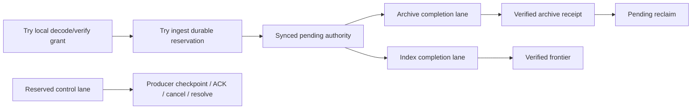

# Operational composition, recovery and configuration authority

Status: selected paper contract for S03/S04/S05/S08, 2026-09-17. No product
runtime, capacity, power-loss or engine crash qualification is claimed here.
This closes the composition choices in P00-T07/P00-T08; implementation and release
evidence remain with the tasks listed below. Detailed record fields remain in the
[component](component-contracts.md), [storage catalog](storage-catalog.md),
[storage service](../architecture/storage-services.md),
[read-view](read-view-contract.md) and
[publication](../architecture/derived-read-publication.md#signing-and-publication-delivery-boundary)
contracts. This document owns cross-boundary ordering and deployment composition,
not a second copy of those schemas.
The [deployment contract](deployment-contract.md) owns installation recipes,
fixed-relay worker selection, concrete remote PG/CH credentials and per-host
native/Compose networking. It does not replace the authority/recovery rules here.

## Decisions and alternatives

1. Use one acquisition/socket owner per host and route budget domain. Validator,
   Monitor, Synchronizer, directory fetch and publication delivery are independently
   scheduled modules; a signing process submits exact authorized bytes to that
   owner. Full local mode has no additional mandatory network proxy. A distinct
   route domain is permitted only for an independently budgeted transport, such as
   an explicitly configured overlay; naming a new domain cannot multiply a
   public-IP quota. Existing cross-process Control permits remain an optional
   isolation recipe with reconciliation/positive exclusion, not the default.
2. Allocate coarse process memory/CPU/I/O envelopes at startup or heavy-job
   admission. Owners use local item/byte credits. Redistribute optional worker
   capacity only at job boundaries. A distributed byte semaphore on every delivery
   is rejected as unnecessary coordination; engine limits/cgroups are containment,
   not proof of successful admission or an exact reservation.
3. Use one instance-wide configuration authority mode for ordinary policy:
   `managed` or `declarative`. Managed is the full-local initialization default.
   Deployment roots and emergency runtime locks have separate named functions.
   The previous normal stack of file + managed override + arbitrary env/CLI
   policy overrides is replaced by the transitions below. Per-field authority
   modes are rejected because they recreate the precedence problem.
4. Keep each durable boundary separately resolvable. There is no distributed
   transaction across RocksDB, PG, DuckLake, CH or a remote relay. Timeout is an
   observation about a caller, never an authoritative negative commit result.

These choices select the socket/process and configuration recommendations in
[runtime alternatives](../reviews/13-runtime-alternatives.md#1-let-the-socket-owner-enforce-network-limits-use-coarse-host-reservations)
and [product alternatives](../reviews/13-product-alternatives.md#5-give-each-configurable-field-one-durable-authority).
The selected [CertifyExisting read path](identity-and-encoding.md#certifyexisting-without-mutation-semantics)
has its own dependency-proof semantics; nothing here weakens Admit's durable
request semantics.

## Cross-store effect and recovery table

An **authoritative absence** is a completed lookup against the correct healthy
store, namespace, generation and fenced owner after earlier writes are resolved.
A stale replica, failed connection, missing mount, read timeout or unavailable
credential is `outcome-unknown`. Neither allows another identity, reclamation or
progress. `not-committed` requires authoritative absence plus exclusion of a late
commit from the original attempt. The operation's accepted identity remains fixed
through timeout, cancellation and recovery. A retry conflict never means retry
with a fresh identity automatically.

| Boundary and accepted identity | Authority / atomic write set / durable response | External effect, timeout and recovery owner | Reclaim condition |
|---|---|---|---|
| Existing-effect certification: exact verified intent + scope/observation + current authority, no ProducerRequestId | One consistent committed inventory read proves exact retained body/eligibility/receive/witness dependencies and protection. No request/source sequence, WAL outcome or certification ledger is written. Missing required effect returns NeedsAdmission. | Lost response is retried/re-evaluated under current policy, not a durable replay of a prior decision. Producer may checkpoint only the verified delivered observation plus dependency proof. Inaccessible basis means unknown, never certified. | Producer checkpoint/backup preserves required dependency closure, policy/topology/recovery generation and protection. The absence of request-detail GC does not permit losing its retained basis. |
| Admission: producer slot/epoch/sequence + bound digest | Exclusive ingest owner checks producer/owner epoch and closing barrier immediately before synced Rocks batch. Batch binds selected body/eligibility/evidence effects, dictionary allocations, source identities, pending records, request digest/outcome; no-effect Admit outcomes retain required retry detail. Respond only after sync. | No network progress follows an unresolved response. Producer resolves the same request against ingest; stored outcome wins. Store unavailable means unknown. Verified-but-uncommitted work after closure is refused. | Pending payload follows archive protection, independently of request-detail GC. Permanent scientific identities are not receipt cache entries. |
| Producer handoff: contiguous local outcomes and progress | Producer's durable ledger transaction binds classified input positions, Receipt/ExistingProof dependency closure, traversal position/gaps and its checkpoint. This need not claim EOSE/page completion. Its local durability precedes ACK(n) for contiguous mutation requests only; a proof-only prefix has no request sequence or ACK. | Lost checkpoint response: producer reads its own ledger. Lost ACK: resend same watermark. Lost certification response: re-evaluate the read under current authority. Producer never infers a receipt from `RetiredRequest` or uses certification to bypass unresolved Admit resolution. | Keep deduplicated ledger closure needed by outstanding outcomes, coverage recovery and any backup that includes corresponding owner GC; compact proofs only through a retained complete source-cut manifest. |
| Owner ACK and receipt GC: producer epoch + contiguous n | Ingest synchronizes watermark n after producer attests durable checkpoint. GC is in that batch or later batches guarded by persisted n. No ACK over a hole. Closed-epoch summary remains. | ACK reply loss resolves by owner watermark; duplicate monotone ACK is harmless. Owner cannot use a PG-observed ACK row as proof of its own Rocks watermark. | Detail at <= n may be removed under retention policy; all later retries return `RetiredRequest`, even with a changed payload. Backup must include the producer checkpoint authorizing n. |
| Producer close: slot/epoch + close operation | Ingest's durable closing barrier serializes with admission commit. Stop/fence producer; resolve accepted work; persist explicit abandoned workflow gaps; then complete retirement. | A previously verified RPC may resume after the barrier but cannot commit. Epoch renewal/replacement does not bypass unresolved old work. Recovery owner is ingest plus the registered producer ledger owner. | Retain current/closed epoch bounds per stable slot; deleting/reusing a slot requires registry-generation fencing. Scientific facts survive abandonment. |
| Archive prepare: batch identity + semantic digest + source cut | Fenced archive publisher records bounded preparation intent and typed batches; native DuckLake writes immutable files through its transactional path. Generated-file SHA state is explicitly `not_captured` or a digest with method/time under the [archive storage contract](archive-storage-contract.md); no assumed precommit hash or mandatory second read. Prepared input/files are not an archive receipt. | Worker/process loss may leave partial/orphan files. Publisher resolves deterministic batch identity and the native transaction; no source cursor advances from preparation or object listing. Timed-out upload does not establish catalog commit. | Only job-owned unreferenced staging can be removed after active worker/transaction exclusion, age and reference checks. Backup completion separately requires its verified full-file hash manifest. |
| Archive catalog commit: same batch identity/digest | One DuckLake transaction commits every required family/dictionary/reference and batch receipt at a catalog snapshot. Files must satisfy the declared storage protection procedure. Publisher cursor/cache may follow the receipt; it is not commit authority. | Commit reply lost: publisher resolves receipt in a new healthy catalog transaction and verifies digest/cut/reference closure. Receipt present means committed. No receipt plus confirmed termination/rollback of the old transaction means not committed; unresolved transaction/catalog means unknown and no second publication. | Ingest reclaims pending only after resolved receipt, verified file membership and protection at least as strong as the original receipt class, plus replay/backup pins. Index lag alone does not require keeping pending if exact archive replay is available. |
| CH chunk: projection generation/incarnation + source records + deterministic family/partition/chunk digest | Index owner persists plan; CH uses selected synchronous/fsync settings. Every required family has deterministic completion, including zero rows. Receipt records actual table identity and serving incarnation. | Insert reply loss: replay identical chunk or verify distinct identities/payload digest under current incarnation. Logical reads remove physical retry copies independent of dedup-token TTL. Partial chunks remain unpublished. | Retain deterministic input/chunk evidence until frontier publication and recovery obligations; physical cleanup cannot delete pinned older generations. |
| Source frontier: expected old vector + verified required-family set | Fenced PG compare-and-set publishes a compatible contiguous SourceCut only after all required CH chunks are verified. | PG reply loss: resolve frontier by generation/incarnation/cut. CH loss or replacement invalidates incarnation first; a surviving PG receipt alone cannot restore readiness. Index recovery revalidates or replays then publishes. | Published chunk control can compact only with sufficient reconstruction metadata; source/archive truth and live pins govern data reclamation. |
| Derived delta: target/scope/working generation + expected checkpoint + output identity | Index storage owner synchronizes typed state changes, dirty/rebuild markers, checkpoint and deterministic pending output in one Rocks batch under target epoch. Algorithms cannot write its directory directly. | RPC response loss resolves exact checkpoint/output receipt, not current aggregate value. Empty output has an explicit identity. Dirty-only or expiry work increments the target checkpoint even with unchanged SourceCut. | Pending output/state or deterministic replay inputs survive until verified CH materialization and PG activation; retained old snapshots remain protected. |
| Derived materialization and activation: exact target/input/config/view generation | CH output verification precedes fenced PG compare-and-set of complete/empty/suppressed target manifest and active pointer. Multi-target activation is required only for a declared common manifest, not all algorithms. | Loss after Rocks, CH or PG commit resolves at that boundary. Old complete generation remains active; newer checkpoint alone is never public completion. Recovery belongs to Index storage owner + target scheduler. | Retire old generation only after all query/job/export pins and required replay/backup obligations release. Disabled algorithm does not revoke storage owner or erase retained data. |
| Job acceptance: principal + operation idempotency key + request digest | PG transaction accepts command receipt, job identity, immutable input/config/policy references and retention pins together. Dispatch occurs after commit. | Reply loss resolves the same authorized command; closing HTTP/browser context does not cancel a committed job. Pause/cancel is a separate durable command. Worker transitions compare epoch and checkpoint. | Terminal display row may expire only after transferring durable artifact/pin/outbox/recovery obligations to their owning ledgers. A generic job TTL cannot erase them. |
| Job pause/cancel: job + expected revision | PG records desired control action; worker checkpoints a safe boundary and reports paused/cancelled only when write/send cessation is known. Native work retains resource grant until joined or positively killed. | Crash or timeout leaves cancelling/unknown work, not completed cancellation. Accepted scientific facts remain. Policy expiry may stop output before an ordinary cancel boundary. | Release pins after workers cannot still use inputs and required output bytes/recovery state are durable, or after explicit abandonment with scope/gaps. |
| Signed outbox: immutable desired revision + signing purpose/coordinate + destination set | PG stores desired artifact/lineage, then verified exact signed bytes and per-destination obligations before send. Signing itself is not a publication receipt. Enumeration progress and page intents commit together. | Signer response loss before bytes persist may require another signature; nothing has been sent. After durable bytes, only those bytes may be sent/retried. Coordinate timestamp and identity history survive restart. | Signed bytes remain through each destination's unresolved/parked obligation and recovery horizon. Success policy at one target does not delete another target's failure. |
| Destination attempt: signed ID + destination + connection epoch | Delivery owner serializes/coalesces attempts, checks current policy/temporal/job authority immediately before dispatch, stores attempts/outcomes in PG. Relay acceptance is external and not atomic with PG. | Lost send/OK/local commit response is unknown. Resolve local receipt first; otherwise retry exact bytes only while authorized. Read-back is separate attributed evidence. Expired/revoked work parks/cancels undispatched retries, preserving prior unknown effects. No exactly-once or remote retention promise. | Terminal per-target evidence and signed bytes follow audited retention/backup obligations; ordinary job expiry never asserts delivery. |

At every row, recovering a store in a different order changes availability, not
authority. In particular: PG first does not certify CH or an unavailable Rocks
checkpoint; files first do not certify a catalog transaction; network recovery
does not authorize a stale signer; producer first does not bypass owner retirement.
The detailed [retirement protocol](../architecture/storage-services.md#producer-acknowledgement-and-receipt-reclamation)
and [outbox rules](../architecture/derived-read-publication.md#signing-and-publication-delivery-boundary)
remain normative.

## Process placement and capabilities

The default full local process graph is explicit. All application processes use
one release image/binary; names below identify process responsibility, not crates.

| Process/domain | Owned writable state and credentials | Local/remote dependency and execution |
|---|---|---|
| `control` | PG control credentials, configuration/jobs/policy authority, private admin listener | No event body store; bounded typed Control RPC. PG is separately operated. Local setup/diagnostics can run without starting this service. |
| `acquisition` | One socket driver/budget owner, producer ledger, registered producer epoch; guarded egress credentials | Independent discover/validate/monitor/sync queues and delivery transport. Full local co-locates ingest ownership here so verified event transfer is by ownership, not RPC copies. Control supplies policy/leases; PG producer checkpoint ledger supplies durable handoff. |
| `ingest` responsibility | Exclusive admission Rocks directory and ingest authority | Embedded in acquisition by default; independently placed only through versioned Ingest RPC. The two placements are mutually exclusive for a directory. Import/monitor producers use the same owner. |
| `storage` | Exclusive Index Rocks directory, raw CH writer, fenced archive publication coordinator and narrow catalog credentials | Index storage remains live with source projector/Deriver/Ranker paused. Archive prepare/export/graph compute execute in terminable worker processes. Archive and indexing have independent cursors, grants and readiness. |
| `read` | Read-only CH/archive access, policy/pin Control access, cursor crypto references | Private/local HTTP/dashboard by default; explicitly enabled public HTTP/ArchiveRelay/DVM have distinct listeners/grants. No migration or signing credentials. |
| `signing` when enabled | Purpose-limited key reference, desired/outbox writer authority | Produces durable signed intents; acquisition owns transport. Remote signer route uses the guarded network owner or an explicit separate budgeted signer route. Disabled in initial full local recipe. |
| `job worker` on demand | One job's input pins, limited temporary root, narrow engine credentials | DuckDB archive preparation/export, graph/rank or maintenance. Termination can isolate noncooperative native code. Grants remain until exit is proven. No permanent container per finite job. |
| PG / CH | Separate volumes, roles, limits and engine processes | Control schema, DuckLake catalog and migration credentials remain separated. CH absent in archive-only. No other process opens either Rocks directory writable. |

Compact mode may co-locate control, acquisition/ingest, storage coordination and
read with in-process calls, but retains ownership/grants and native worker isolation. Native abort/OOM
then affects all co-located roles and must be documented. Default socket budgets
are host-local, not fleet-global. Separate producers on one host that bypass the
socket owner must use the existing Control permit recovery contract; independent
per-process counters are not an equivalent recipe.

| Recipe | Required live owners/stores | Capabilities and stopped-dependency result |
|---|---|---|
| Full online | Control/PG, acquisition+ingest, archive worker/catalog/files, Index storage+CH, read; selected compute | All configured online families. Missing CH leaves bounded ingest/archive possible and online reads unavailable; stopped projector leaves old verified frontiers stale. Missing archive fills pending then halts intake. |
| Full without provenance | Full online graph, edge families absent | Bodies, scope eligibility, event receive facts, registry/monitoring and permitted non-edge analytics remain. Provenance/overlap resources say unsupported/disabled, never zero. No hidden edge inventory/replay jobs. |
| Social-filtered | Full online or declared archive-only base plus explicit filter revision | Scope/dependency manifest names retained kinds and historical intervals. A graph target missing required kinds is partial/unavailable according to its definition; recipe name never asserts complete coverage. |
| Archive-only | Control/PG, ingest, catalog/files and archive worker; optional acquisition | Private administration, import/export/offline jobs. No Index Rocks/CH/search/online graph/read/relay/DVM query capability. CH-backed listeners enabled here fail validation. |
| Fixed-list sync-only | Control/PG, ingest, archive/catalog/files and guarded transport; local or declared remote owners | No Discoverer/Validator/Monitor. Explicit enrollment permits unverified sync work; fixed list excludes unrelated registry entries. Linear/live has no CH dependency; auto uses qualified reconciliation when available or reports linear fallback. |
| Monitor-only | Control/PG, ingest, archive/catalog/files and guarded transport; local or declared remote owners | Independent passive measurements without Synchronizer/Discoverer/Validator. Private status/export without CH; public online monitor views need explicitly selected Indexer/CH/read. |
| Serving existing data | Control/PG, read+CH, verified serving incarnation; retained archive route for promised replay/rebuild | No active acquisition/ingest required. Index storage required for NEG sets/temporal current-state maintenance/derived writes when enabled. Readiness for ordinary immutable pinned reads can survive its outage; resources needing current maintenance stop at their declared temporal deadline. |
| Split roles | Control/PG and one fixed ingest owner host, one fixed Index storage host, archive coordinator host; CH and read/job hosts | Authenticated Ingest/Index/Archive/Read/Control routes and fixed placement. Local archive when all its jobs share one host, or object access for distributed archive consumers. No shared writable Rocks mount. Each host has independent aggregate quotas; dataset topology remains one shard initially. |

Split deployment uses object storage when publisher and replay/export readers
run across hosts; local source/temporary paths belong only to their owning host.
Local Parquet remains supported when all archive users/jobs share the same host
and owner-managed access, including a remote-collector or hot-read split. Identical
path strings on two machines are not shared storage. Credential
authority is deployment root plus secret provider, with per-role bucket/prefix and
database grants. mTLS grants a peer identity; actions still require policy/owner
authority. Routes, DNS/IP guards and deadlines are explicit. Moving an owner is a
manual drain, checkpoint/copy/verify, positive-exclusion, topology-CAS and restart
procedure; automatic failover, online resharding, replicated admission and fleet
network quotas are future capabilities, not enabled by this recipe.

Operator-configured PG/CH/object/private RPC endpoints use explicit trusted
infrastructure routes and may have private IPs. They do not inherit the public
relay CIDR exclusion, and they do not grant discovered relay/HTTP inputs access
to those private addresses. Read-only serve-existing needs matching PG authority,
frontiers and pins through Control as well as CH; no collector is required.
Archive credentials are conditional on actual cold/replay/export paths, while
current/NEG resources retain their specific temporal/index maintenance owners.

Capability state includes `disabled`, `building`, `ready`, `stale`, `unavailable`
and `retiring`, plus reason, config revision, generation/input cut and progress.
This is distinct from process health and query-result completeness. Enabled is
desired configuration; ready requires the actual dependency and published cut.

| Transition | Retained truth and work | Capability publication |
|---|---|---|
| Provenance on → off | Close evidence configuration epoch, stop new edges/sidecar admission/availability probes; retain old edges and their origin. No physical erase. | Default provenance capability disabled; explicitly authorized retained historical exports remain available with covered epochs. Edge-dependent algorithms stop. |
| Provenance off → on | Start new epoch. Retained edges may be reindexed; bodies alone cannot recreate missing witnesses. Reacquisition creates new attributable observations at actual receive times. | Building until retained projection/new epoch ready; report missing intervals permanently unless real evidence fills them. No claim of historical backfill from body membership. |
| Search off → on | Rebuild configured scope/analyzer generation from eligible retained bodies at pinned cut and catch up bounded tail. | Building, then ready at verified frontier. Old generation may remain usable only under the exact old scope/analyzer contract. |
| Search on → off / analyzer change | Stop admissions to disabled query capability; drain readers; retain old generation until pins/retention release. Analyzer change builds a distinct generation. | Disabled or building; zero matches is never the disabled response. No in-place relabeling. |
| Derived family off → on | Keep durable working state or explicitly mark it rebuild-required; replay retained input/dependency generations and dirty/expiry work. | Ready only after complete activation at the stated source/time cut. Changed definition/scope requires new generation and its measured rebuild budget. |
| Pause collection/projector/algorithm | Persist safe progress; keep unrelated storage owner and retained outputs. | Reads may remain stale and qualified; freshness/temporal validity can expire independently. Stop Index storage separately and expose dependent unavailable states. |

## Maximum units, reservations and progress

All sizes are bytes, with `KiB=1024` and `MiB=1024^2`. Intake caps are policy
selection, not permission to drop an accepted record downstream. `E` is the byte
length of the complete normalized signed-event JSON UTF-8 envelope selected by
the event serialization contract, including ID/signature and ordered tags. It is
not content length. `W` is capped wire/inflated envelope bytes; parsing reserves
both W and bounded parsed representation before allocating. Optional wire capture
is separately charged. `D` is a retained document's decompressed raw bytes.
`F` is a fully encoded one-record internal fact envelope including source metadata
and referenced dictionary additions required in the same admission unit. Document
objects, their source envelope and required admission metadata must fit F;
configuration or input exceeding that bound is rejected before admission. The
initial scientific object format has no chunk/assembly-manifest path. Geo/download artifacts use
their separate extraction/job allowance, not a measurement's small-object cap.

Selected default example: E=256 KiB, network W=2 MiB, retained NIP-11 D=1 MiB,
single-fact F<=2 MiB, producer grant=32 MiB with at most 64 outstanding requests.
The fact bound limits record expansion/metadata as well as payload. Every enabled
family has a validating worst-case encoder bound; oversized evidence gets a typed
exclusion before admission, not a poison archive row. Import input=16 MiB permits
a large record envelope but cannot bypass E/D/F. Internal unary encode/decode
limits are 8 MiB each, with application batches <=4 MiB encoded and splitting
only between atomic records. Compression caps apply to compressed input and
decompressed output independently; unsupported compression is refused.

Let `Q(n)` be the exact worst-case JSON-string encoding size for at most n UTF-8
bytes: conservative `6n+2`. A raw JSON event embedded as an object costs E plus
wrapper bytes; embedding its serialization as a string costs Q(E). Encoders
measure actual bytes before handing off and never truncate signed fields.
An internal RPC operation must fit its largest atomic F plus fixed protocol
overhead inside both peer limits; batches reserve the encoded bytes plus decoded
objects and native/transport staging. Parquet target file/row-group sizes are
flush targets, not a promise that one large row fits worker memory.

| Stage | Credit and completion rule | Example for maximum default unit |
|---|---|---|
| Receive/decode/verify | Reserve wire/inflated cap and parser arena/item budget before reading a frame; bounded verification pool. One transfer credit may own buffers across local stages. | 2 MiB wire + 2 MiB inflated + 8 MiB parser arena + 2 MiB internal output = 14 MiB; 16 MiB atomic preparation slot. Optional raw capture must share the retained input or add its exact copy charge. |
| Admission/pending | Reserve durable byte growth, WAL/write staging and producer outcome before commit; an accepted unit owns completion credit until synced or authoritatively absent. | F<=2 MiB fits 4 MiB commit group and 32 MiB producer byte window; 64 request count is an additional ceiling, not 64 reserved maxima. |
| Archive | Separate completion lane reads bounded pending units, grants input + native worker ceiling + staged output disk before preparation; emits small file at age deadline. | 512 MiB worker memory example; one 2 MiB unit plus bounded encoder state must qualify in actual native probe. File target 256 MiB does not require a 256 MiB application buffer. |
| CH/index | Reserve chunk staging within memory plus engine query ceiling; bounded deterministic output chunks; source unit fan-out is pre-counted/byte checked. | 16 MiB source batch and 256 MiB operation query cap are inside process grant; tag expansion is split by subrow identity while publication waits for all chunks. |
| Export/offline | Job admission reserves declared memory/spill/artifact budget; stream canonical JSONL/Parquet chunks and final manifest only after durable completion. | 256 MiB memory/16 GiB spill default proposal; Q(D)<=6 MiB+2 if a 1 MiB document is returned as JSON text. Native archives preserve original files under pins. |
| HTTP data response | Bound request separately from response; largest promised row plus response metadata fits response cap or yields explicit too-large/export route. | 16 MiB response can carry E object or Q(D) with bounded metadata. Pagination never emits an over-cap successful page. |
| ArchiveRelay/NIP-77 | 64 KiB inbound command cap is independent of outbound EVENT. Set projection binds exact outbound message limit and permitted subscription-ID allowance. | 1 MiB outbound message/send reservation admits E plus wrapper/ID. An operator lowering this below E must produce a smaller retrievable set, not advertise excluded IDs over NEG. |
| DVM/signing | Complete signed result including escaping/encryption/profile wrapper must fit published profile limit. Split by profile's page/artifact rules before signing; feedback has its own reserved slot. | A row over that profile's computed limit is refused or delivered through its declared artifact mode. Enabled DVM does not promise every archive row fits one event. |

Parser arenas, element counts, recursion and maximum strings are validated before
allocation. The fixed 16 MiB preparation slot is a conservative configuration
bound to be qualified, not a claim a particular JSON library stays within it.
If an engine cannot process every accepted eligible unit within an advertised
recipe, that recipe is invalid; reduce intake limits before new admissions or
change the qualified worker allowance. Existing accepted units require supported
recovery capacity, never retroactive exclusion. Public routes may be narrower
than archival intake only with explicit capability/refusal and NEG membership.

For process p, let `B_p` be fixed runtime/native caches and socket allowance,
`A_p` local admitted payload and temporary-copy credits, `N_p` native-job grants
and `R_p` completion/control reserve. Enforce
`B_p + A_p + N_p + R_p <= process.memory_max`; accounting includes cgroup resident
page cache/kernel sockets, not just Rust heap/RSS. At the host:
`OS_headroom + sum(process.memory_max) <= usable_RAM`. Borrowing is optional and
cannot borrow R. Native engine configured memory <= its job grant minus explicit
application/FFI/output reserve. CPU/I/O worker concurrency also fits process/host
ceilings; a job cannot claim every service's advertised maximum simultaneously.

Resolved illustrative 16 GiB host: OS/kernel headroom 2 GiB, PG 1.5 GiB, CH 4 GiB,
acquisition+ingest 2 GiB, storage coordinator 1 GiB, read/control 1 GiB, one shared
native-job pool 2 GiB, unassigned margin 2.5 GiB =16 GiB. The pool admits at most
one 1 GiB rank grant plus one 512 MiB archive grant plus 512 MiB native/process
overhead; export waits unless its full grant also fits. Archive completion has a
reserved slot and cannot be displaced by rank. These are arithmetic examples,
not Tux capacity claims. Archive-only can omit 4 GiB CH, 1 GiB Index/read shares
and rank, retaining the same intake/archive/control reserves. No-provenance and
social-filtered recipes inherit full-host ceilings without assuming a fixed
memory reduction from narrower scientific selection. Serving-only can omit
acquisition/ingest, but retains Index/temporal and policy grants if advertised.
The following resolved variants all use a 16 GiB host and retain their stated
completion reserves inside process grants; values are GiB, not measured demand:

| Recipe/host | OS | PG | CH | Acquisition/ingest | Storage coordinator/Index | Read/Control | Native pool | Unassigned | Total |
|---|---:|---:|---:|---:|---:|---:|---:|---:|---:|
| Full; no-provenance; social-filtered | 2 | 1.5 | 4 | 2 | 1 | 1 | 2 | 2.5 | 16 |
| Archive-only | 2 | 1.5 | 0 | 2 | 0.5 | 1 | 2 | 7 | 16 |
| Serving existing data with temporal/NEG maintenance | 2 | 1.5 | 4 | 0 | 1 | 1 | 2 | 4.5 | 16 |
| Split host A: intake/Control/PG | 2 | 1.5 | 0 | 2 | 0 | 0.5 | 0 | 10 | 16 |
| Split host B: storage/CH/archive workers | 2 | 0 | 4 | 0 | 1 | 0 | 2 | 7 | 16 |
| Split host C: read/compute | 2 | 0 | 0 | 0 | 0 | 1 | 2 | 11 | 16 |

The split example is three hosts/48 GiB total; it claims independent placement,
not greater throughput. On host A, the intake grant retains its ACK/control lane;
host B's pool retains archive completion; host C's heavy jobs cannot borrow either.
Split roles apply the same sum separately on each host; remote buffers count at
both sender and receiver until transfer acknowledgement. Filesystem reservations
below apply independently on every host holding writable data, including the
archive-only/serving variants, with a recipe-specific engine debt breakdown.

The wait/ownership graph has one forward path and explicit release edges:

`Try` is bounded/nonblocking admission when another owner is needed: transfer
accepted ownership with receiver credit, or release temporary upstream credits
and retry from retained input. Do not hold one scarce job grant while waiting to
acquire another. A live socket permit can remain while a bounded read pauses;
its fixed/per-connection memory is prebudgeted, and timeout/pressure closes it
with a coverage gap. Durable pending records may wait for archive/CH without
holding producer payload memory or a network worker. CH is not required to free
archive pending. Export pins may retain files but cannot reserve archive completion
worker/disk capacity. Backup/compaction copy jobs acquire the whole extra grant
before beginning and yield at durable chunks. Feedback, cancellations, ACKs,
lease renewals and recovery lookups use bounded control slots inaccessible to
ordinary work. A stalled driver keeps its permit until transport reset/join or
positive process termination; timed-out probes cannot multiply workers.

### Disk reserve and overload

For each filesystem, record separate physical resident bytes `L`, outstanding
durable-growth reservations `A`, and reserved completion/recovery bytes `R`.
Before admitting additional durable growth d require `free - A - d >= R`.
`L` includes existing WAL/SST, catalog/control, partial files and all pinned file
generations. Avoid subtracting already resident reservations twice. R includes
conservative remaining WAL flush/rewrite growth, PG checkpoint/control/receipt
growth, one guaranteed archive preparation/publication lane, required Rocks
compaction scratch, one index replay unit when online, and emergency recovery
metadata. Each engine/domain exposes its bound; if current debt requires more R,
freeze intake until it is provisioned or debt reduced. R cannot be committed to
new payload. Restore/migration and optional compaction/backup each reserve their
full additional copy/spill allowance before starting; failure to obtain it is a
visible refusal, not another claim on the guaranteed completion lane.

Example 1 TiB filesystem: completion reserve R=64 GiB (16 GiB WAL/catalog/control,
32 GiB required compaction/checkpoint scratch, 16 GiB archive/index staging and
repair metadata); outstanding grants A=8 GiB. Intake must stop at free<=72 GiB.
Resume needs free-A>=R+16 GiB for 30 consecutive seconds, so at A=8 GiB the low
pressure threshold is 88 GiB. Pending allowance=128 GiB; stop new payload at
90%=115.2 GiB reserved+resident pending and resume below 75%=96 GiB. The stricter
filesystem or pending condition wins. Active pins count in L and have declared
quota/expiry/cancellation; scientific archive retention is never pressure GC.
These values are an explicit starting recipe to qualify, not a filesystem
guarantee or a useful outage-duration estimate without measured arrival rates.

After a real ENOSPC/fsync error, halt affected durable acknowledgements even if
statistics claim space remains. Complete recovery lookups read-only; remove only
verified reclaimable staging/derived copies, or provision capacity. Retry recovery
metadata under the reserved lane, revalidate store health and show stable low-water
conditions before intake resumes. If archive storage remains unavailable, intake
eventually halts; priority reserves preserve control progress, not unlimited data
progress against a failed dependency. Read/export workloads may be refused before
they endanger accepted-data completion. No accepted evidence is discarded.

## Configuration authority and exact validation

Deployment root is an operator-owned document containing instance/dataset IDs,
authority mode, topology/paths/engine endpoints, listener/security ceilings,
secret-provider references, host/process limits and emergency-lock declarations.
These are restart/explicit-migration fields and management cannot write them.
Root endpoint credentials are references, never plaintext config history. Recipe
values initialize a complete product-policy document; they are not reapplied as
live defaults on every restart. Each release supplies deterministic migrations
for new policy fields, retaining the previous meaning or requiring explicit
operator selection before an incompatible enablement.

| Mode/action | Durable authority and revision rule | Restart/restore result |
|---|---|---|
| Managed bootstrap | On genuinely uninitialized PG instance, validated recipe/file seed becomes revision 1 in one transaction with mode/instance identity. Record input digest and schema. Competing bootstrap loses CAS. | Existing state wins; changed seed is shown as unused initialization input, never applied. Empty/unreachable PG must not be mistaken for a new instance. |
| Managed edit | UI and CLI submit same typed candidate with expected desired revision. Validate roots/capabilities/budgets; PG CAS writes candidate, audit and per-role application plan. | Desired revision persists; roles report actual applied revision. Failed application leaves explicit partial/failed status, not silent rollback. Undo creates another revision. |
| Declarative load/edit | Operator policy document is sole desired authority. Parse/normalize schema, hash contents, then activation command records immutable accepted document/digest and monotone PG revision by CAS. UI previews/exports patches; it cannot create an override. | Missing/unreadable document fails enabled work; changed document becomes an explicit staged candidate. Startup may validate/stage but cannot silently apply exposure/signing or restrictions. Accepted revision remains visibly active until authorized apply. |
| Emergency lock | Only `pause_intake`, `pause_publication`, `disable_public_listeners`, and lower resource ceilings are allowed runtime locks. Name actor/source/reason, expiry and process incarnation. Cannot widen access, create identity, increase cap or silently persist policy. | Nonpersistent, visible in effective state and drift warnings. A process may not continue protected work after lock expiry without re-evaluating durable policy; removal is audited. Env/CLI contain only documented roots and these locks. |
| Managed → declarative | Freeze edits by expected revision; export exact desired policy; preview destination-root/hash, schema, locks and per-role effects; install file; mode-switch transaction records hash/revision and frozen prior authority. | Controlled affected-role restart; root mode must match PG transition. Crash before activation leaves old mode; after activation mismatch stops work until matching root/file is supplied. No value is silently discarded. |
| Declarative → managed | Freeze/document expected accepted digest; import that exact desired document, compare current disk digest, preview and CAS mode/config revision with audit. | Controlled restart; seed file becomes archived input. A changed file invalidates the switch instead of racing an edit. |
| Restore/config rollback | Manifest carries root fingerprint, mode, accepted desired document/revision, applied-role revisions, policy/key epochs and active non-secret migration state. | Explicit root mapping and authority reconciliation required; copied runtime locks do not silently survive. Restore starts isolated with intake/signing/public listeners disabled. |

Normal nonrestrictive budget/config application uses the existing Live/Cycle/Job/
Generation/Restart/Identity classes. Security changes retain the separate
[restrictive activation barrier](../product/private-administration.md#restrictive-change-activation-barrier):
policy revision is not fully applied until all affected work has acknowledged or
lost its <=5 s authority and bounded in-flight drain is excluded. A document edit
alone is not a security activation receipt in either mode.

Schema is the one key/default/range owner. Existing service tables keep their
keys; new composition keys below belong to P01-T04, emitted in generated reference
and effective-config diagnostics. Explicit missing, unknown, duplicate, inert and
nonfinite values fail. Integers use checked arithmetic; `0` is allowed only where
the field explicitly means zero, never as a generic unlimited sentinel.

| Key/group and owner | Starting value / required constraint | Reload and deployment lock |
|---|---|---|
| `config.authority_mode` / `config.schema_version` | `managed` for initialized full local; supported positive version | Root locked; mode transition above |
| `topology.*`, `storage.*_root`, `secrets.*_provider` | Explicit identities/routes/absolute roots; no writable store alias across owners | Root locked; fenced migration/restart |
| `runtime.host_memory_bytes`, `runtime.processes.*.memory_max_bytes` | Explicit host recipe; host/process inequalities above, finite positive; role baseline/reserve fits | Root ceiling locked; lowering drains before new grants |
| `runtime.processes.*.completion_reserve_bytes` | Explicit positive budget; covers largest reserved atomic/control unit; no borrowing | Root floor locked; restart to change ownership accounting |
| `runtime.heavy_job_slots` | 1 initial shared optional heavy slot plus protected archive completion slot; a complete job grant must fit | Cycle; no fractional active job reassignment |
| `runtime.disk_completion_reserve_bytes` | Explicit per filesystem; 64 GiB in worked 1 TiB example, engine-bound composition mandatory | Root floor locked; lowering requires recomputed qualified debt bound |
| `runtime.disk_resume_margin_bytes` / `runtime.pressure_stable_duration` | 16 GiB / 30 s example; margin>0, duration>0 | Live, applies before intake resumes |
| `ingest.pending_high_fraction` / `ingest.pending_low_fraction` | 0.90 / 0.75; `0 < low < high < 1`; used with positive pending_max_bytes | Live; lowering never deletes pending |
| `rpc.max_encode_bytes` / `rpc.max_decode_bytes` / `rpc.batch_max_bytes` | 8 MiB / 8 MiB / 4 MiB; each peer bound >= largest atomic F + framing; batch <= both peer limits minus framing | Restart for negotiated limits; capability epoch for encoding changes |
| `pipeline.max_fact_bytes` / `pipeline.prepare_slot_bytes` | 2 MiB / 16 MiB example; encoder/parser proof bound fits, all required stages support it | Generation/policy epoch; lower cap applies only to new admissions |
| `pipeline.parse_arena_bytes` / `pipeline.parse_max_nodes` / `pipeline.parse_max_depth` | 8 MiB / 65,536 / 32 initial single-input limits; count before allocation, reject before durable acceptance; root object/tag/string nodes all count | Policy epoch; all bounds positive and included in preparation slot |
| `archive_relay.outbound_message_max_bytes` | 1 MiB; complete EVENT+maximum permitted subscription ID fits advertised set predicate and send reservation | Generation; rebuild/invalidate NEG encoding-limit generation |
| Ownership timing and policy leases | Existing 60/20/5/20/30 s TTL/heartbeat/renewal/safety/drain; `heartbeat+renewal < TTL-safety`; authorization TTL <=5 s | Ownership Restart; policy reductions use revocation barrier |
| Existing archive/index/batch/worker settings | group/file/row targets positive; largest unit fits atomic operation; sums of active workers/native grants <= process/host envelope | Existing class; settings cannot override host admission |

Validate the resolved recipe graph, not arbitrary combinations of disabled flags.
Every enabled role has a reachable declared owner and the required engine version,
credential action and source generation. Required signer purpose/key/targets and
private route authorization are nonempty. Provenance-off excludes every edge
admission route. A setting irrelevant to a disabled feature is retained as staged
configuration with applicability shown; an enabled feature with an ineffectual
setting fails. Tightening limits below already accepted work cannot prevent its
drain: retain old completion grants or refuse the change with required capacity.

## Dependency recovery, lifecycle and operator procedure

Health states remain starting/ready/idle/degraded/draining/stopped; jobs and data
capabilities have their own enums. Readiness is evaluated independently per role.
Dependency probes are coalesced and bounded; failed health UI is never writer
exclusion. Initial order: validate static config → inspect versions/roots without
mutation → connect PG/control and obtain policy authority → claim positively
exclusive storage owners → resolve unresolved commits/checkpoints → establish
archive/CH incarnation readiness → enable read/acquisition work → explicitly
configured signing/public listeners. Dependencies may reconnect in any order, but
each transition still proves its own conditions.

PG outage stops new jobs/revisions/ownership and all actions when policy authority
expires; already accepted durable local completion may finish only under its
still-valid owner/policy authority. Reads can use a previously complete CH cut
only until authorization/temporal expiry. CH outage does not stop archive, and
archive outage does not stop valid CH reads. Ingest owner outage pauses producers;
retained CH/archive reads continue. Index Rocks outage pauses dependent derived/
NEG/current-state work while independent complete CH reads remain qualified.
Missing signer credentials parks signed/unsigned obligations separately; missing
archive decryption/object credentials reports inaccessible scope, not absence.

Shutdown first stops new admission and dispatch, then drains producer handoffs,
bounded workers and durable checkpoints; joins writers; closes stores; finally
releases ownership. Reaching the 30 s graceful deadline does not release authority
while a driver can still write. Terminate the process and positively establish
old-owner exclusion before replacement. Cross-host exclusion evidence identifies
the old incarnation and host/storage credential boundary (verified process/host
shutdown, storage detach/revoke enforced at commit, or a future fencing storage
service). TTL, hostname/PID, inaccessible health port or operator assertion alone
is insufficient. Resume an old paused owner during the acceptance drill.

### Backup and restore

Initial receipt class is `local-synced`: process restart after successful WAL sync
on a qualified intact storage path. It promises neither host/disk loss protection
nor power-loss tolerance beyond the actual qualified engine/filesystem/device.
No finite RPO/RTO is promised for unprotected host loss. With verified off-host
backups, recoverable RPO is the last consistent verified manifest cut, including
causally closed producer ledgers; the current wall-clock backup age is displayed.
Initial engineering targets are hourly backup attempts, latest verified backup
age <=2 h and <=4 h restore for the explicitly tested release fixture/envelope.
These are objectives pending measured drills, not achieved SLA or promises for a
billion-row dataset. Capacity/release evidence must report bytes, hardware,
transfer speed, replay and validation duration before quoting an RTO.

Backup sequence, with exact obligations:

1. Accept a durable backup job/pins. Freeze new producer handoffs at a coordinated
   barrier, complete in-flight checkpoint/ACK decisions, and capture the owner
   watermark plus every producer checkpoint that authorizes its retired detail.
   Alternatively quiesce those producers through capture. A post-GC owner image
   plus a pre-checkpoint producer image is rejected even if all files are present.
2. Reach a short fenced archive-publication/catalog-maintenance capture barrier
   and resolve outstanding catalog transactions. Establish the consistent catalog
   backup image and enumerate/pin its exact required data/dictionary/document
   inventory from that same image, including current and retained snapshot roots.
   A pin on one historical data snapshot does not authorize pairing only its
   files with a newer catalog backup. Release the barrier after the immutable
   capture identity and protecting inventory are established; copying can then
   proceed while live publication resumes. Capture coherent control
   transaction/config/policy/job/pin/outbox state, ingest Rocks checkpoint and
   stream cuts. Capture Index Rocks/published generations
   coherently or declare deterministic rebuild from retained inputs; a PG active
   pointer alone is not a backed-up generation. CH may be captured with matching
   incarnation or marked rebuild-required. Persist cut relationships in manifest.
3. Copy/hash every referenced immutable object and required engine checkpoint;
   include schema/engine/binary compatibility, root mapping, crypto references,
   outstanding destination obligations and frozen publication coordinates.
   Signer secrets are excluded unless a separate encrypted secret-backup policy
   was explicitly configured. Keep pins until manifest and copies are verified
   or an audited cancellation transfers/abandons the backup obligation.
4. Mark uploaded, verified and restore-tested separately. Test restore in isolated
   roots with production outbound routes blocked and independent no-send observer.
   Ordinary portable corpus export is not a resumable deployment backup.

The planned command/state order is `restore inspect MANIFEST`, `restore plan
MANIFEST --target ROOT --expected-target ID`, then `restore apply PLAN_ID`.
These commands do not exist yet. Inspect verifies checksums, version ranges,
dependency/file closure and root identities without writes; plan lists exact
paths/copies, free-space grants and old-owner exclusion needed for activation.
Apply only writes the explicit isolated target, records resumable checkpoints,
opens stores without producers, verifies logical corpus/receipts/dictionaries and
causal closure, rebuilds derived/serving state as declared, and reports readiness.
`ownership activate PLAN_ID` is the separate typed activation after positive
exclusion/topology CAS, credential/policy reconciliation and publication sequence
review. Signing and public listeners remain disabled until explicit activation.
Recovering an older signed ledger needs coordinate/identity recovery against the
known publication history; replaying stale timestamps is never automatic.

Corruption quarantines the smallest reliably identified record/file/store scope;
affected frontiers cannot claim completeness. Preserve suspect bytes. Repair
copies a known-good source into a verified new artifact with lineage; do not edit
immutable history in place. If no valid copy exists, an explicit loss-acknowledgment
operation records the exact gap and invalidates completeness. Missing credentials,
offline objects and corruption are three different diagnoses.

### Compatibility, migration and rollback

Supported production artifacts are Linux amd64 and arm64 binaries and one image
index binding both, pinned PG/CH/RocksDB/DuckDB/DuckLake/native versions, bundled
verified extensions, static dashboard/admin, seeds/configs/migrations/service
units and immutable release manifest/SBOM/checksums/provenance. macOS is development
support, not a production durability claim. Rootless/host-network modes are
advertised only if their actual binds/permissions/secret mounts pass the recipe
tests. No runtime extension download is required to start archive work.

Each immutable release manifest declares component reader/writer schema ranges,
RPC/API majors, accepted optional-field versions, pending/archive formats,
cursor/key compatibility and exact engine/native matrix. The initial release
supports only its qualified tuple; after a predecessor exists, each release must
qualify exactly the immediately previous supported release as upgrade input.
Mixed application releases are permitted only across that adjacent pair while
both advertise the same RPC major and writer formats remain inside their
intersection. No mixed engine/native patch set is inferred from semver. Static
clients need their advertised API major/capability schema; mismatches present an
upgrade-required page instead of destructive management requests. Unknown required
record/config fields or a raised writer floor refuse before writes.

Planned upgrade order:

1. `migrate inspect` and `migrate plan` bind source/target manifests, exact roots,
   target writer floor, steps/checkpoints, disk grant and verified backup. Refuse
   unsupported source versions before mutation. Pause optional heavy work.
2. Drain signing/delivery and producers; close/resolve producer epochs, unknown
   archive commits and durable job checkpoints. Positively exclude old writers
   and migrators. Existing reads may continue only when the plan explicitly
   retains their schema/incarnation/policy validity.
3. Apply additive reader-compatible schema/copies with dedicated migrator
   credentials, durable per-step checkpoints and prepare/verify/activate for
   CH/file changes. Upgrade readers/adapters/storage owners first, still writing
   old format; verify restart and mixed-peer negotiation.
4. Before first incompatible write or destructive activation, record the last
   safe binary rollback checkpoint and require the prepared recovery plan.
   Raise writer floor in authoritative schema/owner metadata under exclusion;
   start compatible writers, activate verified generations, then resume intake
   and separately authorized signing/publication.
5. Verify logical corpus, all selected frontiers, configuration applied revisions,
   outbox/retirement continuity and user journeys. Retain old artifacts/pins for
   the declared rollback/backup horizon; do not remove them merely because the
   new binary starts.

Before the floor/irreversible boundary, package rollback drains the new binary
and restarts the old release against its still-supported format. After it, old
binary startup must refuse. The options are forward repair/resume by the new
migrator or restore the verified backup to new fenced roots, with explicit loss
of post-backup work and publication reconciliation. A cancellation commits
`paused` only at a durable migration boundary; it does not reverse already
applied DDL. Resume validates the exact plan and source/target/checkpoint hashes.
Disk-full pauses before further mutation; corrupted source stops and preserves
forensics. Two migrators cannot acquire the same exclusion authority.

Retain the immediately previous supported release bundle plus exact old-format
fixtures for admission/retirement, catalog/object closure, dictionaries, CH/derived
generation, config mode, jobs/pins and signed destination receipts. Each shipped
format's golden examples remain while any supported reader/backup can reference
that format, even beyond one release. CI tests negative unsupported downgrade,
not merely a successful upgrade. Actual old-engine restore/mixed-process tests
remain P02/P08 work.

Release promotion authority is an explicitly enrolled maintainer workflow with
trusted signing/provenance roots distributed through the documented release
channel. Promotion binds the already tested bytes; no unauthenticated self-update,
automatic public publication or signing-key enrollment is implied. Project license
and every bundled dependency/native/asset license must be in the release manifest.
Select MIT for newly authored BigBrotr code, reusable libraries and documentation:
the product favors broad ecosystem reuse, without requiring downstream services
to publish their changes. This deliberately retains the legacy project's simple
permissive choice; Apache-2.0's explicit patent provisions and network copyleft
were considered, but are not added requirements for this product. The
[standard MIT terms](https://opensource.org/license/mit) require preservation of
their notice. P01-T01 adds the actual LICENSE/attribution files to the product
workspace; P08-T11 verifies all shipped third-party licenses and provenance.
Repository privacy and publication authorization remain separate from license
selection. Research references do not establish rights to copy unrelated assets;
each reused component retains its own notices and obligations.

### Read-only diagnosis and loss of the browser

`config validate`, `config show`, `doctor`, `diagnostics collect`, `ownership
inspect`, `backup inspect`, `restore inspect` and `migrate inspect|plan` are planned
typed read-only commands. They never auto-migrate, repair, register a producer,
bootstrap a dataset, sign, publish, acknowledge work, run acquisition or delete
files. Health reads use bounded connection/time/byte budgets. Full active network
probes require an explicit separate command, route authority and evidence scope.
Reading a local Rocks store uses its live owner's inspection RPC or a supported
offline read-only/checkpoint reader; it never opens a competing writer to inspect.

Diagnostics show installed manifest, redacted root/policy source+revision,
capability graph, local lock/epoch evidence, last durable/source/archive/serving
cuts, unknown operations, pins/oldest obligations, disk reserve, process grants,
applied schema and suggested typed recovery action. No raw signer key, DSN,
private URL/query or hostile payload enters an ordinary bundle. Secret file
loading follows the descriptor/type/ownership/size safeguards already selected.
CLI uses the same grants/CAS as private management; offline recovery has explicit
local operator authority and exclusion requirements. An unavailable browser or
Control endpoint is reported as an outage, never permission to become an owner.

## Fault schedules and implementing-agent handoff

The executable research model in
[experiments/operations-contract](../../experiments/operations-contract/README.md)
checks representative transitions with hand-authored forbidden-state oracles and
deliberately wrong alternatives. It enumerates admission commit/reply/checkpoint/
ACK/GC orderings, and schedules closure while a verified RPC is paused, mixed
backup cuts, unknown archive receipt, partial CH, stale incarnation, dirty-only
derived output, cancelled durable job and policy-expired signed retries. Results
are recorded in [operations evidence](../research/evidence/operations-contract.json).
This is a protocol reference model with in-memory atomic transitions; it does
not execute fsync, locks, real engines, native allocations, HTTP/2 or remote Nostr.

| Required real acceptance boundary | Fault and independently observed result | Implementation owner |
|---|---|---|
| Producer/ingest | Outstanding window 2 with longer live page; lose every commit response; pause verified RPC at close; skip-hole and mixed-cut negative controls. Exact scientific corpus and checkpoints survive. | P01-T06/T07, P02-T02/T06–T08 |
| Archive | Kill native worker/catalog client before/after commit; make catalog unavailable during resolution; orphan object with active transaction; file/copy/fsync failure. No duplicate logical batch or premature reclaim. | P02-T04/T08/T09 |
| CH | Partial family/chunk, zero rows, reply loss, dedup-window expiry, forced merge and fresh empty CH with old PG. Old verified cut remains or capability unavailable; never phantom completion. | P02-T05/T07/T09 |
| Derived state | Lose reply after each Rocks/CH/PG step; dirty-only expiry with ingestion stopped; disable algorithm while Index owner lives; fail worker with pending output. Compare independent full oracle. | P05-T01, P06-T08 |
| Jobs/outbox | Lost accept/cancel/sign/send/receipt response; restart/cancel/park; restrictive policy/temporal expiry; one failed destination; display TTL expiry while obligation remains. Inspect exact persisted bytes and no forbidden send. | P07-T03/T04, P08-T01/T03 |
| Resource composition | Fail each reservation, full pending/high filesystem pressure, stuck native call, saturated queries/backup pins, reverse dependency recovery. ACK/control/archive completion gets reserved progress when dependencies permit. | P01-T04/T05, P02-T06–T09, P08-T08/T12 |
| Recipes/config | Full/no-provenance/social/archive-only/serving/split graphs; stop each dependency; toggle each generation feature; managed/file conflict, declarative staged edit, mode-switch crash, lock restart. Effective desired/applied values match authority. | P01-T04/T07, P08-T01/T09/T10 |
| Upgrade/restore | Isolated clean bundle, causal backup, lost archive/outbox response, paused old owner resumes, disk-full migration, old writer at new floor, missing keys; independent corpus and no-send observer. | P02-T08, P08-T05/T06/T09/T11/T12 |

Integrated owning documents: system-design's process/recipe matrix and provenance
toggle meaning; storage-services' unknown-commit resolution, Index owner lifecycle
and resource/upgrade links; configuration/runtime's single-authority rules and
coarse grant/reserve model; private administration's mode-specific edits;
acquisition's default socket owner and optional multi-process permit path; and
security/recovery's causal backup/version/recovery procedure links. These edits
replace the old six-layer normal precedence and managed-override wording.

Remaining P00-T10 integration owners: root reconciliation links component
boundaries and data durability to this composition; P01-T04 takes the new
composition keys and P01-T07 takes the wire limits; P08-T09/T10 map grants to actual
Compose owners. P02/P05/P07 consume the effect-table fault cases and P08-T05/T06
consume causal backup/writer-floor procedures. These are implementation
deliverables, not remaining undecided protocol meaning.
Record S03/S04/S05/S08 semantic closure separately from empirical qualification;
S06 owns exact client command/field schemas and S07 owns useful workload targets.
The release-license decision remains a named owner release prerequisite, not a
reason to leave runtime semantics unspecified or claim distribution authorized.
