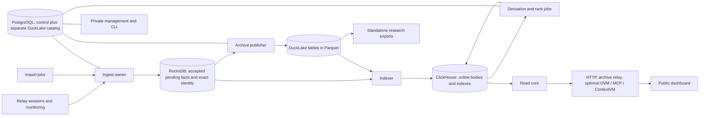

# Start here: what BigBrotr is and how to build it

This repository currently contains the design, not an installable Rust product.
BigBrotr collects verifiable Nostr events, studies relay behavior, derives useful
statistics and viewpoint-dependent scores, and makes those results accessible.
It is one product with selectable capabilities, not a different application for
each recipe. This page introduces the vocabulary; linked specifications own the
details and the phase tasks own implementation and practical verification.

## One example from arrival to a useful answer

1. A collector receives a signed event from a relay. It checks the exact signed
   fields and signature. An untrusted claimed event ID is insufficient.
2. The ingest owner commits the new body, identity, applicable observations and
   scope-qualified signed representative and recovery receipt together in synchronized RocksDB. Only then is local durable
   acceptance acknowledged. Later ordinary copies do not become new archive rows.
3. Two independent consumers proceed. The archive publisher commits permanent
   facts to DuckLake-managed Parquet; the Indexer makes online representations in
   ClickHouse. Online reads need not wait for a large archive file to fill.
4. A read request selects a coherent authorized view. It can return the full
   event, applicable provenance, a search match or an explained analytical result.
   A timestamp, first witness and current availability answer different questions.
5. An export creates standalone files and a manifest that another person can read
   without this deployment. A backup additionally preserves operational state
   needed to restore the deployment. Export and backup have different contracts.

The diagram shows durable relationships, not one synchronous chain. Pausing a
ranker leaves collection working. Pausing indexing leaves its previous complete
view readable and dated. A long archive outage eventually fills finite pending
space and pauses acceptance; no service promises infinite buffering.

## What the six storage names mean

| Name | Actual role |
|---|---|
| RocksDB | Embedded storage with one writer per directory. Ingest owns exact event/edge inventory, pending facts and retry state; its synchronized WAL provides the first local recovery boundary. A separate Indexer-owned directory holds rebuildable incremental/reconciliation state for enabled online capabilities. |
| Parquet | Compressed columnar files containing archival rows. There are many bounded files, not one ever-growing file. It is not a per-event transaction log. |
| DuckLake | Catalog and transaction/maintenance layer describing which files form each table snapshot. Its internal metadata is separate from BigBrotr's scientific tables. |
| DuckDB | Engine used by archive/maintenance/export workers and standalone analysts. It is not another required public database server. |
| ClickHouse | Rebuildable online body/index/analysis store. It spends extra disk space to serve frequent reads and computation. |
| PostgreSQL | Transactional operational state and, under separate ownership, DuckLake catalog metadata. It does not hold the main event corpus. |

See the [storage catalog](specification/storage-catalog.md) for every selected
logical table, keys, row units, owners and retention. Physical sort orders, codecs
and file targets have explicit alternatives; a migration becomes a supported
layout only after its actual engine/recovery/workload tests.

## What is kept

Complete accepted events retain `id`, `pubkey`, `created_at`, `kind`, `tags`,
`content` and `sig`. Content remains a string even when it looks like JSON.
Whitespace inside content/tag strings and the order of tag entries remain part
of the signed values. Wire-JSON whitespace outside strings, object key order and
unsigned extension fields are separate optional wire-capture fidelity; those
serialization details are not authenticated by the event ID.

Provenance optionally records the first attributable observation of an event at
a relay, and strictly earlier corrections. Repeated ingestion counts and passive
last-arrival timestamps are operational diagnostics rather than permanent
research fields. Intentional availability experiments are a separate measured
question; they also require provenance permission.

Monitoring retains actual measurements and useful source documents. A document
is the bytes; an observation states who obtained or used those bytes, when, how,
and with what outcome. Their identities stay distinct even if a physical Parquet
layout stores the bytes beside each observation. Dictionary compression within
files is different from global content deduplication. The
[document-layout decision](specification/storage-catalog.md#document-layout-and-archive-immutability)
explains both candidates and their costs.

Deletion requests and their historical targets remain archived. Ordinary current
reads apply the declared deletion/replacement/expiry policy; authorized history
is a distinct resource. Low ranking never deletes an archived original.

## Computation and interfaces

The social graph is built from selected current signed relationships, with an
explicit vertex population, edge interpretation and input cut. User trust scores
depend on a named viewpoint/seeds. Relay suitability uses observed service
behavior; optional social evidence remains a separately explained component.
Note recommendation is a different optional product question. None is a universal
truth score. Full graph builds and convergence can require global work even when
some input updates are incremental.

The [interface catalog](specification/interface-catalog.md) separates public data
resources, Nostr protocols, private management and internal RPC. Dashboard and
administration use those interfaces; browsers never receive database credentials.
The website is a separate static documentation/product build. The CLI and one
application image run configured roles or finite jobs. A crate is a Rust
compilation unit producing a library or executable; a Cargo package can contain
several crate targets. Neither implies a running service or Docker container.

## Reading and implementation order

1. Read this page, the storage/interface catalogs and the
   [shared names](specification/naming.md).
2. Read [data fields](specification/data-contracts.md),
   [component boundaries](specification/component-contracts.md) and the
   [selected architecture](architecture/system-design.md).
3. Read the relevant service specification, then its owning task in the
   [phase breakdown](implementation/README.md). Follow task prerequisites;
   phase numbers do not require every earlier phase to finish first.
4. Build the first real event → synchronized receipt → archive → read → export →
   restart journey. Extend it with controlled fleets, analytics, clients and
   actual operator/browser workflows. Avoid years of disconnected components.
5. Review each coherent change and exercise its affected practical scenarios.
   [Verification discipline](engineering/security-recovery-and-validation.md)
   covers unit/property/fuzz, actual engines/protocols, failures, load, browser,
   accessibility and clean-install evidence according to the risk.

[PLAN.md](../PLAN.md) is the roadmap. [Decision confidence](planning/decision-confidence.md)
records alternatives and the measurements that could change selections. Research
and reviews explain dated evidence and superseded choices; they do not introduce
another set of current defaults. Nothing here claims that writing a plan proves
100,000 busy relays, billion-row query performance or absence of future defects.

## Giving the design to an implementation agent

Use [the agent handoff](implementation/agent-handoff.md), not a prompt asking the
agent to invent another architecture. It links the current contract owners and
the phase/task/step pipeline. The [readiness register](planning/specification-readiness.md)
separates closed data/authority/client decisions from real-system gates. The
product is still unimplemented; experiments under `experiments/` are labelled
research and never presented as running BigBrotr services.
